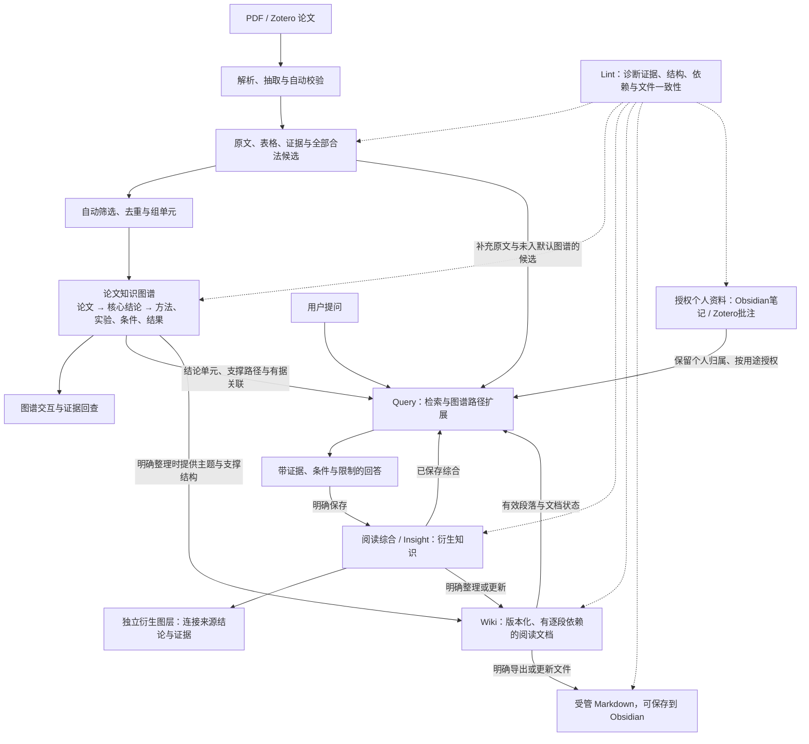

# ResearchGraph Studio

辅助阅读、理解和整理科研论文的本地桌面产品：以知识图谱组织论文结论及其支撑证据，逐步连接阅读、问答与知识整理。

## 当前状态（2026-11-07）

P5 — Lint / Wiki 的软件主流程已接入共享引擎：确定性 Lint、反向依赖、Wiki 草稿/保存、P09/P10/P11 工作流、个人来源选择、授权受管 Markdown 发布和局部更新均已实现，Alembic head 为 `0020`。用户已确认扫描可以继续；当前问题卡片提供按规则和生命周期生成的只读处理方案，具体步骤、模型需求和边界见[最新进度](docs/progress.md)。`unknown` 仍是信息缺口，不会被推断为矛盾或补造条件。

Lint 性能与进度增量见 [ADR0030](docs/adr/0030-lint-performance-and-progress.md)：批量读取和索引优化保持完整来源校验与旧 catalog/hash 兼容；依赖查询计算完整闭包后再按权限过滤、分页。扫描分别显示准备、对象检查和末批依赖重建，并保留阶段耗时。固定规模基准、峰值内存、实际验证与安装包状态以[本轮报告](docs/p5-lint-performance-verification-20261107.md)、[实施进度](docs/progress.md)和[开发日志](DEVELOPMENT_LOG.md)最新条目为准；[P5 续开发报告](docs/p5-verification-20261105.md)和[扫描反馈修复报告](docs/p5-scan-feedback-verification-20261105.md)保留前轮分母。真实 P09/P10/P11 科学质量、新包原生反馈、干净机/跨平台/strict 和复杂版面仍未完成；本轮没有新的真实模型调用、正式库实验、Commit 或 Push。

P4/R5 的历史成绩、失败分母、原始响应和用户反馈保留在 [历史时间线](docs/archive/reports/progress-through-20261105.md) 及各轮报告中。当前工程状态以最新 P5 报告为准，历史报告中的“未进入 P5/head0014”只描述当时轮次。

## 当前产品定位

当前目标采用 **v3.3 阅读辅助设计**：论文直接生成图谱，后台完成候选抽取、论文级整合与自动选择，默认“论文→关键结论→支撑知识”。没有人工审核步骤；原文、证据、模型输出与未选候选保留。入口见[设计导航](docs/README.md)。

## 从论文到阅读知识

知识图谱承担结论组织、支撑路径与关联扩展；交互画布用于探索这套结构。Query 沿图谱寻找问题相关的结论、方法、实验、条件和证据，Wiki 依据这些结构组织阅读文档，Lint 检查证据、支撑路径及衍生内容的依赖。

下图描述完整目标流程；**当前已接入论文解析、自动建图、Query 检索/回答/显式保存，以及 P5 Lint、Wiki 草稿/保存、受管文件发布与局部更新；P5 真实科学与原生退出验收仍待完成**。各阶段实际边界见[开发计划](docs/06_development_migration_plan.md)与[进度](docs/progress.md)。



这些对象共用 Knowledge Engine / KnowledgeStore / SQLite。Query 的图谱扩展读取完整有效结构，不受画布分页、收起或隐藏限制；导航线不充当科学证据，回答仍需回查根来源。

| 部分 | 职责与沉淀位置 |
| --- | --- |
| 知识图谱 | 组织论文结论、支撑路径和有据关联；保留作者主张归属，不把模型关系当作已证实事实 |
| Query | 兼读图谱结构、全部合法候选与原文、有效 Wiki、已保存综合和显式授权个人资料；默认只读 |
| 保存回答 | 经 Store 新增 Synthesis/Insight 等衍生对象，保留原回答、来源版本与证据；可加个人批注或移出已保存库，移除后不再参与检索/衍生层，不改写论文 Claim 或核心选择 |
| Wiki | 将图谱与已保存综合组织成有版本、逐段引用和依赖的阅读文档；Markdown 是可导出的表达形式 |
| Lint | 检查来源、图结构、综合/Wiki 依赖及受管文件同步；给出诊断，不静默修改论文知识或私人笔记 |
| Obsidian | 容纳授权导出的受管 Markdown，也保留独立私人笔记；私人笔记默认只读，不因位于 Vault 就自动纳入受管 Wiki |

“保存回答”“整理或更新 Wiki”“导出 Markdown”分别是明确动作；它们不构成人工科学审核。内部文档有效性与磁盘文件是否同步分开检查，外部编辑不会自动继承旧证据或反写论文图谱。完整边界见[ADR0018](docs/adr/0018-query-wiki-and-obsidian-lifecycle.md)。

## 当前开发状态

**R1–R5 历史验收范围已交付，P4 Query 已接入；当前继续 P5 — Lint / Wiki，真实科学与用户原生退出验收另记。** 当前数据库 head 0020，入口 paper-reading-v1 与领域 reading-extraction-1.0 保持。新 PDF 输入保留跨页章节树、行坐标及可恢复的表格结构，References 保留但不抽取。新任务按章节组织，不再使用 6000 字符/48 证据目标；所有章节遵循同一抽取规则。默认图谱显示核心结论及其方法、实验、条件、结果和指标支撑。Query 从完整来源与候选检索，补齐合法支撑、条件、表头和根证据，不受画布分页/隐藏限制；普通查询只写派生索引与执行记录，不推进科学图修订。来源展示原文和已有中文要点，一次问答整组阅读；保存后可批注或移除，原问答和证据保留。P5 的确定性诊断、P09/P10/P11 任务、Wiki 版本及独立授权发布已接入；实现和退出验收分开，详见[实际进度](docs/progress.md)和[迁移计划](docs/06_development_migration_plan.md)。

整合/选择使用 [ADR0015](docs/adr/0015-complete-reading-context.md) 的完整上下文策略：新 P12 一次读取本篇全部有效候选及其完整引用证据，新 P13 一次读取全部结论单元，不再受软件固定字符数/候选数/窗口数预算阻止。真实模型上下文能力、严格 Schema/来源验证和有界超时仍生效；已成功阶段与旧冻结窗口继续复用。

已接入的问答阅读交互按 [ADR0025](docs/adr/0025-query-browsing-and-paper-grouped-answers.md) 提供各板块独立论文筛选、全部本地命中的每页10条浏览和默认图谱存在标记；回答依真实引用按论文组织，跨篇综合单列，引用采用默认收起的整体/逐条两层折叠。显示筛选、翻页和展开不改问题范围或冻结回答，不触发模型调用；实际验证及交付状态见 [progress](docs/progress.md)。

阅读流程按 [ADR0017](docs/adr/0017-semantic-protocol-and-stage-recovery.md) 拆分语义与程序职责：新 P02v4 只输出候选/关联/说明，身份由程序绑定；新 P12 只提出关联与重复建议，程序沿全部已验证路径组单元；P13 只给贡献建议。新/缓存响应共用完整终验，来源快照变化停止。首次失败临时视图明确“贡献排序未完成”，已有图保留。Provider 输出策略显式冻结，兼容 JSON 仅为 requested，不自动降级收费；真实 strict API 尚未验收，历史改造见[语义协议验收](docs/archive/reports/semantic-reliability-verification-20261103.md)，后续真实质量结果见 [R5 补验收报告](docs/archive/reports/r5-acceptance-verification-20261104.md)。

旧 P13 末尾 coverage_gaps 字符串数组漏一个 `]` 的响应，可按 [ADR0016](docs/adr/0016-selection-json-syntax-recovery.md) 在完整 token 边界做限定恢复，保留原响应及精确审计。旧 P13 正常/恢复后均拒绝重复键与 NaN/Infinity；“其他阶段不变”是该历史增量范围，新语义三阶段都严格解码且不作通用恢复。这不补写模型内容或保证语义完整，旧合法响应完整重验才复用，成功阶段不重调。

技术栈继续使用 Tauri 2 + React/TypeScript、Python/FastAPI Sidecar、SQLite/FTS5；继承 P0–P2 的导入、证据、审核与数据。G0 保留用户放行记录，不等同于干净机实测。历史结果见 [Phase 1](docs/archive/reports/phase1-verification.md)和 [Phase 0](docs/archive/reports/phase0-verification.md)。

开发目录：`C:\Users\KLucen\Desktop\AI科研知识推理平台`。开发远端：[KLucen/ResearchGraphStudio](https://github.com/KLucen/ResearchGraphStudio)，本地 origin 已关联。

## 开发与构建

Windows x64 需要 Node 24.20.0、pnpm 12.5.1、Rust（见 rust-toolchain.toml）、Visual Studio C++ Build Tools/Windows SDK 和 WebView2。Python 优先使用 Anaconda 的独立环境 `researchgraph-studio`，不向 base 安装依赖。

```powershell
# 在项目根目录；创建环境只需执行一次
conda create --name researchgraph-studio --file .\conda-win-64.lock
conda run -n researchgraph-studio python -m pip install --require-hashes -r requirements-win-64.lock
pnpm install --frozen-lockfile

# 静态检查、契约生成、测试及前端构建
pwsh -File .\scripts\check-phase0.ps1

# 构建 Sidecar 并启动原生开发窗口
pwsh -File .\scripts\dev.ps1

# 打包 Windows 当前用户 NSIS 安装器
pwsh -File .\scripts\build-windows.ps1
```

脚本自动定位指定 Conda 环境；Conda 未加入当前 shell 时可设置 `$env:RGS_PYTHON='C:\Users\KLucen\anaconda3\envs\researchgraph-studio\python.exe'`。根目录 `pnpm dev` 启动 Tauri，但要求已构建 Sidecar；`pnpm --dir apps/desktop dev` 只启动 Web UI。修改 Python 后重新运行开发脚本以重建引擎。

安装器输出在 `apps/desktop/src-tauri/target/release/bundle/nsis/`。随包携带 Python 解释器；当前 WebView2 缺失时需要联网安装。默认用户数据在 `%LOCALAPPDATA%\com.researchgraph.studio`，精确路径可在设置页查看。运行数据库、日志和个人材料不进入源码。

`environment.yml` 表达 Conda + pip 依赖意图；`conda-win-64.lock` 锁定基础解释器，`requirements-win-64.lock` 锁定 Python 包及哈希，`pnpm-lock.yaml`、Cargo.lock 和 rust-toolchain.toml 锁定前端与 Rust。优先用上面的两步方式复现 Python 环境。

## 现行软件：论文阅读与抽取

打开项目，选择 Zotero 附件开始建图，或通过原生选择器导入 PDF；论文知识概览展示真实模型生成的知识与抽取进度，点击卡片回查证据。现行版本保留旧编辑/审核接口供历史兼容；新设计流程移除审核操作。来源可定位不等于作者主张已被科学证明。缺失条件保留 unknown。

真实模型在全局“设置与诊断”中管理，供所有项目共用，支持 OpenAI、兼容 API和本地模型；产品入口仅使用真实模型。保存后测试连接并选择 Extraction/Reasoning 角色；API Key 保存在 Windows 凭据管理器，数据库仅保存随机引用。阅读区使用全局 Extraction 模型，明确同意发送当前论文片段后抽取。参数、端点和旧环境变量入口见[模型配置说明](docs/model-configuration.md)。每次抽取保存模型、Prompt 哈希、输入哈希、参数、原始结果和状态；私人笔记不进入输入。默认统一 P02 合并相邻段落、每批一次抽取多类知识并生成中英标签；正常界面不再提供旧基线或 Mock 选择器。失败/取消可在任务历史重试；已提交批次和收到但未提交的合法响应可复用。界面展示批次状态、模型调用与供应商 Token；未知费用明确显示未知。中文缺失允许英文回退，详情可按需补译，补译不修改科学内容。

“文献与阅读”分为导入论文、任务记录、项目文献三个可折叠板块，展开状态按项目保留。导入论文提供同级“本地 PDF / Zotero”入口；任务区显示阶段、批次、失败原因和继续入口；项目文献包含列表、知识概览、来源证据与模型记录。收起不清空当前选择。Obsidian 位于独立“笔记来源”，读取授权目录只扫描 Markdown 快照；Wiki 通过“Lint / Wiki”入口另行授权写入根并发布受管文件，读取笔记不授予写入权限。

Zotero 仅使用本机 Local API 读取条目、附件位置与高亮/文字批注，不读写 Zotero SQLite。在“导入论文 → Zotero”连接后选择 Collection、搜索论文、勾选 PDF 或全选本页可用附件，选择“解析后直接建图”后使用全局抽取模型开始处理，默认只读引用原 PDF。真实模型必须先勾选原文发送许可；也可仅解析、稍后抽取。每附件独立显示任务阶段、失败重试和去重结果；原条目与附件关联保留。批注无法唯一匹配时显示“锚点未解析”。

局部关系引用缺失会报告具体路径，并最多执行一次受限引用修复；原始响应、修复响应及关联运行编号均保留。修复不允许改写知识正文、证据、关系类型或已有合法端点，之后仍经过完整校验和 Knowledge Store。旧失败任务可复用此类响应，成功批次不重跑。详见 [图谱与抽取稳定性验收](docs/archive/reports/stability-verification-20261102.md)。

新任务使用 P02_reading_extract_compact_v4 / reading-semantic-1，程序绑定身份后展开到 reading-extraction-1.0。跨页章节优先完整输入，仅模型上下文容量不足时按完整段落或表格组拆分；不为不同章节设置不同抽取重点，也不承诺所有论文只需一次请求。请求超时与重试仍有界。候选先保存，再经 semantic-reading-1 的语义关联、程序组单元和贡献建议自动发布；非法关联与无路径支撑不能入图。旧 v3/更早任务的 Prompt、分块计划和签名保留，按原路径复用成功阶段及完整重验响应，普通继续必要时建立独立兼容续接。

0005–0011 为兼容迁移，启动升级前自动备份旧库；0006/0007 增加全局模型配置并保留旧凭据引用。0008 增加推理尝试、关系/实体对齐候选、历史语义审核和 FTS5；0009 增加显示元数据与布局，0010 增加质量、单元/成员、选择/偏好/检查点。0011 新增按文献版本及解析器版本唯一的 document_parses，旧 Paper/附件修订/文本块/证据和模型记录保留。新 PDF 以完整原文块建立 span；旧证据不重写。identity-v1 字符映射及块级高亮不变。章节/双栏/表格恢复是启发式，不含 OCR、逐字框、公式语义或所有复杂表格的可靠恢复。全局侧栏折叠状态可在重启后保留。

## 现行软件：跨论文关系与图谱

项目内切换到“图谱与比较”，默认显示论文、核心结论及其有据非 Claim 支撑，包括 Method、Experiment、Condition、Finding、Metric；支撑连接结论分支，不全部连接论文中心。可显式收起/展开，证据在详情回查；缺少关联时说明缺口，不编造节点。共享节点不复制。拖动联动、双击固定、缩放和平移保持，布局独立保存。可搜索包括未选内容的全部候选并设置显示偏好。基于已有候选整合无需重抽 PDF，已有选择切换密度不再调用模型。

打开“Claim Comparator / 实体对齐”复用旧比较流程，选择主张、概念或方法节点，使用关键词和 top-k 检索其他论文候选。Comparator 显示当前条件节点、双方来源状态、原文和 PDF 高亮。选择全局 Reasoning 模型并同意发送双方证据后，主张执行 P04→P05，概念/方法执行 P03。比较器显示条件、证据和模型记录；图谱统一由点与边呈现。正常界面已移除审核控件；模型解释和历史记录仍可查看。

推理写入统一 KnowledgeStore，引用双方已校验证据，保存模型原始输出、条件快照、历史记录和图版本；来源或条件变化后标为失效。NO_DECISION 只有历史记录；实体对齐候选不会物理合并知识。FTS5/BM25 召回不是语义同一性判断。Query 与 P5 Lint/Wiki 已在共享引擎接入；Wiki 的依赖变化诊断、局部草稿更新、保存及文件更新仍是独立动作，不自动改写科学知识。实际验证与未完成退出项见 [P5 报告](docs/p5-verification-20261105.md)。

## 设计与过程记录

- [当前文档导航](docs/README.md)、[v3.3 产品设计](docs/01_product_design.md)、[v3.3 实施计划](docs/06_development_migration_plan.md)、[v3.3 Schema](docs/03_schema_design.md)与 [Prompt 规范](docs/05_prompt_engineering.md)
- [历史文档整理记录](docs/migration/v3-documentation-map.md)、[v3 基线 ADR](docs/adr/0003-v3-documentation-baseline.md)、[历史文档索引](docs/archive/README.md)
- [迁移评估](docs/migration/v1_to_v2_assessment.md)、[统一引擎 ADR](docs/adr/0001-unified-knowledge-engine.md)、[实际进度](docs/progress.md)；[旧开发计划 v0.4](https://github.com/KLucen/ResearchGraphStudio/blob/8e15a9583a7a6becff9d49800af3717eee867121/docs/development-plan-v0.4.md)仅保留历史
- [历史需求基线](docs/design/requirements-baseline.md)、[原文 QA](QA.md)、[补充材料登记](docs/design/source-register.md)
- [早期领域约定](docs/design/domain-model.md)、[Tauri 决策](docs/decisions/0002-tauri-evidence-workbench.md)、[工具/Wiki 决策](docs/decisions/0003-controlled-knowledge-evolution.md)、[来源检查决策](docs/decisions/0005-source-check-relocation.md)、[任务历史与临时工作区决策](docs/decisions/0006-job-history-workspace-recovery.md)
- [已实现 API](docs/api.md)、[Phase 0 验证与待验收项](docs/archive/reports/phase0-verification.md)、[环境报告](docs/archive/reports/environment-check.md)
- [开发日志](DEVELOPMENT_LOG.md)、[实验计划](experiments/README.md)

**历史优化轮次记录（以下范围不代表当前阶段）**

历史 v3 增量见 [v2→v3 工程审计](docs/migration/v2_to_v3_assessment.md)和 [ADR 0004](docs/adr/0004-v3-projection-and-unified-extraction.md)。DEV-0026 在真实库副本上完成 4 次真实 API 续跑，旧知识不变；新分批规划将原 48 批样本合并为 16 批。完整结果及有限验收范围见 [历史优化验收](docs/archive/reports/refinement-verification-20261102.md)。这段记录对应当时的 v3 阶段，当前 Query、Lint、Wiki 状态见[实施进度](docs/progress.md)。设计版本不等于应用发布版本；当前应用仍为 0.0.1，工期与效果指标均为目标。

Zotero 安装程序为 `D:\Zotero\zotero.exe`，此目录不代表文献数据目录。Zotero 管原文题录，ResearchGraph 管证据/候选/知识版本，Obsidian 管个人笔记及授权 Wiki。MCP 不是前置依赖。

Git HTTPS 不通时，可使用已验证的官方 SSH 443 通道，保持 origin 和全局配置不变：

```powershell
git -c 'url.ssh://git@ssh.github.com:443/.insteadOf=https://github.com/' -c 'core.sshCommand=ssh -o BatchMode=yes -o StrictHostKeyChecking=yes -o ConnectTimeout=10' fetch origin
```

用户本轮 P3 指令覆盖旧自动推送授权：**未经新的明确授权不得 Push**。任何 Commit/Push 前须检查实际文件内容、暂存差异和 Gitleaks 结果，详见[敏感信息检查](docs/security-checks.md)。现有 CI 会在 Windows 构建后，由另一 runner 安装产物并运行 PowerShell 验收；本轮尚未推送或运行远端 CI。
