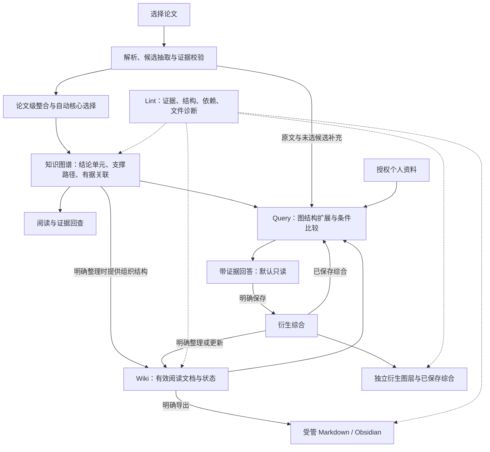

# 01 — 科研论文阅读辅助产品设计（v3.3）

2026-11-04 当前：P4-Q01～Q07 已接入，Q08 正在修复安装后的来源展示、问答组织/导航和保存生命周期反馈，Alembic head **0014**。新增行为见 [ADR0024](adr/0024-query-reading-cards-and-saved-lifecycle.md)，本轮实际执行见[反馈报告](p4-query-feedback-verification-20261104.md)；前次交付保留在 [P4实际报告](p4-query-verification-20261104.md)。P5 Lint/Wiki 生成、导出和增量更新未启动。

## 目标体验

用户选择论文即可生成知识图谱，快速理解研究问题、主要贡献、证据与适用边界。面向不同科研论文类型，不以某个研究方向或学科指标作为前提。知识图谱组织结论及其支撑路径，为阅读、Query、Wiki与Lint提供共享结构；画布用于交互探索，原文通过Zotero/证据回查阅读。

## 从自动建图到阅读知识循环

完整流程图见[项目介绍](../README.md#从论文到阅读知识)。自动建图与阅读交互、P4多源检索/图谱扩展/P07回答、项目问答页面和显式保存已接入。下图同时表达后续目标：Wiki主题整理、Markdown导出与Lint尚待P5，已有文档的只读状态消费和内部版本保存不等于完整发布器。实际验证见[本轮报告](p4-query-verification-20261104.md)。

候选层是内部持久化结构，不要求用户逐条筛选或人工审核。正常流程不出现待审、接受、驳回按钮。图谱选择由系统自动完成；异常以具体来源/校验/网络原因呈现，不能把技术失败转成待人工审核。

模型负责抽取科学语义、提出关系及贡献建议；程序负责来源身份、短编号映射、已验证路径组单元和发布。新语义协议与阶段恢复见 [ADR0017](adr/0017-semantic-protocol-and-stage-recovery.md)，不要求模型重复回传已知的文献版本或枚举所有支撑成员。

PDF 先转为结构文档：跨页章节树、原文行/块及可恢复表格的表头、行列、单元格关系。换页不结束章节；References 原始材料保留，但不进入知识抽取。各章节共享相同抽取规则，优先完整章节输入，仅受模型上下文容量与有界故障恢复约束，不以固定字符数或证据数切碎内容。无 OCR，复杂版面无法可靠重建时明确标明限制。

## 默认图谱

论文直接连接少量核心 Claim。核心 Claim 代表论文报告的关键结论或贡献，不等于科学事实。有据的非 Claim 支撑默认显示在相应结论分支下，包括 Method、Experiment、Condition、Finding、Metric 及有合法关联的其他成员；可显式收起/展开，证据在详情回查。不因缺少某类内容强造节点。共享方法保持一个知识 ID；收起一个单元不隐藏另一个仍引用的节点。

默认密度为 standard，可选 concise/detailed；根据贡献覆盖、冗余和可读性调整，不按“必须生成 3–8 个”硬凑数量。若没有通过质量门槛的核心结论，显示原因与已保存候选数量，不能回退为全部挂到论文中心。

首次整合或贡献排序失败、没有旧图时，可显示“贡献排序未完成”的临时阅读视图：仅包含来源有效、论文作者归属明确、非背景、非 unknown/speculative 且无未解疑点的 Claim 及已有合法支撑。视图明确为 provisional/pending/partial，不称最终核心图谱或成功任务；不符合门槛的候选仍保留。若已有图则继续显示旧图；原文、候选或快照变化时停止并要求新构建，不能把过期内容当作临时成果。

## 不同论文类型

| 类型 | 核心 Claim | 支撑内容 |
| --- | --- | --- |
| 实验 | 主要发现、重要负面结果 | 实验设计、对照、条件、指标、测量结果 |
| 方法 | 方法贡献及验证结论 | 方法组成、设计依据、验证、局限 |
| 理论 | 命题、定理或理论结论 | 假设、推导/证明、适用范围 |
| 综述 | 分类、综合判断、争议 | 文献比较依据、转述归属、覆盖限制 |
| 混合/未知 | 依据现有证据选择贡献 | 按内容组合；不强制猜论文类型 |

研究问题和概念默认在论文概览或结论支撑中展示，不为了凑类型在首屏平铺。综述作者的综合判断与其转述被引用论文的结论分开；未获取被引全文不能标记为已核验该原始论文。

## 关键内容选择

先检查 Schema、来源版本、引用、归属和关系端点，再评估证据完整性、论文内重复、主贡献覆盖。背景知识一般仅检索；必要限制和负面结果可以成为核心。摘要/结论用于发现贡献线索，重要数值和实验结论仍需要对应结果证据。局部条件缺失可附限制展示；影响结论归属或比较方向的关键缺失阻止默认核心发布。

自动选择理由和缺口可查看。用户可“在主图显示/从主图隐藏/恢复自动选择”，这些是可选展示偏好，不改变来源验证、科学内容或历史状态，不是审核流程。

## 页面与阅读交互

- 项目：文献、任务、图谱入口；保留现有项目数据和侧栏折叠记忆，设置位于底部。
- 文献与阅读：导入论文/任务记录/项目文献三块可折叠；本地 PDF 与 Zotero 平行，Obsidian 不混入论文导入。
- 论文概览：研究问题、类型、核心贡献、限制、构建完整度、候选数量；不默认铺满解析文本。
- 图谱：点与边、展开/收起、邻居高亮、实时拖动、双击固定、缩放平移；点击详情显示完整原文语义及证据。
- 候选检索：按需查看未进入主图的内容和未选择原因，无待审任务列表。
- Comparator：给定主张进行条件比较和候选关系解释；AI 关系保持推断标识，无人工审核前置。
- 问答与阅读知识：一次问题、论文范围、来源、逐段回答、限制及选段保存成组查看。来源以题名、原文和已有中文要点展示，缺少中文摘要时明确提示；引用编号辅助核对，不用数据库 ID 代替内容。历史及“查看原问答与引用”读取并定位原问答，加载/失败可见，不重新生成。完整任务记录仍集中在文献与阅读，不重复铺设任务列表。
- 已保存阅读知识：可添加个人批注、移除保存对象并查看独立衍生图层。批注与模型答案/作者主张分开；移除后不再进入检索与衍生层，但原问答、模型记录和论文证据保留，不等于删除原论文。

问答各板块增加独立的单篇/多篇论文展示筛选，来源预览、回答段落、保存内容及历史每页 10 条并显示总数/页数。输入区选择仍决定提问范围，板块筛选只决定当前阅读内容，不改冻结答案或模型请求。来源可遍历本问题的全部合法命中，并标明知识是否进入当前默认图谱；原文被图谱节点引用时使用不同提示，不能把 Query 临时扩展或某一画布页当作默认图谱全集。

回答按实际引用的论文分组，跨论文段落独立归为综合且仅展示一次；模型正文和选段标识保持。每段引用采用外层整体与内层逐条的两层折叠，初始均收起；打开外层不会展开各条原文，只有独立“展开所有引用”操作才全部打开。跨页/筛选保留保存勾选并显示已选总数。设计边界见 [ADR0025](adr/0025-query-browsing-and-paper-grouped-answers.md)，实际完成情况仍以 [progress](progress.md) 为准。

## 中英与来源

SourceText.original/language 保留论文原语言语义，zh 是辅助翻译；英文论文的英文仍为权威。证据 quote 是解析器原文，不能由翻译或模型摘要覆盖。中文缺失时回退原文。页内定位不可靠时仅打开 Zotero 附件并显示可确认的位置范围。

Query 来源预览复用已保存抽取译文，不为页面显示额外调用模型。来自当前已验证答案的中文要点须标为“本次问答中文要点（AI 综合）”，不能冒充来源逐字翻译或原论文结论。显示投影不改冻结证据或历史答案。

## 阅读工作流与后续文档能力

| 部分 | 在整个流程中的职责 | 持久化与写入边界 |
| --- | --- | --- |
| 论文知识图谱 | 以核心结论组织方法、实验、条件、结果和证据支撑，保留经过校验的关联；支持跨篇比较与问题相关的路径扩展 | 复用已有知识、单元和关系，由KnowledgeStore统一管理；不为画布另建知识库 |
| Query | 兼读完整有效图结构、全部合法候选/原文/表格、已保存综合、有效Wiki及明确授权的笔记/批注；区分作者、转述、个人观点和AI综合 | 默认只读；本地执行历史与回答快照不自动沉淀为知识 |
| 已保存综合与衍生图层 | 保存有据解释、跨篇总结或个人观点，关联来源知识、条件与证据；可作为以后问答的上下文 | 明确保存后新增Synthesis/Insight等对象，保留原回答与模型记录，不修改论文Claim、数值、原文或核心选择 |
| Wiki | 依据图谱的结论单元、支撑结构和已保存综合，按论文/概念/方法/比较组织阅读文档，并补充必要原文与未选候选 | 内部保存文档/段落版本和依赖，Markdown是其可导出表达；明确整理/更新才新增文档版本 |
| Lint | 检查证据与来源、断边/支撑路径、条件结构、综合/Wiki根依赖及受管Markdown状态；定位知识变动的影响 | 保存诊断，不静默修改科学语义或私人文件；模型仅补语义检查建议 |
| Obsidian | 承载授权导出的受管Wiki Markdown，同时容纳独立私人笔记 | 导出是独立写入动作；私人笔记默认只读，明确登记后才纳入受管文档边界 |

例如提问“两篇论文为何得出不同结论”，Query先命中相关Claim，再沿单元和合法关联取得实验、方法、条件、结果与限制，回查原文表格后形成解释；不能只把画布上几个节点的标签交给模型。图谱分页、收起、隐藏和核心选择不限制检索范围，图谱缺少关联时仍可检索原文和候选，不能因此编造关系。Wiki提供已有总结和组织入口，不能代替根证据，重复转述不增加独立支持数。

用户保存解释后，默认在“已保存阅读综合”查看，并可在独立衍生图层看到与来源结论的引用关系。再选择“整理到Wiki”形成文档版本，选择“导出/更新文件”才写入授权目录；三个动作可明确组合，内部仍保留独立的校验与恢复边界，没有科学审核队列。

当前批注和移除经 Store 保存独立元数据，不递增科学图版本。移除同时阻止已保存段落经后续文档副本或依赖再次作为有效来源；不相关段落继续可读。原问答属于历史执行记录，保留不代表已移除内容继续获得检索资格，见[ADR0024](adr/0024-query-reading-cards-and-saved-lifecycle.md)。

Query回答与保存已接入；完整Wiki整理/发布和Lint为后续阶段。任务、实现方法和验收方式以[开发计划](06_development_migration_plan.md)为准，当前成绩只以实际报告为准。

具体边界见[ADR0018](adr/0018-query-wiki-and-obsidian-lifecycle.md)：Wiki是可阅读的有据文档，不是知识图谱本身。Query读取有效内部Wiki/已保存综合和底层来源，检查段落依赖、版本、权限及文件状态；无Wiki也可问答。保存默认新增阅读综合/洞见，不覆盖论文主张；可指定内部文档目标追加选段并核对基线，不能因此声称已整理或导出Wiki。P5再补主题整理、外部编辑diff、受管文件发布和Lint诊断；不静默改回私人文件或论文图谱。
