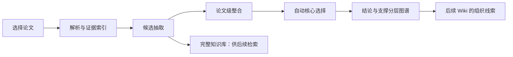

# 01 — 科研论文阅读辅助产品设计（v3.3）

> 实现状态（2026-11-02）：R1–R4 已按本设计接入，R5 部分验收；运行差异及自动隔离规则以 [ADR 0009](adr/0009-reading-pipeline-implementation.md) 和[实际验收](reading-implementation-verification-20261102.md)为准。参考 Schema 仍不等同于运行 API；Query/Wiki 保持后续范围。

## 目标体验

用户选择论文即可生成知识图谱，快速理解研究问题、主要贡献、证据与适用边界。面向不同科研论文类型，不以某个研究方向或学科指标作为前提。图谱提供阅读路线，原文仍通过 Zotero/证据回查阅读。

## 一条自动主流程

候选层是内部持久化结构，不要求用户逐条筛选或人工审核。正常流程不出现待审、接受、驳回按钮。图谱选择由系统自动完成；异常以具体来源/校验/网络原因呈现，不能把技术失败转成待人工审核。

## 默认图谱

论文直接连接少量核心 Claim。核心 Claim 代表论文报告的关键结论或贡献，不等于科学事实。点击可展开方法、实验、条件、Finding、Metric、Argument、Limitation、Evidence，所有支撑内容都归属于相应结论分支。共享方法保持一个知识 ID；多个展开单元可以共同连接它，收起其中一个不隐藏另一个仍引用的节点。

默认密度为 standard，可选 concise/detailed；根据贡献覆盖、冗余和可读性调整，不按“必须生成 3–8 个”硬凑数量。若没有通过质量门槛的核心结论，显示原因与已保存候选数量，不能回退为全部挂到论文中心。

## 不同论文类型

| 类型 | 核心 Claim | 支撑内容 |
| --- | --- | --- |
| 实验 | 主要发现、重要负面结果 | 实验设计、对照、条件、指标、测量结果 |
| 方法 | 方法贡献及验证结论 | 方法组成、设计依据、验证、局限 |
| 理论 | 命题、定理或理论结论 | 假设、推导/证明、适用范围 |
| 综述 | 分类、综合判断、争议 | 文献比较依据、转述归属、覆盖限制 |
| 混合/未知 | 依据现有证据选择贡献 | 按内容组合；不强制猜论文类型 |

研究问题和概念默认在论文概览或结论支撑中展示，不为了凑类型在首屏平铺。综述作者的综合判断与其转述被引用论文的结论分开；未获取被引全文不能标记为已核验该原始论文。

## 关键内容选择

先检查 Schema、来源版本、引用、归属和关系端点，再评估证据完整性、论文内重复、主贡献覆盖。背景知识一般仅检索；必要限制和负面结果可以成为核心。摘要/结论用于发现贡献线索，重要数值和实验结论仍需要对应结果证据。局部条件缺失可附限制展示；影响结论归属或比较方向的关键缺失阻止默认核心发布。

自动选择理由和缺口可查看。用户可“在主图显示/从主图隐藏/恢复自动选择”，这些是可选展示偏好，不改变来源验证、科学内容或历史状态，不是审核流程。

## 页面与阅读交互

- 项目：文献、任务、图谱入口；保留现有项目数据和侧栏折叠记忆，设置位于底部。
- 文献与阅读：导入论文/任务记录/项目文献三块可折叠；本地 PDF 与 Zotero 平行，Obsidian 不混入论文导入。
- 论文概览：研究问题、类型、核心贡献、限制、构建完整度、候选数量；不默认铺满解析文本。
- 图谱：点与边、展开/收起、邻居高亮、实时拖动、双击固定、缩放平移；点击详情显示完整原文语义及证据。
- 候选检索：按需查看未进入主图的内容和未选择原因，无待审任务列表。
- Comparator：给定主张进行条件比较和候选关系解释；AI 关系保持推断标识，无人工审核前置。

## 中英与来源

SourceText.original/language 保留论文原语言语义，zh 是辅助翻译；英文论文的英文仍为权威。证据 quote 是解析器原文，不能由翻译或模型摘要覆盖。中文缺失时回退原文。页内定位不可靠时仅打开 Zotero 附件并显示可确认的位置范围。

## 后续阅读工作流

Query 检索核心、支撑、未选候选及原文；区分作者主张、转述、用户笔记与 AI 综合。Wiki 按论文/概念/方法组织阅读所得，每段有版本化知识和证据依赖；核心选择只是组织线索，不是真实性标志。笔记只读，导出到指定授权目录，文件冲突停止覆盖。上述功能为后续阶段。
