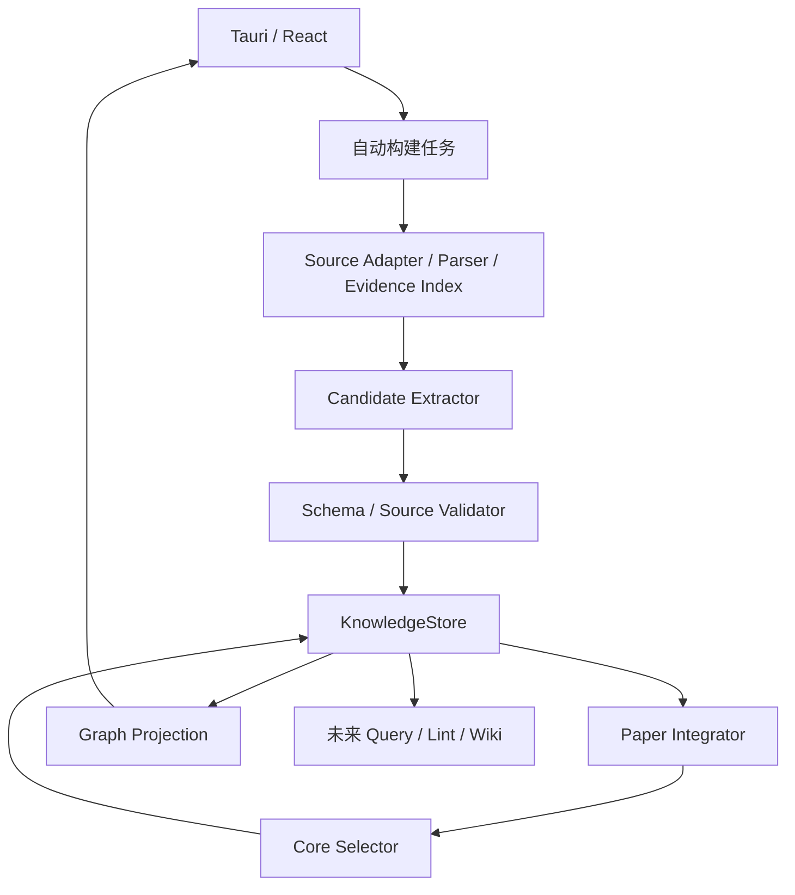

# 02 — 统一引擎与自动建图工作流（设计 v3.3）

## 职责与数据流

所有模块使用一个 SQLite 知识底座。候选、结论单元、选择记录是不同职责的对象，不创建独立“图谱库/Query 库/Wiki 知识库”。LLM 只产生候选或提案，校验、幂等、事务与发布由代码控制。模块可重构，以可维护性为目标，不为减少修改量保留错误耦合，也不为目录好看重建工程。

## 来源与证据

Zotero Local API 只读；身份由 server/library/item/attachment 区分。PDF 读取前后核对 SHA-256，变动产生新 DocumentVersion，不在旧版本改 offset。原文段落、表格文本/表头/注释、定位及 ModelRun 原输出持久保留。表格不能可靠重建时标 partial/unresolved，保留可解析原始内容、附件定位和原因，不编造行列。

完整证据保留不等于长期复制 Zotero PDF；附件离线时旧索引与知识仍在，并标 source_unavailable。临时回收仅清理任务自有临时文件，不能顺带清理持久证据。直接 PDF 导入延续现有授权引用/托管模式。

## 自动处理阶段

1. indexing：解析、章节/表格上下文、证据版本；P01 仅结构不足时使用。
2. extracting：P02 对完整语义单元选择性抽取贡献、必要支撑和限制，不逐句实体化。明确背景归属；每批校验后经 Store 保存候选和原输出。
3. integrating：确定性去重先行；P12 在必要时跨批关联结果、方法、条件及论证。只使用已给定候选和证据，不重写主张或静默合并科学语义。
4. selecting：质量门槛、贡献相关性、重复和覆盖检查；P13 可提供带理由建议，由服务端决定核心和支撑集合。
5. publishing：校验单元连通性及选择快照后原子发布。无人工审核节点；失败不会转为待审。

## 硬门槛与语义评估

Schema、证据 ID/版本、精确 offset/hash、局部引用、端点类型和依赖闭合由程序检查。语义支持程度不能只靠 ID 存在来证明，需保留模型辅助评估及不确定性，并用真实论文评价。critical blocking issue、错误归属、证据不足、未解重复不会自动进入核心。有限缺口不影响原意时可展示 caveats；不能把未知条件等同于相同或不同。

所有合法候选持久化；格式/来源失败的响应只存原始 ModelRun 与诊断，不能混入可引用候选。未选候选仍可被检索，严重失效/旧历史驳回对象默认不作为答案依据但保留诊断历史。

## 结论单元

KnowledgeUnit 是 root Claim 与支撑对象的版本化关联，不复制 Claim 文本。UnitMembership 的 association_ids 必须形成同一文献版本内从根到成员的已验证路径，可跨 Experiment→Finding→Metric。视图可以将这些细节平铺在结论分支下，但导航边不冒充直接科学因果关系。跨单元共享方法/条件允许，多论文实体合并仍走独立候选对齐，不自动覆盖旧语义。

## 任务与原子发布

每阶段保存输入快照、Prompt/Schema 哈希、模型配置、原输出、已提交操作键及用量。batch checkpoint 与候选写入同事务；整合/选择失败只重做未完成阶段。已收到合法响应复用；不能把切换密度做成重新抽取。

首次构建可发布通过相同门槛的部分单元，标 partial 和 coverage_gaps；未完成批次不伪称全文图谱。更新期间继续提供上一有效选择版本，构建完成用 expected revision + 活跃指针事务切换。用户修改展示偏好或源变动使输入过期时拒绝旧发布并重新基于最新状态计算。

现有超时保护继续：配置时限内有界请求、区分连接/发送/等待响应/读取、响应超时仅一次拆分根批，子批失败停止；成功批次不重发。三次真实缩小请求仍超时是现有未解决项，不宣称换 Prompt 即可消除。新 P12/P13 也必须有独立预算和停止边界，不能无限串行补调。

## 版本与缓存

- knowledge_revision：语义对象、证据关联及有效性变动。
- selection_revision：核心集合、支撑成员、密度/展示偏好与选择依据。
- layout_revision：坐标、固定和视口；不改变知识或触发 Wiki 内容重算。
- 构建签名：来源/解析器版本、各阶段输入 hash、Prompt/Schema、模型与参数；阶段配置冻结，旧任务旧签名续跑。
- 投影/分页缓存绑定上述知识与选择快照、展开单元、过滤条件；游标跨版本拒绝，页内补齐论文/根上下文，不补全部来源线。

## 后续消费与部署

Query 读完整 Store 和 Evidence，不以 GraphProjection 作为检索全集。Wiki 每段跟踪知识 revision、文献版本及证据；选择变化只提示组织可能变化，证据失效才令依赖内容失效。Query 保存与 Wiki 文件导出需明确动作，不加入科学审核流程。

保持 Tauri Sidecar 生命周期、回环鉴权、凭据安全、源文件只读。所有新记录与通知经 Store 事务；事件或轮询实现按现有工程演进，本文不宣称已有 outbox/SSE。
