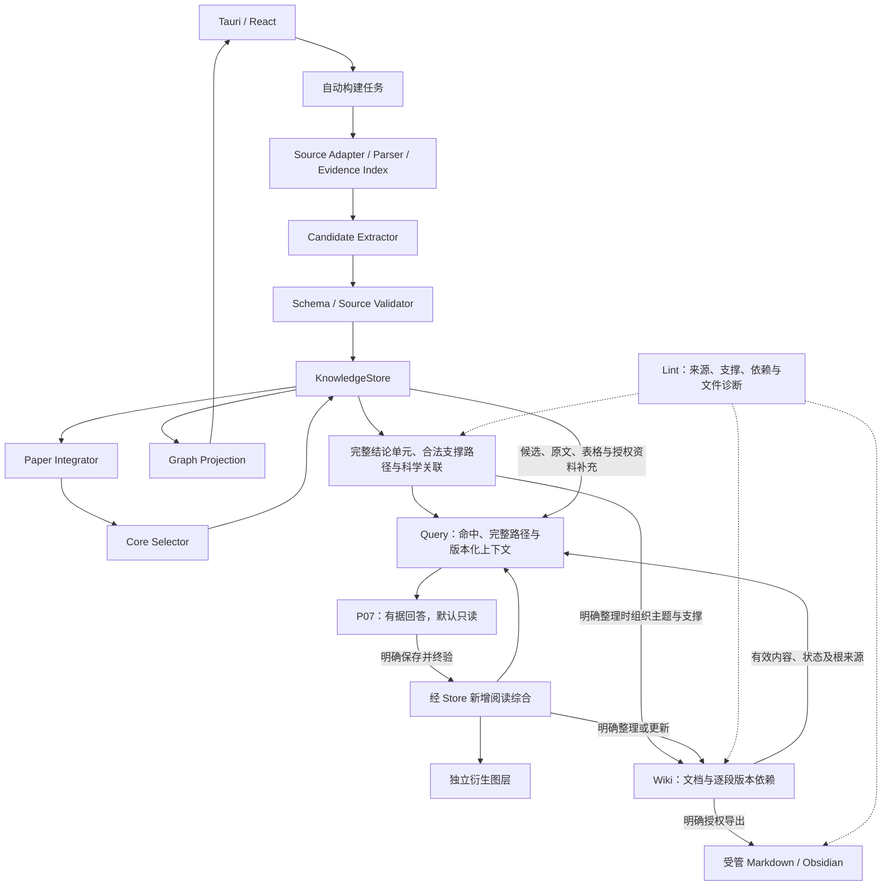

# 02 — 统一引擎与自动建图工作流（设计 v3.3）

> **当前 Lite P0 覆盖（2026-11-09）**：`experience_mode=lite` 复用现有 Tauri/React、FastAPI/SQLite/FTS5、Zotero、PyMuPDF 和 KnowledgeStore；Lite 选择论文不进入完整图谱抽取。旧 `legacy` 项目和历史图谱保留可读，P0 不实现 B/A/D 业务。详见 [Lite 迁移评估](migration/lite_from_v3_assessment.md) 与 [ADR0031](adr/0031-researchgraph-lite-p0.md)。以下 v3.3 内容保留完整模式与历史兼容边界，P5/head0020 是重构前基线。

重构前完整模式基线为 P5 — Lint / Wiki、Alembic `0020`；当前 Lite P0 为 `0022`，实际状态统一见 [实施进度](progress.md)。P5 设计决策和未验收项保留在 [ADR0029](adr/0029-lint-wiki-workflows-and-managed-publication.md) 与对应历史报告中，本页其余完整模式设计继续用于 legacy 兼容。

## 职责与数据流

当前P13恢复按[ADR0021](adr/0021-keyed-ranking-and-bounded-correction.md)：合法外壳下独立有效槽位只作私有检查点，缺失/非法槽位最多定向修复一次，完整上下文保留。发送前持久预留账本，每构建至多两个请求槽位（超时计入）；继续重验已有raw，不重发已用槽位。全部槽位经终验和Store再验才发布。旧排序失败通过独立v3后继和P12原响应重验续接，保留谱系，不重新调用已成功P02/P12。

所有模块使用一个 SQLite 知识底座。候选、结论单元、选择记录是不同职责的对象，不创建独立“图谱库/Query 库/Wiki 知识库”。LLM 只产生候选或提案，校验、幂等、事务与发布由代码控制。模块可重构，以可维护性为目标，不为减少修改量保留错误耦合，也不为目录好看重建工程。

重构前完整模式已接入 P4-Q01～Q07：运行契约、本地检索、完整图谱扩展、最小文档只读适配、版本化证据上下文、P07回答及显式选段保存；来源presentation、整组问答导航、个人批注/移除的反馈修复已接入；P5另行接入Lint、Wiki生成/保存及受管发布。知识图谱复用 ReadingUnit/ReadingMember、SourceAssertion 和合法支撑闭包，GraphProjection 负责画布分页。旧 Query读取完整结构，不从画布抓取数据，不另建来源或科学数据库。重构前完整模式为head0020，阅读抽取领域和R5协议保持；Lite P0当前为head0022，见[基础ADR0022](adr/0022-query-foundation-and-versioned-context.md)、[回答/保存ADR0023](adr/0023-grounded-query-and-explicit-saving.md)与[反馈ADR0024](adr/0024-query-reading-cards-and-saved-lifecycle.md)。

## Lint 读取、依赖与进度

[ADR0030](adr/0030-lint-performance-and-progress.md) 的优化保留完整 catalog 的目标排序、字段和输入 hash；大字段以列读取，关联集中读取，避免逐对象加载相同来源。每次推进仍重算完整 catalog，检查仅预取本批所需节点、证据、原文与依赖并运行原验证器，结束后释放本批引用，不复用跨调用校验结论。

依赖重建将来源/成员/引用集中读取，在同一事务中批量写入派生边与游标；文档依赖仍按当前权限和来源验证。正向/反向查询用SQLite递归CTE和对应索引求完整闭包、去重终止，再按当前权限筛选、计数和分页；不让不可见的中间对象截断后续合法影响，也不返回其身份。读取报告和查询影响范围不推进扫描或科学图修订。

扫描启动前显示总数待定的准备状态；对象扫描为`scanning`。首次全范围成功扫描需要建立依赖索引时，末批先持久提交`processed == total`及`rebuilding_dependencies`，下次推进重新验源后重建并进入`finished`。取消、重启与输入变化保留已有范围；幂等key包含阶段，前端保护终态、对象进度和同进度阶段不回退。阶段耗时独立持久保存，旧报告无记录不补零；实际固定规模、峰值内存和剩余验证见[本轮报告](p5-lint-performance-verification-20261107.md)。

## 来源与证据

Zotero Local API 只读；身份由 server/library/item/attachment 区分。PDF 读取前后核对 SHA-256，变动产生新 DocumentVersion，不在旧版本改 offset。原文段落、表格文本/表头/注释、定位及 ModelRun 原输出持久保留。表格不能可靠重建时标 partial/unresolved，保留可解析原始内容、附件定位和原因，不编造行列。

完整证据保留不等于长期复制 Zotero PDF；附件离线时旧索引与知识仍在，并标 source_unavailable。临时回收仅清理任务自有临时文件，不能顺带清理持久证据。直接 PDF 导入延续现有授权引用/托管模式。

解析器复用 PyMuPDF，不引入 MarkItDown。`pdf-structure-1` 包含跨页章节树、按原文保留的块及行/字体/坐标、阅读顺序、表格表头/行列/单元格与合并关系。章节不以换页切断；表格先于标题识别，防止单元格词语成为假章节。References、重复页眉页脚保留并标 excluded，不传入新 P02。无 OCR；章节/双栏及表格恢复是启发式，解析限制进入 warnings。

Alembic 0011 仅新增 `document_parses`，以 document_version_id/parser_version 唯一保存结构 JSON 和源 hash。新 PDF 证据使用完整原文块。既有 Chunk/EvidenceSpan 的文本、坐标、ID 和 offset 不修改；对旧版本补解析先核对源 hash 与全部原文块，不能准确匹配就拒绝写入结构并保留旧证据。解析版本与知识/选择/布局版本独立。

## 自动处理阶段

1. indexing：解析、章节/表格上下文、证据版本；P01 仅结构不足时使用。
2. extracting：P02 对完整语义单元选择性抽取贡献、必要支撑和限制，不逐句实体化。新任务使用 P02_reading_extract_compact_v4 / reading-semantic-1 / section-context-v1；模型只输出 items/links/warnings，程序绑定冻结版本、批次、默认语言和证据短编号。按跨页章节组织，所有章节用相同规则，不设置 6000 字符/48 证据目标。已知上下文不足才按完整段落/表格上下文组拆分；不可容纳的单组明确失败，不截断或丢弃。每批校验后经 Store 保存候选和原输出。
3. integrating：新 finish plan 的 flow_policy=semantic-reading-1。P12_reading_associations_v1 一次读取全部来源有效候选和完整引用证据，仅提出 associations/duplicates/warnings。程序校验端点与来源后，由 Store.form_units 沿全部已验证有向支撑路径形成各 Claim 单元，不依赖模型抄写 member_ids。不重写主张、不物理合并科学语义。
4. selecting：新plan冻结P13_reading_ranking_v3，读取全部程序单元、真实引用原文、疑点与数字排版风险。程序将本次结论短编号固定为assessments对象的required属性；模型只填贡献建议、理由、说明与0–100整数priority，程序稳定排序，同分按冻结输入顺序。旧v1/v2计划保持原协议。原文不支持或必要支撑不可靠时needs_context；程序再执行质量门槛、相关性、重复、覆盖及显示偏好，碎片依据不能成为核心，成员疑点汇总单元。见[ADR0020](adr/0020-evidence-aware-core-selection.md)与[ADR0021](adr/0021-keyed-ranking-and-bounded-correction.md)。
5. publishing：校验单元连通性及选择快照后原子发布。无人工审核节点；失败不会转为待审。

## 硬门槛与语义评估

Schema、证据 ID/版本、精确 offset/hash、局部引用、端点类型和依赖闭合由程序检查。语义支持程度不能只靠 ID 存在来证明，需保留模型辅助评估及不确定性，并用真实论文评价。critical blocking issue、错误归属、证据不足、未解重复不会自动进入核心。有限缺口不影响原意时可展示 caveats；不能把未知条件等同于相同或不同。

所有合法候选持久化；格式/来源失败的响应只存原始 ModelRun 与诊断，不能混入可引用候选。未选候选仍可被检索，严重失效/旧历史驳回对象默认不作为答案依据但保留诊断历史。

## 结论单元

KnowledgeUnit 是 root Claim 与支撑对象的版本化关联，不复制 Claim 文本。UnitMembership 的 association_ids 必须形成同一文献版本内从根到成员的已验证路径，可跨 Experiment→Finding→Metric。视图可以将这些细节平铺在结论分支下，但导航边不冒充直接科学因果关系。跨单元共享方法/条件允许，多论文实体合并仍走独立候选对齐，不自动覆盖旧语义。

## 任务与原子发布

每阶段保存输入快照、Prompt/Schema 哈希、模型配置、原输出、已提交操作键及用量。batch checkpoint 与候选写入同事务；整合/选择失败只重做未完成阶段。已收到合法响应复用；不能把切换密度做成重新抽取。

统一终验 validate_stage 同时用于新响应和 received/succeeded/validation_failed 缓存：传输绑定后检查 JSON/DTO、版本/批次/修订、白名单、原文锚点和当前候选快照，Store 写入时再验。失败分类 protocol/schema/context/evidence，raw 不改，诊断写 stage_validation。仅响应本身不合格才更新 validation_failed/error/finished_at；可信来源或快照变化 response_invalid=false，保留历史 status/error/finished_at，只记本次复用诊断并停止。固定坏响应不能反复命中，也不能为来源冲突重新收费。详见 [ADR0017](adr/0017-semantic-protocol-and-stage-recovery.md)。

新模型快照显式冻结 output_policy。只有官方精确端点/文档模型登记才用 native_json_schema；兼容 API 的 json_object 是 requested，不保证严格 Schema。能力冲突/拒绝不触发额外收费探测或自动降级。源/请求 Schema 哈希及转换审计保留；真实 strict 调用尚未验收。

新 `reading_finish_plan.context_policy=complete-context-v1` 去除 P12 的 26000 字符候选/24000 字符证据、60 候选/8 根/20 窗口及 P13 的 48000 字符/8 单元软件预算，不截断证据或因这些常量拒绝选择。真实端点容量与有界请求时限仍生效，不承诺任意长度论文都能成功单次整合。ADR0015 的上下文改动不改旧 Prompt；本轮独立新语义模板按 ADR0017 接入，领域 Schema 不变。

旧 `reading_windows` 必须在构造新窗口前读取并原样复用；不得为了新策略重跑已成功 P02/P12。旧 finish plan 的 P13 维持原 8 单元分组、输入与检查点键，只移除 48000 字符的调用前阻塞；新计划才采用全部单元一次。来源/候选快照变化仍按版本冲突处理，不静默覆盖旧任务。见 [ADR0015](adr/0015-complete-reading-context.md)。

首次构建可发布通过相同门槛的部分单元，标 partial 和 coverage_gaps；未完成批次不伪称全文图谱。更新期间继续提供上一有效选择版本，构建完成用 expected revision + 活跃指针事务切换。用户修改展示偏好或源变动使输入过期时拒绝旧发布并重新基于最新状态计算。

新语义流程首次整合/排序失败且无旧图时，可发布保守 provisional 视图，ranking_status=pending、build_state=partial、质量相关性 unresolved。仅来源有效、明确论文作者归属、非背景/unknown/speculative、无未解 issues 且非重复代表的 Claim 可显示，支撑仍需合法路径。任务保持失败及继续入口，不冒充核心贡献排序完成；已有图或来源/快照冲突时不发布临时替代。

现有超时保护继续：配置时限内有界请求，区分连接/发送/等待响应/读取；P02 响应超时仅一次拆分未完成根批，子批失败停止。结构计划拆分不破坏完整段落或表格组，无法安全拆分时停止并说明原因。成功批次不重发。按章节组织不保证供应商永不超时；P12/P13 保留真实端点容量与有界停止，不重新引入软件字符或窗口数预算。

## 版本与缓存

- knowledge_revision：语义对象、证据关联及有效性变动。
- selection_revision：核心集合、支撑成员、密度/展示偏好与选择依据。
- layout_revision：坐标、固定和视口；不改变知识或触发 Wiki 内容重算。
- 构建签名：来源/解析器版本、各阶段输入 hash、Prompt/Schema、模型与参数；结构计划额外冻结 parse_artifact_id。原任务计划和成功操作不重排，普通继续需要升级时按 ADR0013 建独立续接；不把新结构计划写回旧 Job。
- 投影/分页缓存绑定上述知识与选择快照、展开单元、过滤条件；游标跨版本拒绝，页内补齐论文/根上下文，不补全部来源线。

## 后续消费与部署

Query 读完整 Store 和 Evidence，不以 GraphProjection 作为检索全集。Wiki 每段跟踪知识 revision、文献版本及证据；选择变化只提示组织可能变化，证据失效才令依赖内容失效。Query 保存与 Wiki 文件导出需明确动作，不加入科学审核流程。

Query 的路径是文本/术语/文档命中种子→合法单元与科学关系扩展→补全方法/实验/条件/结果/限制→根证据终验。导航线只帮助找内容，NO_DECISION、布局相邻和共享证据不能作为推理依据；没有合法关联时回到原文检索，不能猜边。遍历去重并记录所经路径及修订，只扩展问题相关单元，必要支撑不裁断；真实模型容量不足时明确覆盖范围或停止，不直接继承旧 Comparator 的3跳/100节点/48K字符或画布60/120节点限制。旧 Comparator 保留原兼容路径。

Wiki使用这些结论单元组织主题、共同点、分歧与条件，补充未选候选和原文，不逐节点机械转成Markdown。Lint分开检查科学支撑图、来源/文档依赖图和文件同步；循环自证禁止，普通文档导航可以双向。Q01已增加KnowledgeStore.audit_event，Query准备及Obsidian授权/用途变更/扫描改走审计入口，不新建或递增GraphRevision；原科学写入继续使用Store.event，布局另有版本。

按 [ADR0018](adr/0018-query-wiki-and-obsidian-lifecycle.md) 澄清：当前图谱是结构化论文知识的视图，Wiki 是带逐段依赖的阅读文档，两者不等同。已保存阅读综合（Synthesis/Insight）、Wiki文档/版本及结构化来源共用一个Store；Obsidian Markdown是授权文件载体，私人笔记仍是独立只读来源。P5已接入独立Wiki工作流、版本化保存及受管文件发布，真实科学与原生退出验收见[当前报告](p5-verification-20261105.md)。

P4-Q01～Q04已建立最小文档登记、段落manifest、状态和只读适配，Query同时检索有效已保存Wiki/阅读综合与底层知识/证据；没有登记文档时该召回为空。P5已在同一文档registry上接入文档生成、受管导出和局部更新。引用Wiki必须携带文档版本和根来源，不能把综合/文档/原论文三次转述算成三个独立证据；来源依赖不允许循环，普通文档导航链接不受此限制。

内容依赖有效性、草稿/已保存版本、授权用途和文件同步状态分别保存。磁盘缺失不自动令内部有效文档失效；外部手改不继承旧manifest。Query可明确引用仍有效的内部旧快照并提示文件差异，不能声称读到磁盘最新内容；过期科学段落默认不作为当前依据，其他有效段落可用。Query读取时重验当前状态，不依赖上次Lint的报告结论。

Q07显式保存新增阅读衍生对象，不改写论文Claim或自动调整论文核心；可选独立衍生图层展示。保存可新建内部综合文档，或在明确指定文档和基线后追加已验证段落；这不执行P10/P11主题整理或生成式重写。导出/更新文件另需授权动作。只读适配核对受管Markdown的登记hash和文件状态，不导入外改正文、不静默回写图谱；外改只读diff、文档整理和发布恢复由已接入的P5独立流程负责。

保持 Tauri Sidecar 生命周期、回环鉴权、凭据安全、源文件只读。所有新记录与通知经 Store 事务；事件或轮询实现按现有工程演进，本文不宣称已有 outbox/SSE。

### 当前本地Query准备流水线

1. QueryRequest固定项目、论文/版本范围、来源类型/知识类型、个人材料开关、local/model用途和命中数量。默认文献模式不读取私人笔记；模型外发需要独立NoteUseGrant，目录读取授权不自动授予外发权。
2. query_index_entries/query_fts从权威来源维护派生索引；FTS5/BM25与精确短语/术语、已有中英译名和别名融合，中文补确定性二字片段。实时资格及用途过滤在最终排名之前执行，不调用模型改写，不引入向量服务。
3. 从候选、真实NodeEvidence对应原文和文档根依赖确定种子，沿完整合法支撑闭包补回结论、方法、实验、条件、结果和限制；跨篇仅沿种子相邻且终验通过的科学关系扩展另一端完整单元，不递归发送整库。画布分页、折叠、隐藏不参与范围判定。
4. query-context-1绑定请求内短编号与不可变Chunk/EvidenceSpan、节点修订、根来源、章节、必要表格完整组、授权和文档双维状态。不会为了查询写新的EvidenceSpan/KnowledgeUnit；现存PDF未检查标not_checked。已知模型容量不足保留完整组并标insufficient，不截掉表头或条件；没有任意字符/跳数预算。
5. prepare持久化QueryRun及Reasoning配置快照（若已配置），不读取API Key、不调用模型。读取历史准备、相同幂等请求和显式validate均重新组装终验，来源/权限变化拒绝旧上下文，历史记录仍保留。prepared表示本地上下文准备成功，不是已生成回答。

query_model_runs/query_answer_versions已用于项目级P07调用与不可变回答，旧单篇ModelRun不改。上述准备流水线仍不调用模型；只有显式generate入队后才进入下述回答事务。实际接口与边界见[API](api.md)及[本轮报告](archive/reports/p4-query-verification-20261104.md)。

## P4 回答与保存的实际事务边界

prepare 冻结问题、用途授权、来源与模型；generate 只排统一 query_answer Job。工作器在外发前提交 QueryModelRun 请求槽位，收到 raw 后先持久化再终验，崩溃可零调用恢复；坏 JSON/Schema/引用与网络错误分型，显式继续才允许第二槽，超时也计入，已发槽位不重发。成功答案不可变保存为 QueryAnswerVersion，不推进科学修订。

用户明确保存选段后，经 KnowledgeStore.save_query 再验回答、根依赖及当前权限，确定性创建 Synthesis/Insight 和文档版本；同内容或幂等重放只保存一次。只有此动作记科学变更事件/revision，原作者知识和模型原响应保持。DERIVED_FROM 仅为衍生引用，不是科学关系；隐藏该图层不影响检索。Wiki 主题整理、局部更新与 Markdown 写出使用独立 P5 工作流和发布命令，不能借 Query 保存隐式执行。

本地presentation在来源终验后生成可读原文和已有中文摘要，不修改冻结snapshot/hash或增加模型调用。0014保存偏好独立记录个人批注与移除；Store操作只写审计及元数据revision。批注不进入科学回答上下文；移除对象从阅读库、检索和衍生层排除，段落复制及依赖谱系同样重验，原Query/raw/文档/论文根保留。前端把问题、来源、答案和显式保存作为一组阅读内容，并对原问答跳转提供可见反馈。

## SQLite读写与工作器认领边界

按[ADR0026](adr/0026-query-read-snapshots-and-worker-locks.md)，连接使用WAL，保留默认FULL同步策略、外键和5秒busy timeout。已审计的Query准备记录读取、validate、文档、历史、回答、保存列表/详情及衍生图使用受保护的只读快照：`sqlite_readonly`执行选项、`query_only=ON`、deferred `BEGIN`及关闭autoflush。连接归还时恢复普通写模式；只读路径不申请写锁，也不能悄悄写入。来源/依赖/用途重验仍执行，不以缓存替代。同步索引的search/search/page、prepare/入队/保存及个人元数据写入继续使用IMMEDIATE事务，不能将其混入只读会话。

工作器空轮询只读探测queued候选；有候选才在新的短IMMEDIATE事务中重新检查状态并认领，原子提交running/stage/attempt。同步认领及诊断执行/完成持久化通过线程执行，不阻塞异步事件循环。认领繁忙未成功时保持queued、不发送模型请求；关闭时等待已投递的认领结束再清理，避免running任务漏记interrupted。该优化不宣称所有引擎GET或模型流水线数据库步骤都已切换。

数据库锁按错误码返回503 `DATABASE_BUSY`标准JSON，其他数据库OperationalError为500 `DATABASE_ERROR`，不返回SQL、参数或driver原文。桌面桥对非JSON失败保留HTTP状态但不显示body；历史页提供手动重读，仅重新取历史、不生成问答或重试模型。WAL不消除所有写冲突，迁移前一致性备份及工作区单引擎锁保持，不能复制活动主数据库文件代替SQLite backup API。无新迁移或科学版本变化，实际验收和原生结果见[本轮报告](archive/reports/query-history-lock-verification-20261104.md)。
