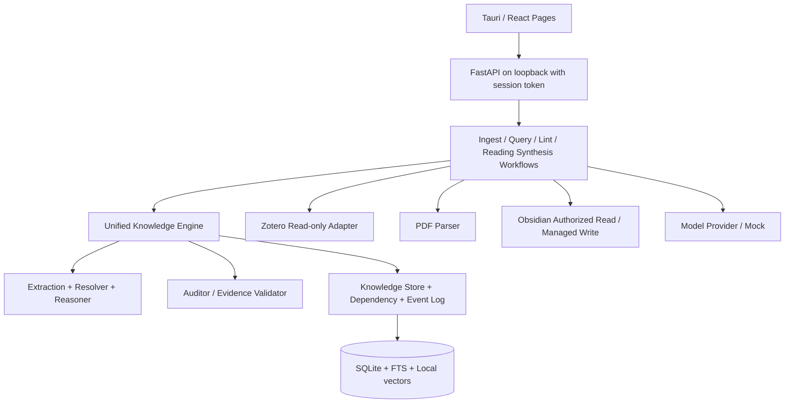
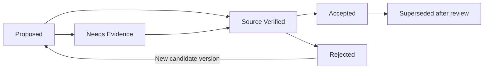

# ResearchGraph Studio — Development Plan v2.0

> 日期：2026-11-01 | 使用者：Codex / 软件工程师 | 开发状态：**P1 兼容补全与 P2 最小闭环已实现，外部验收限制见[实际进度](progress.md)**
> 文档层级：`01_product_design.md` 定义产品目标；**本文件**定义工程与分期；`03_knowledge_schema_and_prompts.md`定义数据与LLM契约。
> 这是旧版 `development_plan.md` 的**架构更新版**；保持 Phase 0～6 名称，但职责按 Graph-Centric Knowledge Lifecycle 重排。

## 0. Codex 必须执行的约束

1. 首先检查已有仓库与实际环境；禁止重建或覆盖已存在的可运行工程。做差异分析，输出迁移任务清单。
2. 阅读上述三份文档并将架构决定提炼进根目录 `AGENTS.md`、`docs/adr/0001-unified-knowledge-engine.md`。
3. **每次只实现当前 Phase 的端到端可运行功能**。禁止提前生成大量空壳“Agent”和假图谱；如无真实LLM，允许明确标记的 MockProvider，且测试不走网络。
4. 实施前写简短计划，实施后运行格式、类型、单测、集成测试；生成 `docs/progress.md`（完成事项、实际命令、测试日志、遗留风险、下一步）。
5. 任何时候保证工程可启动，数据库可迁移，升级有备份/回滚方案；避免破坏用户的原文和Obsidian私人笔记。
6. **LLM输出只是候选数据**。不能让模型直接写数据库、文件系统或自动更改Schema；统一经 DTO 校验、知识写入服务和事件日志。
7. 只有可以复现的测试和实际构建结果才能标记“完成”。Windows安装包必须在Windows环境作最终验收；其他平台编译成功不替代。

## 1. 技术选型（默认建议与替代）

| 子系统 | 推荐选择 | 选择理由 / 约束 |
|---|---|---|
| 桌面壳 | **Tauri 2 / Rust** | Windows优先，打包Python Sidecar、限制文件权限 |
| 前端 | **React + TypeScript + Vite + pnpm** | 类型安全、组件生态成熟 |
| UI | Tailwind CSS + shadcn/ui（或类似可访问组件） | 统一桌面交互与审核表单 |
| 路由与远程状态 | React Router + TanStack Query | 页面、后台任务与错误缓存 |
| 图可视化 | React Flow（`@xyflow/react`） | 可控子图、节点卡片、关系编辑 |
| 后端 | Python 3.12+ + FastAPI + Pydantic v2 | AI管线、模型Schema、API契约 |
| 环境依赖 | uv + pyproject.toml；Windows PyInstaller Sidecar | 保证最终安装端无独立Python依赖 |
| 存储 | SQLite WAL + SQLAlchemy 2 + Alembic | 本地强事务、版本迁移、事件记录 |
| 文本检索 | SQLite FTS5 | 原文/笔记关键词检索，MVP必需 |
| 向量检索 | 可替换 Embedding Adapter + 本地索引（先简单KNN，规模增大再切sqlite-vec） | 不强行绑定一个扩展，保证打包可用 |
| PDF解析 | PyMuPDF；可选GROBID适配器 | 优先段落/块坐标与原文定位；GROBID非安装包强依赖 |
| LLM | Provider接口（OpenAI兼容API/本地服务）；MockProvider | 保证可替换、可离线测试；配置真实API需明确用户授权 |
| Zotero | Local API + 附件读取（只读） | 与文献主库关联；支持直接PDF备用入口 |
| Obsidian | 授权目录下Markdown + YAML frontmatter | 无插件依赖；私有笔记只读，AI文档受控写入 |
| 代码规范 | Ruff + Pyright/mypy，ESLint + TypeScript | 早发现Schema及接口漂移 |
| 测试 | pytest + httpx + Vitest + Playwright（按阶段） | 单元、契约、集成、GUI端到端 |
| CI | GitHub Actions（如仓库使用GitHub） | Lint、测试、构建产物与Windows验证 |

**注意**：锁文件固定经验证的具体版本，而不是在设计文档里假定未来软件包一定兼容。安装包需要解决Sidecar路径、WebView2前提、Windows权限、进程端口、Windows Defender误报、日志和崩溃恢复。

官方参考：Tauri Sidecar https://v2.tauri.app/develop/sidecar/；Zotero Local API https://www.zotero.org/support/dev/web_api/v3/local_api；PyMuPDF https://pymupdf.readthedocs.io/。

## 2. 总体架构与服务边界



- `engine/domain/` 只定义业务对象及不变量，不依赖前端和具体LLM。
- `engine/contracts/` 是可验证的 Pydantic DTO，API 与 LLM调用可复用，但“LLM生成格式”与“持久化模型”不能混为一谈。
- `engine/knowledge/` 统一管理入图、审核策略、事件、版本、去重与依赖；**不得让Ingest、Query、Lint各自直接写表**。
- `engine/workflows/` 编排业务流程；Query默认只读，用户点保存才调用Knowledge Store。
- `engine/publishing/` 负责Obsidian模板、段落级依赖与安全原子写，不负责另建科研事实库。
- 前端仅调用经过授权的本机API；API不接受任意绝对路径读写请求，路径需经文件选择器和授权列表检验。

### 2.1 首版工程目录

```text
researchgraph-studio/
├── AGENTS.md
├── README.md
├── docs/
│   ├── 01_product_design.md
│   ├── 02_development_plan.md
│   ├── 03_knowledge_schema_and_prompts.md
│   ├── adr/
│   ├── progress.md
│   ├── api.md
│   └── testing.md
├── apps/desktop/
│   ├── src/{pages,components,features,api,hooks,types}/
│   ├── src-tauri/
│   └── tests/
├── engine/
│   ├── pyproject.toml
│   └── researchgraph/
│       ├── api/
│       ├── domain/
│       ├── contracts/
│       ├── providers/
│       ├── integrations/{zotero,obsidian}/
│       ├── documents/{pdf,anchors}/
│       ├── knowledge/{extraction,resolution,reasoning,audit,store,deps}/
│       ├── workflows/{ingest,query,lint,reading_synthesis}/
│       ├── retrieval/
│       ├── publishing/
│       └── experiments/
├── migrations/
├── prompts/
├── tests/{unit,contract,integration,fixtures}/
├── scripts/
├── .env.example
└── .github/workflows/
```

**目录控制原则**：模块先在一个Python包中分层，不另建微服务/独立队列服务器；仅在规模和运行需求明确后拆分。

## 3. Schema 与数据存储先行

### 3.1 数据实体

最少持久化：`Project`、`SourceDocument`、`DocumentVersion`、`Section`、`EvidenceSpan`、`Annotation`、`Concept`、`Method`、`Experiment`、`Condition`、`Metric`、`Finding`、`Claim`、`RelationAssertion`、`Insight`、`ResearchQuestion`、`Hypothesis`、`Synthesis`、`WikiPage`、`KnowledgeEvent`、`ReviewDecision`、`ModelRun`、`Job`、`LintFinding`。

`EvidenceSpan`保存不可变文档版本ID、页码、文本范围、可用bbox、原文指纹；`Claim`只是论文所声称内容，不能表示科学事实成立。`RelationAssertion`是“关系判断对象”，包含两侧主张、comparability、证据、理由、审核状态；`NO_DECISION`仅作为推理运行记录，不产出正式科学关系边。

### 3.2 存储模型

- Node表与Type-specific payload（可以用扩展JSON字段）；高频条件信息结构化列+JSON，**严禁只剩一大块不可查询JSON**。
- `evidence_links`、`relation_evidence_links` 等多对多表保存依赖与角色。
- `knowledge_events` Append-only，显式 actor、model_run_id、前后revision、trigger、diff、时间。
- `wiki_pages`、`wiki_sections`、`knowledge_dependencies`、`publish_outbox`支持增量发布与冲突恢复。
- `source_documents` 保存来源（Zotero library + key 或 imported PDF key），`document_versions`保存文件hash及解析器版本，禁止PDF改版后静默覆盖旧证据。
- 文本全文索引含段落、审核过的Claim和用户授权的笔记片段，索引版本与原文关联。

**迁移**：每次Schema变更提交Alembic迁移+回归测试；领域Schema版本变化不能直接重写已接受记录，先迁移兼容与校验。

## 4. Phase路线图与依赖

| Phase | 目标 | 主要增量 | 交付里程碑 |
|---|---|---|---|
| **P0** | 可安装的工程骨架 | GUI + API + DB + Sidecar + Mock | 空项目创建/重启持久化 |
| **P1** | 可靠文献与批注来源 | Zotero/PDF/Obsidian读、段落证据锚点 | 两篇真实PDF的证据定位 |
| **P2** | 统一Knowledge Engine最小闭环 | Schema + LLM抽取 + 校验 + 入图 +事件 | 1篇论文自动入图且可修订 |
| **P3** | 条件化关系与图谱交互 | Resolver + Comparability + Reasoner + Comparator | 两篇论文候选关系及证据核验 |
| **P4** | Query和知识沉淀 | Hybrid retrieval + grounded answer + Save | 回答追溯+用户选择保存 |
| **P5** | Lint与Wiki/精读演化 | 审计 + 阅读综合 + Wiki发布/依赖/冲突 | 批注总结、Obsidian落盘、增量检测 |
| **P6** | 实验验证与产品发布 | 基线评测、安装测试、性能与文档 | 可复现实验+可安装发行版 |

**阶段顺序原则**：P0优先验证桌面打包的真实可行性；P1/P2完成首条纵向路径；P4前P3完成跨论文对比；P5实现完整Ingest-Query-Lint-Wiki闭环。

## 5. P0 — 工程初始化 / 独立安装可行性

### 实现任务

1. 检查既有仓库、Git、OS、Python/Rust/Node工具链；创建迁移报告（如已有代码）。
2. Tauri 2 + React + TypeScript启动；页面壳含5个导航占位，但不要伪装为有功能的页面。
3. FastAPI运行于`127.0.0.1`随机可用端口；Tauri生成一次性会话令牌并安全传给Sidecar；前端通过Tauri受控接口获取端口/授权。
4. `GET /health`、`GET/POST /projects`、`GET /jobs/{id}`基本契约；SQLite migration和Project CRUD。
5. MockProvider，不调用真实网络；数据库目录使用OS app-data；`.env.example`无明文密钥。
6. Sidecar进程生命周期：首次启动、退出、崩溃恢复、端口冲突、安全日志与测试。
7. 进行第一次Windows构建/全新安装验证，保存具体安装包与测试记录；无法在当前OS验证则记录blocked与Windows验证步骤。

### 验收

- 启动桌面→后端就绪→创建项目→退出→重启后项目仍存在。
- 本地API无令牌/错误令牌不能写入；默认不监听公网接口。
- `pytest`, `ruff`, `tsc`, `eslint`, `vitest`可运行；若某测试暂不适用需说明。
- Windows fresh install不需要Python/Node环境；如未实际测试，不可标记通过。

### 输出

`README.md`、`AGENTS.md`、`docs/progress.md`、`docs/adr/0001-*.md`、工程锁文件、基础迁移、构建脚本、初版安装包或记录的阻塞。

## 6. P1 — 文献接入、PDF解析、Obsidian授权读取

### 实现任务

1. `ZoteroAdapter`：探测本地API、浏览Collections/Items、获取元数据与附件信息，记录library/key/instance id（若可用）；不请求写权限。
2. 对受支持的Zotero附件，按官方本地API的文件定位方式及用户授权读取本地PDF；处理file URL、路径权限、未同步和非PDF附件。
3. 直接PDF导入：支持拖拽、多文件、hash去重、引用路径丢失提示；是否复制用户文件由明确选项决定。
4. `PDFParser`：PyMuPDF块/词/坐标抽取、章节/段落ID、页码、可回查文本范围；抽取版本可追溯。
5. `AnnotationImporter`：Zotero原始高亮/评论及其可获得锚点；缺失锚点留unknown，不能伪造。
6. `ObsidianReader`：仅扫描明确授权的笔记目录，保存笔记hash/片段ID，忽略未授权文件；不修改笔记。
7. 源文件变化检测；导入结果与异常/重试的任务日志。

### 验收

- 不依赖网络的fixture测试和真实Zotero手动验收均可执行；2篇真实PDF段落可以通过页码和bbox返回原文。
- Zotero关闭时已有项目可浏览；损坏PDF、重复导入、批注无定位/附件丢失均有显式状态。
- Obsidian只读路径之外无法访问；未授权文本不会进入LLM上下文。

### API草案

`GET /integrations/zotero/status`、`GET /integrations/zotero/collections`、`POST /documents/import`、`GET /documents/{id}/sections`、`GET /documents/{id}/annotations`、`GET /jobs/{id}`。

## 7. P2 — 统一Knowledge Engine / 有证据的自动入图

### 实现任务

1. 根据`03_knowledge_schema_and_prompts.md`实现Pydantic DTO + Domain Enums + Alembic迁移，服务端生成主键与事件ID。
2. 将主张/方法/实验/结果等信息按章节分阶段抽取。每一Prompt只看到最小必要段落集合、有效段落ID、领域Schema版本。
3. `EvidenceValidator`：paragraphId在本次请求中存在、offset有效、quote匹配规范文本、原文hash版本一致；异常归`needs_evidence`。
4. `Resolver`候选实体对齐（精确/别名/embedding/LLM）；**禁止不经审核进行高风险语义合并**。
5. `KnowledgeStore.upsert_candidates()`统一验证、幂等写入、提交事件和图依赖；来源可验证的文献内容可自动入图，语义关系仍保留proposed。
6. GUI Paper & Reading：左章节、中原文、右抽取卡；定位证据、查看状态、人工修订、重提取任务。
7. 保存 `ModelRun`（模型provider、标识、参数、prompt_hash、inputs_hash、schema_version、usage、raw_output受隐私限制）。

### 验收

- 1篇真实英文CS论文抽取若干带EvidenceSpan的Claim/Method/Finding；每条都可核验或明确标识无法核验。
- 模型输出不存在的段落ID时被拒绝；错误数值与引用位置进入审查。
- 重跑相同版本导入不会无端重复Claim；MockProvider测试覆盖错输出、缺字段、超时、重试和失败保留。

### API草案

`POST /knowledge/extract`、`GET /knowledge/claims`、`GET /evidence/{id}`、`PATCH /knowledge/claims/{id}`、`POST /knowledge/reviews`。

## 8. P3 — 跨论文条件化推理与图谱探索

### 实现任务

1. 统一标准化术语/概念；用明确可配置的召回top-k与检索策略筛选主张对。
2. `ComparabilityAnalyzer`将实验维度按 comparable/limited/not_comparable/unknown和field-level比对输出；未知≠不一致。
3. `RelationReasoner`读取两条主张及证据、比较报告，生成关系候选；`NO_DECISION`只作为推理记录。
4. `RelationAssertion`保留source/target、对比、证据、rationale、模型调用和审核状态；支持保留相反意见及仲裁历史。
5. React Flow：Paper/Question/Concept/Argument子图；Claim Comparator并排展示条件、来源与证据。
6. 图谱性能：服务端分页/子图查询、按状态筛选、限制一次渲染数量。

### 验收

- 两篇真实论文至少一组相关主张可以走完“候选召回→条件对比→推理→原文回查→审核”闭环。
- 指标/任务不同不会被系统默认标为CONTRADICTS；缺信息输出unknown或NO_DECISION。
- 人工确认变更记录在事件日志，回放后结果一致。

### API草案

`POST /knowledge/relations/infer`、`GET /knowledge/relations`、`GET /graph/subgraph`、`POST /knowledge/reviews`。

## 9. P4 — Query：混合检索、证据问答、知识沉淀

### 实现任务

1. 三种查询范围：`literature_only`、`research_exploration`、`personal_recall`，权限与类型分别过滤。
2. 检索层同时覆盖图谱邻居、FTS原文、向量索引、用户授权笔记与已发布Wiki片段；保留源ID列表与召回理由。
3. 查询规划 + 回答生成：模型只能引用实际检索命中的ID；答案区分`paper_claim`、`model_synthesis`、`user_insight`。
4. 引文校验与不足证据降级；不得只把生成答案当成图谱证据。
5. 默认只读；用户点击“保存为知识”后，经过`ExtractFromQuery`生成`ResearchQuestion`/`Insight`/`Synthesis`候选，并经统一KnowledgeStore更新。
6. UI Research Assistant：上下文证据、来源标签、图谱跳转、保存/忽略操作、检索记录。

### 验收

- 同一问题可在文献模式与个人回顾模式返回有区分的来源；无证据时说明不足。
- LLM编造的Evidence ID被拦截；Query不点保存则图谱revision完全不变。
- 用户保存后新增的Synthesis具有来源依赖、状态与ModelRun记录。

### API草案

`POST /query`、`POST /query/{run_id}/save-candidate`、`GET /query/{run_id}/sources`。

## 10. P5 — Lint、Reading Synthesis、Wiki与增量演化

### 实现任务

1. 图谱Lint：无来源、重复、审核状态不一致、悬空边、相互冲突的候选、未知条件异常等。
2. 证据Lint：来源文件hash/位置失效、数值单位偏差、引文归属错误（LLM语义检查须标为候选）。
3. WikiLint：Markdown断链、依赖的Claim变更、文档hash与预期不一致、用户修改冲突。
4. Reading Synthesis：论文知识+Zotero批注+授权Obsidian精读笔记 →主题组织→独立总结文档预览；区分原文、用户观点、AI分析。
5. Wiki Publisher：概念页/方法比较页/综述页；保存`WikiSection`与图谱依赖，支持增量建议与Markdown diff。
6. 发布走安全outbox：生成→检查目标hash→原子写文件→确认数据库状态；崩溃重试幂等；**不覆盖用户手改文件**。
7. `DependencyTracker`：Source/Claim/Relation变更 → 找受影响 Synthesis/WikiSection → mark stale → 生成修订提案 →审核/发布。
8. 统一Maintenance审查UI；仅确定性的非科学性索引修复可自动应用。

### 验收

- 新增Zotero批注→重新生成精读总结草稿→用户同意后输出到Obsidian独立文件，私人笔记未改。
- 新Claim影响Wiki段落时可追踪依赖、产生diff而非静默重写整篇；文件外部改动会触发冲突提示。
- Lint能创建可复核问题与修复提案；未批准重要语义变更不能改accepted记录。

### API草案

`POST /lint/runs`、`GET /lint/findings`、`POST /reading-synthesis/drafts`、`GET /wiki/drafts/{id}`、`POST /wiki/publish`、`GET /knowledge/dependencies`、`POST /knowledge/reviews`。

## 11. P6 — 实验评测、稳定性与发布

### 实现任务

1. 自建科学主张/条件比较评测集（建议20~30篇同领域论文，100~200对候选关系）；双人标注部分样本，保留分歧与仲裁规则。
2. 基线A抽取：自由LLM vs Schema+Anchor；基线B关系：直接LLM vs 分两步Comparability+Reasoner；基线C更新：全量 vs 依赖增量。
3. 数据与配置冻结：语料hash、parser/schema/Prompt/模型、温度和top-k、输入/预测/人工标签、Token/成本、日志。
4. 报告：分类F1与混淆矩阵、错误冲突率、Evidence定位准确率、更新召回、时间与成本；显示未知和拒答样本。
5. 集成和GUI E2E：Zotero失联、没有网络、无模型密钥、文档损坏、Outbox重试、Obsidian冲突、备份恢复。
6. Windows全新安装验证：软件首次启动、Sidecar、SQLite迁移、卸载、更新与用户数据保留；生成用户手册及发布说明。

### 验收

- 使用固定配置可重复运行指标脚本；不承诺云模型逐字确定复现，但结果与输入可追溯。
- 所有严重级别的数据损坏/覆盖问题有防护测试。
- 在Windows clean VM上实际安装通过，发布包附带哈希和说明；缺少实际验证则不标注已发布。

## 12. 工作流状态机与安全写入策略



这些状态描述**审查/来源**，不代表科学真伪。所有状态变更需Event；可被允许自动入图的Claim可以`Source Verified`但`review_status=unreviewed`，两个维度在数据中分别存储，不能用一个Enum混淆。

- Query默认读，Lint默认审计；LLM不能直接`UPDATE`。
- 需要安全审核的操作：变更Accepted科学性语义、重要实验结果数值、不可逆实体合并、删除证据和覆盖用户文件。
- `expected_revision`控制并发事务；事件存储`before/after`与actor。
- Wiki同步先检测`expected_file_hash`；不一致→conflict，不覆盖。
- 使用outbox保证数据库变更与外部文件写入的可恢复性；不宣称跨SQLite与文件系统存在真实分布式原子事务。

## 13. 最少API契约（后续写OpenAPI）

| Endpoint | 权限/效果 | 开始阶段 |
|---|---|---|
| GET /health | 健康与版本 | P0 |
| POST /projects | 事务创建项目 | P0 |
| GET /jobs/{id} | 任务状态 | P0 |
| GET /integrations/zotero/collections | Zotero只读 | P1 |
| POST /documents/import | 用户授权路径导入 | P1 |
| GET /documents/{id}/evidences | 证据位置 | P1/P2 |
| POST /knowledge/extract | 结构抽取任务 | P2 |
| GET /knowledge/claims | 条件过滤 | P2 |
| POST /knowledge/relations/infer | 两阶段关系推理 | P3 |
| GET /graph/subgraph | 子图分页 | P3 |
| POST /query | 默认只读 | P4 |
| POST /query/{id}/save-candidate | 用户触发知识沉淀 | P4 |
| POST /lint/runs | 默认审计 | P5 |
| POST /reading-synthesis/drafts | 总结草案 | P5 |
| POST /wiki/publish | 受控文件写入 | P5 |
| POST /knowledge/reviews | 统一审核变更 | P2起 |
| POST /experiments/runs | 批量实验 | P6 |

所有写请求有明确用户动作/后台任务身份、审计Actor、idempotency key、结构化错误码。确切请求字段在`docs/api.md`经实现后冻结。

## 14. 测试矩阵（必须落实到仓库）

| 用例 | 预期 | 测试类型 |
|---|---|---|
| LLM引用不存在的段落ID | 拒绝/needs_evidence | contract |
| PDF文本范围偏移不匹配 | 证据校验失败 | unit |
| 重复导入同一文件版本 | 幂等，不生成重复主张 | integration |
| 两论文不同指标 | 不直接强制CONTRADICTS | contract |
| Query不保存 | graph revision不变 | integration |
| Query编造citation | 不输出为有效引用 | contract |
| Lint发现悬空边 | 生成finding，不直接删除 | unit |
| 外部修改Wiki | 发布触发conflict | integration |
| 保存阅读总结 | 仅AI管理文件变化 | integration |
| Sidecar崩溃 | UI提示重试，不失用户数据 | E2E |
| 无网络/无Zotero | 已存图谱可浏览 | E2E |
| 变更Accepted结论 | 必须有审核事件 | contract/integration |
| Windows clean install | 无Python/Node可用 | manual E2E |

## 15. 研发过程记录与阶段交付规范

每个Phase结束必须提交：

```text
Phase: Pn
Implemented: ...
Changed files: ...
Architecture decisions: ...
Commands executed: ...
Tests passed / failed / skipped (with reason): ...
Screenshots or fixture demo: ...
Open risks: ...
Next-phase entry criteria: ...
```

推荐每阶段按“后端契约+最小存储→单测→前端真实联调→端到端→记录”顺序，避免堆积假UI。

## 16. Codex首条指令（用于实际执行）

> 请先读取 `docs/01_product_design.md`、`docs/02_development_plan.md`、`docs/03_knowledge_schema_and_prompts.md`，并检查当前仓库与旧版 development_plan.md 的差异。新版统一Knowledge Engine、Ingest/Query/Lint共享图谱、Query默认只读、Zotero只读、Obsidian私人笔记只读是最高优先级约束。首先只执行 **P0**：建立或迁移Tauri 2 + React + TypeScript前端、FastAPI Sidecar、SQLite/Alembic、Project CRUD、本地会话鉴权、基础任务状态、MockProvider、测试、CI与首次打包验证。不要伪称Graph/LLM/Wiki已完成；不要提前实现后续Phase。输出变更清单、执行命令、测试与安装验证结果、未完成问题，并更新 `docs/progress.md`。

## 17. Phase 1后续指令模板

> P0完成并通过验收后，阅读 P1 与Schema的`EvidenceSpan`/`Annotation`规范，只实现真实Zotero读取适配器、PDF备用导入、PyMuPDF文档结构与原文锚点、Obsidian授权笔记只读扫描。为Zotero未连接、PDF无文本、附件丢失、锚点失效创建测试。完成后运行所有回归测试、更新`docs/progress.md`，然后停止，等待下一Phase的开发安排。

> 若遇到需求未指定的小细节，采取最保守、最可测试的实现并在ADR记录。不得自行扩大功能范围，不得假定模型能可靠理解所有图表/公式。
