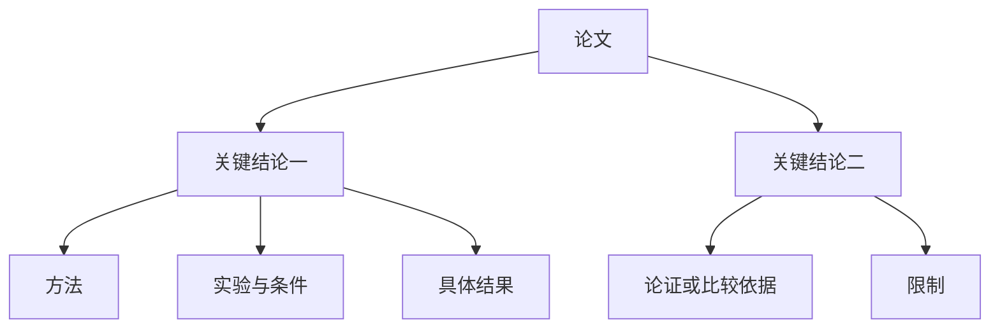

# 04 — 分层知识图谱与阅读交互（设计 v3.3）

## 首屏、展开与收起

首屏显示论文、通过自动筛选的核心 Claim，以及沿合法有向关联可到达的非 Claim 支撑，包括 Method、Experiment、Condition、Finding、Metric。研究问题、完整标题、构建范围和限制摘要在论文概览。论文中心不直接连接所有方法/概念/条件。单击结论打开详情及证据；独立操作可收起/展开支撑。缺少支撑关联时显示缺口，不补造分支。

以上连线是导航分组，不宣称“结论直接因果导致实验”。真实关系路径在详情保留。共享方法只出现一个稳定节点；收起单元时，其他未收起单元仍引用的节点继续显示。只有布局不可读时使用明确标识的视图实例，不能复制数据库知识。

新语义流程首次整合/排序失败且没有旧图时，可显示来源有效且通过保守门槛的临时分支；根 graph_role=provisional，明确标“结论候选（排序未完成）”，不称为已完成选择的核心结论。Paper→临时根为 HAS_CANDIDATE_CLAIM，完成选择后为 HAS_CORE_CLAIM；根→有据支撑为 UNIT_MEMBER，支撑角色仍为 supporting。三者都是导航边，不能冒充科学关系。已有有效图时失败继续显示旧图，来源/候选快照冲突不发布临时替代。完整边界见 [ADR0017](adr/0017-semantic-protocol-and-stage-recovery.md)。

## 操作

图谱与比较页面按“搜索与筛选 → 知识图谱展示 → 各论文候选与建图选项”排列。搜索栏集中提供关键词、节点类型、论文和语言筛选；任务记录只在文献与阅读保留，不在图谱或 Comparator 重复。末尾每篇论文都有可展开的已保存候选与建图选项，打开选项不改变画布的论文筛选，也不触发抽取。

画布上方用一栏图例说明全部 11 种节点类型：论文、概念、方法、主张、研究问题、实验、条件、结果、指标、论证、限制。颜色及中文名称与节点共用类型表；未知类型使用明确回退色，不露出默认白底。颜色仅表示类型，不表示科学真实性或审核状态。

“全部论文”按论文轮换取节点，每篇内部交替取结论与支撑，避免首篇占满首屏。分页仍有界且标本页论文/节点数和更多结果；必要的父结论与论文作为上下文补齐。翻页不代表全文不完整，partial 仍由构建证据缺口决定。论文筛选列表读取全部分页。

| 操作 | 行为 | 数据影响 |
| --- | --- | --- |
| 单击节点/键盘 Enter | 打开详情及一阶邻居高亮 | 无知识写入 |
| 展开/收起 | 默认展示有据支撑；显式收起或重新展开当前分支 | 不删除候选，不改变单元成员 |
| 拖动 | 指针节点移动，邻居力导向响应 | 松手/冷却保存布局 |
| 双击/固定按钮 | 切换固定 | 不触发展开 |
| 画布拖动/滚轮 | 平移/缩放 | 保存视口 |
| 适应图谱/切换论文或搜索范围 | 对已返回的当前范围调整视口 | 不改固定位置或知识 |
| 全屏/退出/Esc | 图谱覆盖应用视口，画布与详情自适应；焦点约束与返回 | 保持同一画布实例，不重新布局 |
| 密度选择 | concise/standard/detailed 自动选择结果 | 更新选择版本，不重新抽取 |
| 在主图显示/隐藏 | 可选用户展示偏好 | 不等于审核或改变科学状态 |
| 搜索未选知识 | 显示结果、来源与未选择原因 | 检索仍覆盖全部候选 |

没有人工审核列表、待审数量、接受/驳回或必须确认的流程。来源/语义风险使用自动诊断原因与限制标识；错误修复以重试、定位来源或调整输入为操作。

## 详情

Claim 显示完整原文语义、辅助中文、作者/转述归属、模态与范围；按“依据、方法、条件、结果、限制”组织关联内容。英文/原语言回退，不因标签缩短丢失否定和条件。Evidence 展示真实片段、可确认页号/范围、来源版本和 Zotero 打开；缺少精确坐标不得假称逐字高亮。

显示“来源已验证”“AI 关系推断”“构建尚未完成”等可解释状态；不以绿色已接受标签暗示真实性。导航边低饱和半透明；科学关系显示明确类型、条件比较及模型来源，候选虚线。

新语义选择可提供 contribution_order 和从 1 开始的 contribution_rank，表示贡献建议及筛选后的相对展示顺序，不表示科学确定性，也不强制节点坐标。旧快照没有这些字段仍有效；布局保存、拖动和固定保持独立。

## 生成中与失败

任务分 indexing/extracting/integrating/selecting/publishing，阶段与各自完成量分开，不伪造百分比。候选保存不等于核心发布；可以展示已验证部分单元，并始终标 partial。更新失败保留上一有效图谱，新候选继续保留；没有核心时显示原因，不能用平铺回退掩盖失败。

GraphProjection.paper_builds 的 ranking_status 表示当前可展示选择的排序状态，selection_mode 表示 ranked/provisional；兼容默认 unknown/ranked，已有有效历史选择缺字段时按 complete/ranked 解释。首次临时视图为 pending/provisional/partial；任务失败和继续入口保留。若失败后保留旧图，旧图状态与本次任务的 pending 分开显示，不能将已发布单元数当作本次贡献排序成功。

调用次数与 Token 来自实际 ModelRun/attempts，包含失败的整合/排序请求。缺少历史请求明细显示“仅已记录调用”，供应商未提供费用显示未知；缓存复用不新增调用，不能把超时未报用量显示为零费用。

## 稳定性与可访问性

保留受控点尺寸、有限坐标校验、RAF 清理、边文字不截获指针；悬停不能改几何布局。物理模拟冷却停止，尊重固定和减少动态效果偏好。展开新分支局部布局，轮询、侧栏与全屏改变仅更新尺寸，不自动打断当前相机；首次挂载尊重保存视口，切换筛选范围或分页在新结果返回后适应视口，也可主动点“适应图谱”。键盘能操作详情与展开，重要信息不只靠悬停。

## 验收

默认可见核心结论及其有据方法、实验、条件、结果和指标等非 Claim 支撑，支撑节点不直连论文；显式收起与共享节点保留正确；重新展开不复制知识；切换密度不调用抽取；重启保留布局和偏好；首次失败临时根/导航边与排序未完成提示一致，失败保留旧图；贡献顺序不改坐标或历史快照；拓扑与持久关联一致。真实 React Flow 渲染验证悬停、快速拖动、展开/收起、连续缩放及侧栏变化，不仅测试 mock 回调。

## 后续 Query / Wiki / Lint 的图谱入口（待实现）

P4可从结论、方法或条件详情预填“围绕此内容提问”的问题范围，仍需用户明确发起请求和相应用途授权；Query读取完整合法结构，不限制在当前画布页。答案展示扩展路径、条件和根证据，可定位原有节点或原文；没有单元的原文/候选也可直接引用，不为查询编造节点。明确保存的综合默认进入已保存区，可打开独立衍生图层，引用来源Claim而不加入论文作者核心层；隐藏该层不删除或排除检索。

P5从所选结论单元/主题明确发起Wiki整理，以支撑结构组织内容，并补原文与未选候选；另选目标页更新、另行授权导出。Lint在节点/单元详情定位断支撑、来源失效及受影响综合/文档段落，区分语义问题与文件同步问题；诊断不静默改图、改私人文件或新增审核队列。以上只是交互任务要求，现行安装版尚无这些完整功能。
