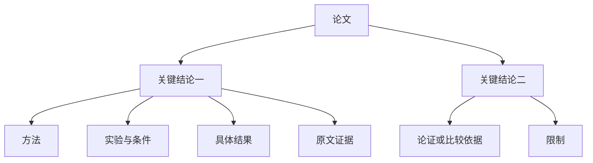

# 04 — 分层知识图谱与阅读交互（设计 v3.3）

> 实现状态（2026-11-02）：R1–R4 已按本设计接入，R5 部分验收；运行差异及自动隔离规则以 [ADR 0009](adr/0009-reading-pipeline-implementation.md) 和[实际验收](reading-implementation-verification-20261102.md)为准。参考 Schema 仍不等同于运行 API；Query/Wiki 保持后续范围。

## 首屏与展开

首屏显示论文及通过自动筛选的核心 Claim；研究问题、完整标题、构建范围和限制摘要在论文概览。论文中心不直接连接所有方法/概念/条件。点击结论打开详情，使用独立“展开支撑/收起支撑”操作显示结论分支。

以上连线是导航分组，不宣称“结论直接因果导致实验”。真实关系路径在详情保留。共享方法只出现一个稳定节点；收起单元时按仍展开的引用保留节点。只有布局不可读时使用明确标识的视图实例，不能复制数据库知识。

## 操作

| 操作 | 行为 | 数据影响 |
| --- | --- | --- |
| 单击节点/键盘 Enter | 打开详情及一阶邻居高亮 | 无知识写入 |
| 展开/收起 | 加载/移除当前单元支撑投影 | 不删除候选 |
| 拖动 | 指针节点移动，邻居力导向响应 | 松手/冷却保存布局 |
| 双击/固定按钮 | 切换固定 | 不触发展开 |
| 画布拖动/滚轮 | 平移/缩放 | 保存视口 |
| 密度选择 | concise/standard/detailed 自动选择结果 | 更新选择版本，不重新抽取 |
| 在主图显示/隐藏 | 可选用户展示偏好 | 不等于审核或改变科学状态 |
| 搜索未选知识 | 显示结果、来源与未选择原因 | 检索仍覆盖全部候选 |

没有人工审核列表、待审数量、接受/驳回或必须确认的流程。来源/语义风险使用自动诊断原因与限制标识；错误修复以重试、定位来源或调整输入为操作。

## 详情

Claim 显示完整原文语义、辅助中文、作者/转述归属、模态与范围；按“依据、方法、条件、结果、限制”组织关联内容。英文/原语言回退，不因标签缩短丢失否定和条件。Evidence 展示真实片段、可确认页号/范围、来源版本和 Zotero 打开；缺少精确坐标不得假称逐字高亮。

显示“来源已验证”“AI 关系推断”“构建尚未完成”等可解释状态；不以绿色已接受标签暗示真实性。导航边低饱和半透明；科学关系显示明确类型、条件比较及模型来源，候选虚线。

## 生成中与失败

任务分 indexing/extracting/integrating/selecting/publishing，阶段与各自完成量分开，不伪造百分比。候选保存不等于核心发布；可以展示已验证部分单元，并始终标 partial。更新失败保留上一有效图谱，新候选继续保留；没有核心时显示原因，不能用平铺回退掩盖失败。

## 稳定性与可访问性

保留受控点尺寸、有限坐标校验、RAF 清理、边文字不截获指针；悬停不能改几何布局。物理模拟冷却停止，尊重固定和减少动态效果偏好。展开新分支局部布局，不自动打断当前相机；侧栏改变仅更新尺寸，Fit View 由用户主动触发。键盘能操作详情与展开，重要信息不只靠悬停。

## 验收

默认只见论文与核心结论；展开后支撑节点不再直连论文；共享节点收起行为正确；切换密度不调用抽取；重启保留布局和偏好；失败保留旧图；图谱拓扑与保存数据一致。真实 React Flow 渲染验证悬停、快速拖动、展开/收起、连续缩放及侧栏变化，不仅测试 mock 回调。
