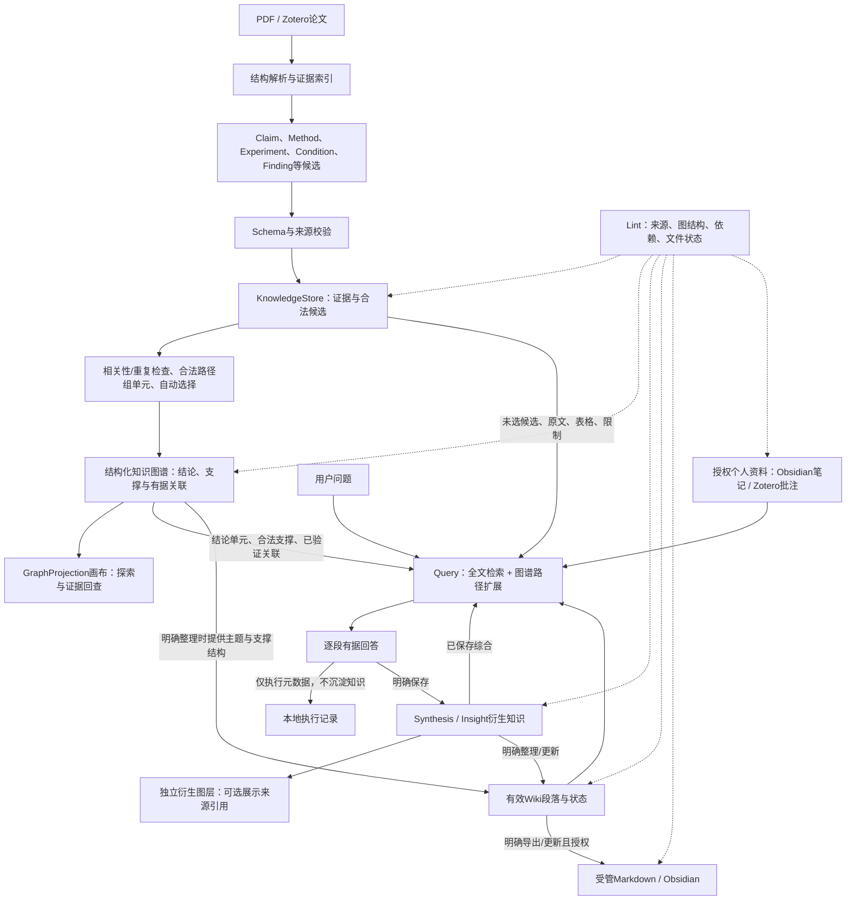

# 06 — 图谱驱动的阅读知识生命周期与开发计划（v3.3）

更新：2026-11-04（Asia/Shanghai）。完整生命周期计划沿用ADR0018；R5本轮真实协议、已知科学缺陷与新包三项补验收范围内通过，见[实际报告](r5-acceptance-verification-20261104.md)，**不开始P4/P5实现**。成绩以[progress](progress.md)、[开发日志](../DEVELOPMENT_LOG.md)及验收报告为准，以下未来任务与指标均为待完成目标。

## 当前真实阶段与推荐路线

工程继承P0–P2，当前完成 **P3/R5本轮三项补验收**。M0–M5和R1–R4核心已接入，用户此前3篇图谱五项反馈及本包原项目/续接/重启三项反馈均通过。P13v3修复见[ADR0021](adr/0021-keyed-ranking-and-bounded-correction.md)，本轮当前模型两篇各1请求成功、零重复P02/P12，32+2错误不进默认图、5同义组各1代表。旧v2失败历史不改，有限证据/partial/strict/干净机限制仍分别记录，不宣称所有模型/论文均通过。完整Query、保存综合、Lint、Wiki registry/发布尚未实现；后续明确开发指令从Q01开始。

| 阶段 | 交付目标 | 现状与启动条件 |
| --- | --- | --- |
| P3/R5 收尾 | 论文→结论→合法支撑，数据保持、失败继续、多论文与证据回查 | 本轮三项补验收范围内通过；部分覆盖/有限证据、strict与干净机等限制已登记 |
| P4 Query | 从完整知识与图谱路径生成有据回答；明确保存为衍生综合，可回到来源图谱 | 全部待开发；先完成多源作用域、索引、最小文档状态和只读适配 |
| P5 Lint / Wiki | 检查知识/支撑/依赖；按图组织阅读文档；授权导出与局部更新 | 全部待开发；复用 P4 的来源、检索、逐段依赖与文档登记，不另建知识库 |

当前运行版本分别为 Alembic **0011**、领域 **reading-extraction-1.0**、入口 **paper-reading-v1**；新 P02_reading_extract_compact_v4/reading-semantic-1 仅输出语义，程序绑定来源；semantic-reading-1 的 P12 提案关联、程序组单元、P13 提供贡献建议。结构文档见 [ADR0014](adr/0014-structured-pdf-and-support-graph.md)，完整上下文见 [ADR0015](adr/0015-complete-reading-context.md)，旧 P13 限定恢复见 [ADR0016](adr/0016-selection-json-syntax-recovery.md)，统一阶段终验与新协议见 [ADR0017](adr/0017-semantic-protocol-and-stage-recovery.md)。旧计划、原文、候选、模型输出及成功操作保留，不因后续 Query/Wiki 开发要求用户重抽论文。

## 技术路线与继承

继续 Tauri 2、React/TypeScript、Python/FastAPI、SQLite/FTS5、Alembic、React Flow；Python 用 Conda researchgraph-studio。保留来源/解析/Evidence/ModelRun/KnowledgeStore、真实模型设置、Zotero 批量选择、布局和断点任务。允许按职责重构，不追求最少改行；禁止重置工程、引入平行知识库或未经验证增加 Neo4j/Redis/Celery。

## 贯穿各阶段的产品生命周期

开发计划以“论文证据 → 知识图谱 → 图谱驱动阅读 → 有据沉淀 → 文档整理 → 依赖诊断”为一条连续流程。知识图谱不是最后的画布，也不是 Wiki 的别名；它是经过来源校验、自动相关性/重复检查后的论文知识组织层，向下连接证据，向上为 Query 和 Wiki 提供可解释的结构。

### 当前实现与计划边界

| 层 | 当前可复用/已接入 | 本计划要补齐 | 明确不混淆的边界 |
| --- | --- | --- | --- |
| 来源与证据 | Paper/DocumentVersion、结构 PDF、Chunk/EvidenceSpan、表格材料、Zotero/Obsidian 只读适配 | Query 可重建的正文/表格/中文/笔记/Wiki索引及版本化 manifest | 原文和表格保留；解析或定位不可靠时标限制，不编造坐标 |
| 候选与图谱 | reading 候选、KnowledgeStore、ReadingUnit/Member、SourceAssertion、支撑闭包、GraphSelection/Projection、图谱交互 | 图谱感知召回、跨论文合法路径扩展、衍生知识独立图层 | 画布分页/收起/隐藏不影响 Query；导航线、NO_DECISION 和相邻布局不构成科学证据 |
| Query | 旧 FTS 与 Comparator 的局部条件检索可复用校验逻辑 | 项目级多源 Query、混合召回、完整证据上下文、P07回答、P08显式保存 | 旧 Comparator 的 3跳/100节点/48K 限制不直接继承；ModelRun不能把跨篇请求挂到第一篇论文 |
| Wiki | 尚无完整运行 Wiki；ObsidianReader/AuthorizedRoot/NoteSnapshot 可作只读基础 | 文档 registry、逐段依赖、P10整理、受管 Markdown 渲染/导出、P11局部更新 | Wiki 是有版本阅读文档，不是 GraphProjection；Markdown 是表达/导出载体，不是第二个科学数据库 |
| Lint | 尚无完整 Lint；已有来源/关系/条件校验 | 确定性规则、P09建议、诊断生命周期和反向失效索引 | 诊断不等于科学审核；文件同步冲突与知识内容失效分别记录 |

Knowledge Graph 在 Query 中的作用是“从命中点找到必要支撑并解释路径”，在 Wiki 中的作用是“按结论单元组织主题、条件、分歧和限制”，在 Lint 中的作用是“检查支撑是否闭合、依赖是否仍有效”。这些消费都直接读取完整 KnowledgeStore/版本化单元，不读取被分页后的画布结果。Wiki、已保存综合与论文原文共同命中同一根来源时只算一份独立支持。

## 已接入的建图资产与 R5 收尾

| 里程碑 | 工作 | 完成条件 | 当前记录 |
| --- | --- | --- | --- |
| R0 设计与参考契约 | 产品定位、三层数据、自动选择、Schema/Prompt/示例/测试 | 规范一致、契约可执行、阶段差异明确 | 已接入；当前细则随 R5 更新 |
| R1 持久化与旧数据适配 | 审计/备份、质量元数据、单元/成员、选择快照/偏好、阶段检查点 | 旧 ID/原文/模型/历史状态逐行保持，迁移可恢复 | 已实现；合成/真实备份副本迁移通过 |
| R2 候选抽取与证据上下文 | reading-extraction DTO/P02、论文类型、表格上下文、显式候选 | 不造实验、引用/类型严格、旧任务可继续 | 已实现；严格候选和旧任务回归通过 |
| R3 论文级整合与自动选择 | P12/P13、有界调用、覆盖/去重、根与成员闭合、原子发布 | 一键流程无需人工审核，失败保留旧图和候选 | 已实现；自动阶段恢复与局部真实链路通过 |
| R4 分层图谱与阅读 UI | 论文→核心→支撑、共享展开/收起、候选搜索/显示偏好 | 不再全连论文、布局稳定、选择不重抽 | 已实现；多论文、图例与全屏已有自动回归记录，原生反馈待确认 |
| R5 回归与真实验收 | 隔离迁移、跨论文类型、真实 API、恢复、打包/用户反馈 | 分别记录通过/未验收、保护正式数据 | 本轮三项范围内通过；真实P13、32+2过滤/重复/支撑、新包反馈已验，限制见报告 |

R1–R5 是当前自动建图能力的重构里程碑，不是进入 P4/P5。每一阶段必须可独立回归，避免先更换 Prompt 输出却仍接旧 DTO。

## 迁移设计

1. 先只读审计旧表和源版本并一致性备份；正式库不用于试迁移。保留 0009 之前的兼容历史，不用参考 SQL 直接升级。
2. 复用 knowledge_nodes、evidence_spans、dependencies、SourceAssertion、ModelRun；将旧内嵌详情映射到已有对应对象，只有缺失的领域类型/字段才新增。
3. 候选 ID 保持，质量与单元/选择旁表新增；旧 review 原样保留为历史，读取适配 legacy_review_status。新流程不产生审核任务，历史 rejected/superseded 不自动重新发布。
4. 旧嵌套 Finding/Condition/Experiment 已存在时引用原 ID；Argument/Limitation 可从已有类型映射，无法确定就保留 retrieval_only，不编造关联。不得自动重抽用户全部文献。
5. 旧 Job/Prompt/DTO/分块签名保留。普通继续需要升级旧生产模板时按 ADR0013 建独立兼容续接，复用已成功操作与可完整重验响应；不能将新结构计划默写回旧快照。
6. 对已有有效候选执行整合/选择即可生成新视图；来源不足只定向补充必要内容，记录新的调用。旧有效图在新选择发布前继续可读。
7. 新选择与旧布局解耦，节点 ID 不变；隐藏节点布局保留，展开可恢复；不同选择 revision 使用可复现缓存键。
8. 0011 在 0010 上只新增 document_parses，按文献版本/解析器版本唯一，保存 pdf-structure-1 原文块/行、跨页章节树和表格布局。新 PDF 建完整块证据；已有 Chunk/EvidenceSpan 不重写。旧版本补解析必须先验证源 hash 与逐块精确文本/坐标，不匹配时拒绝补解析，保留原证据。回滚以已验证备份恢复评估，禁止自动删除新数据或无保护降级。

### R5 补验收结果与退出基线

2026-11-04补验收结果：下表的当前两篇质量/安全续接/新包项目及重启已执行并在范围内通过，见[新报告](r5-acceptance-verification-20261104.md)。表中广泛模型/论文覆盖、strict与干净机仍是限制或后续扩展验证，不倒改旧失败记录，也不因剩余泛化未知重复收费。

下列是现有实现的补验收，不重新开发 R1–R4，不重复调用已有成功批次。

| 收尾项 | 已有基础 | 本轮结果及保留限制 |
| --- | --- | --- |
| 全文建图质量 | 跨页章节/表格结构、References排除、P02语义抽取、程序组单元与P13贡献建议已接入 | 两篇原抽取6/6、15/15基础上，当前模型P13v3各一次成功；32无支持+2上标误读均不进默认图、5重复组各一代表，条件/限制/caveats核验通过。6主要贡献有代表、15组仍可检索；22/45覆盖提示及有限证据保留，复杂版面/无OCR/全局准确率不认证 |
| 恢复与费用 | 新/缓存共用终验、旧检查点复用、固定坏响应隔离、有界超时、首次失败临时预览/旧图保护 | 新增2次真实P13、零重复P02/P12，再继续零调用，用户历史成功后继反馈通过；真实格式修复分支未触发，异常/超时上限由离线专项覆盖。276699总Token、金额未知，不把离线恢复记新生成 |
| 图谱作为稳定读取层 | 核心Claim与有据支撑、共享成员、独立布局、多论文分页/图例/全屏已有回归 | 此前五项图谱原生全部通过；本轮36/232完整成员路径和来源锚点0错误。未来Query读完整Store，不从默认60/最大120画布分页推断论文知识总量 |
| 安装与兼容 | 旧库备份、加性0011、冻结引擎/宿主/PowerShell和本地安装包 | 本轮17引擎/1打包Host/3合成旧schema升级通过；用户新包原项目证据/历史续接/退出重启三项通过。干净机和真实strict未测，分别单列 |

实际命令与当前交付见[progress](progress.md)。前轮[R5收尾报告](r5-final-verification-20261103.md)的547 Python/76 React等历史成绩与P13v2失败原样保留，不代替本轮结果。本轮101 Python/32 React专项通过，真实P13v3及科学缺陷范围复验另见新报告，不仅以格式通过标科学质量通过。历史局部调用见[紧凑输出](compact-output-verification-20261102.md)、[流式恢复](tencent-recovery-verification-20261102.md)、[旧响应复用](reading-response-verification-20261102.md)和[候选范围](schema-scope-verification-20261102.md)。

#### 当前协议可靠性任务与验收

1. 新计划冻结P13_reading_ranking_v3，运行Schema固定assessments全部required短编号；模型只输出建议、理由、说明及0–100整数priority，程序稳定排序。同分不冲突，额外字段和重复JSON键不放行。
2. 首次响应中外壳合法的有效槽位私有保留；定向修复只要求未完成槽位，完整单元/证据/条件上下文不截断。总计最多两个持久请求槽位，超时计入；恢复重验raw与谱系，不重新调用成功P02/P12或已用槽位。费用与投递未知如实保留。
3. 旧v1/v2排序失败任务走现有继续入口建立独立v3后继；原计划/签名/raw不变。候选、关系和原P12成功响应必须重新终验及Store核对，通过才零调用采用，否则停止，不隐式重跑整合。
4. 离线覆盖重复/冲突编号旧形状、未知字段、缺失槽位、非法JSON、局部修复、恢复和费用上限、来源变化及旧协议精确兼容。界面显示结论评估与修复实际状态，全部槽位终验及原子发布才记排序完成；本轮真实2请求成功、32+2均不进默认图。真实修复分支未触发，不能记为真实格式修复成功。

后续实施前登记可复现基线、未验收和已知限制；阻止正常导入、证据定位、数据保持或启动的缺陷先修复。其他质量未知项按影响记录与后续任务并行跟踪，不重置用户数据，不把 G0 用户放行重新列为阻塞。

## P4 / P5 计划状态与共用约束

2026-11-03 本轮仅制定以下任务、实现方法和验收方式，**全部为待开发，不代表开始或完成 P4/P5**。实施前先登记 R5 当前安装反馈、已知阻塞和可用数据基线；阻止正常导入、证据回溯、数据保持的缺陷须先修复，其他已知质量限制记录后按后续明确开发指令推进，不重复搭建 P0–P3。

- 产品仍为通用论文阅读辅助。Query、Lint、Wiki 共用 Knowledge Engine / SQLite / KnowledgeStore，不建立三个独立知识库；没有人工审核、待审或接受/驳回流程。保存回答、导出文件是明确写入动作，文件冲突是技术保护。
- 默认只读的 Query 不改变知识、关系、选择或布局版本；允许保存本地任务、ModelRun、检索快照与诊断元数据，但这些不是知识沉淀，不自动回流为回答依据。用户明确保存后才经 Store 建立衍生知识。
- 原文/证据/候选是知识底座，GraphProjection 只是分页视图。检索不能受当前画布页码、折叠、隐藏或核心选择限制；来源失效、隔离及历史排除对象不能因相关性高绕过门槛。
- 笔记目录读取授权、笔记内容发给模型的授权、Wiki 导出目录授权分别处理；不从旧“读取笔记”授权推断外发或写入权限。Zotero、原 PDF 和私人精读笔记保持只读。
- 授权撤销须穿透衍生依赖：原资料、已保存综合、问答缓存和Wiki草稿不能作为二手来源继续自动检索、外发或导出私人内容；原本地历史不删除，显式查看与重新授权按用途处理。入队、模型实际发送、保存及导出前均再验当前权限。
- 复用全局真实模型、Provider 输出策略、阶段终验、ModelRun/Job/幂等键。模型只给语义及请求内引用，版本、正式 ID、原文坐标和文件目标由程序绑定；新运行 DTO/Prompt 独立版本化，不改旧任务签名，不将连接成功等同协议验收。
- 数据变更先备份并在隔离副本演练，再用 Alembic 加性迁移；当前 head0011 不因本轮写计划改变。表名、路由和错误码在下文均为拟定，实施时同步 OpenAPI/TS、Tauri 白名单及实际 ADR；不能把参考 SQL 直接用于用户库。

### 已有基础与真实缺口

| 部分 | 可以复用的实际资产 | 需要新增或调整 |
| --- | --- | --- |
| 来源与知识 | Paper/AttachmentRevision、Chunk/EvidenceSpan、结构文档、reading 候选/单元/选择、SourceAssertion、条件比较；实现见[单元模型](../services/engine/researchgraph/reading_models.py)、[路径计算](../services/engine/researchgraph/reading_support.py)与[Store组单元](../services/engine/researchgraph/reading_store.py) | 面向问答的跨类型检索适配与版本化证据上下文；旧知识保留但不自动混入当前科学依据 |
| 检索 | [knowledge_fts迁移](../services/engine/researchgraph/migrations/versions/0008_reasoning.py)、[reasoning_context.py](../services/engine/researchgraph/reasoning_context.py)的 BM25 和项目范围候选召回 | 当前主要是知识节点检索，不能当作原文/笔记/全类型 Query；补全文、中文/原文、笔记及后续受管 Wiki 索引与排序 |
| 执行与写入 | KnowledgeStore、knowledge_dependencies、knowledge_events、ModelRun、Job、幂等/重试、全局真实 Provider | 问答/诊断/受管文档的持久化、逐段版本依赖、可靠失效传播及文件发布恢复；现有ModelRun强制单一文献版本，Store.event及ObsidianReader新增快照会增加GraphRevision，不能原样用于只读跨论文问答/文件扫描；现有依赖表不是完整Wiki依赖追踪器 |
| 私人资料 | ObsidianReader、AuthorizedRoot、NoteSnapshot、独立笔记页 | 笔记授权快照的检索/引用、撤销过滤、外发选择；独立导出根和受管文件边界 |
| 参考规范 | [Schema](03_schema_design.md)、[P07–P11](05_prompt_engineering.md)、[参考契约](schemas/contracts.py) | 只是设计参考；尚无完整 Query/Lint/Wiki 运行 API、页面与验收闭环 |

### Query、Wiki、图谱与 Obsidian 的边界

2026-11-03 追加澄清见 [ADR0018](adr/0018-query-wiki-and-obsidian-lifecycle.md)：知识图谱组织结构化论文知识及合法支撑路径，GraphProjection是它的画布视图；Wiki是有段落、顺序、引用和版本依赖的阅读文档；已保存阅读综合是有归属的衍生知识；Obsidian Markdown是受管Wiki的可选文件载体，也可包含独立的私人笔记。当前软件尚无完整Wiki，不把现有图谱称为Wiki。

Query必须兼读有效Wiki及其状态、已保存综合、完整候选和原文。P4-Q01/Q02/Q04前置实现最小文档登记/只读快照/段落manifest/状态过滤，不等待P5完整生成发布；没有文档时该召回为空。P5-W02在此基础上扩展文档生成、渲染与发布，不能重建另一套registry。默认不把普通问答历史和未保存草稿回流为知识。

默认“保存阅读知识”新增Synthesis/Insight等对象及依赖，保留原作者Claim/数值/证据/选择；原论文图不被重写，可用独立衍生层展示引用关系。另行选择目标Wiki页才创建或更新其文档版本，另行导出才写Markdown；可以明确选择组合动作，内部仍保持各自提交/恢复边界。全文证据不会因写成Wiki而获得额外独立支持，依赖链不得循环自证。

Wiki按段落区分内容有效/过期/失效/未验证；文件另记未导出/一致/外部修改/缺失/冲突。外部手改不自动获得旧证据，磁盘缺失不自动使内部有效内容失效。Query可明确使用仍有效的内部保存版本并报告文件差异，不能声称内容已与磁盘同步；内容失效段落默认不作科学依据，其余有效段落仍可用。查询前重新检查状态，不仅依赖上次Lint。

Lint区分受管Markdown和授权私人Markdown：前者核对身份/hash、段落manifest、根证据、依赖和链接；后者只读检查快照/链接/可确认引用，无依赖元数据时标无法核验，不据此判个人观点科学错误。受管文件手改后生成快照/diff与冲突，阻止覆盖和自动反写论文图谱；用户明确选择登记编辑时才产生新的文档/个人资料版本，保留原文件与归属，不引入人工审核。

## P4 — Query：检索、证据回答与显式保存

### 完成后的用户流程

在项目中提问 → 选择全部或若干论文（默认文献问答，个人回顾另行开启笔记）→ 展示命中文献/知识/原文及召回理由 → 生成带逐段引用、条件和限制的回答 → 点击引用回到原文或 Zotero → 可选“保存为阅读知识”。跨论文比较复用当前条件快照，不因指标名相同就比较大小；没有足够依据时明确说明不足，不调用外部搜索补造答案。

### 任务、实现方法与逐项验收

| ID / 任务 | 实现方法与交付物 | 验收方式与完成条件 |
| --- | --- | --- |
| P4-Q01 运行契约与存储边界 | 定义 QueryRequest/检索快照/回答版本/保存命令及失败状态；建立 GroundedPassage 与运行 Store 的适配。复用来源与知识表，按需新增 query_runs、query_passages、版本化引用及保存操作记录；前置最小文档/段落registry、不可变快照、根依赖manifest和内容/文件双维状态，供P4只读消费Wiki及P5扩展。科学知识只在显式保存时写入。冻结项目、论文版本、候选范围、授权、Prompt/模型/参数及输入哈希 | Schema 正负例、API/TS 合同测试；0011 隔离副本加性迁移后旧表原列/ID/任务签名保持，外键/完整性和重启读取通过；跨项目引用拒绝 |
| P4-Q02 完整可重建检索索引 | 复用 knowledge_fts，补齐候选原语言/中文、题名/别名、原文正文/表格材料、已保存阅读综合、可用Wiki段落及授权笔记索引；Wiki来源同时绑定内部版本、根证据和文件同步状态，外部编辑不得继承旧manifest；来源和类型过滤先于最终排序。持久对象与派生索引分开，可重建且不改原文。索引返回图谱种子及完整 KnowledgeUnit/合法关联的入口，不能把 GraphProjection 的分页结果当检索全集；References/页眉页脚默认不作为科学回答证据，被引论文未获取全文不声称已核验 | 首屏之外、收起/隐藏及 retrieval_only 知识均可命中；仅有原文未抽取的内容也能检索；中文/英文、数字/单位、空查询和特殊字符测试；折叠/隐藏/论文分页前后命中与路径集合一致；隔离/旧驳回/Mock 默认排除；重建前后有效命中一致、数据不丢 |
| P4-Q03 混合召回与条件比较 | 首版采用 FTS5/BM25 + 精确术语/别名 + 完整候选/原文命中后的合法 KnowledgeUnit 支撑路径与已验证科学关系扩展，融合去重并返回命中原因、扩展路径和根证据；补全与问题有关的方法、实验、条件、结果及限制。中英检索优先复用已存译名，必要改写显式记录；向量索引仅在基准证明必要后独立接入，不成为首版依赖或引入向量服务。不要直接复用旧 Comparator 的同类过滤、3跳/100节点/48K字符限制；新 Query 仅按问题相关性、证据完整性和有界请求策略组装上下文。P4即接入最小Wiki只读适配器，P5再补生成/发布；Wiki须追溯到底层来源，和原论文/综合重复命中时不自引加权 | 固定检索金标集对比“文本种子”和“图谱路径扩展”两组结果；条件、表头、限制和不同归属被补回；折叠/隐藏/分页不改变完整结果；邻域扩展不使用导航边、NO_DECISION或相邻布局充当证据，不整库外发；known/unknown/not_applicable/conflicting、单位不同、转述归属及 NO_DECISION 均有用例；任意论文/项目过滤不越权 |
| P4-Q04 版本化证据上下文 | 对有结论单元的 Query 种子沿合法支撑闭包组装完整命中片段、章节路径和必要表头/条件；没有单元的合法原文/候选直接构造可验证来源manifest，不为查询制造单元。返回 claim→method/experiment→condition/finding/metric 的可解释路径及请求内短编号→真实来源映射。已有 EvidenceSpan 复用，原文命中缺正式 span 时使用可验证的 Chunk/版本只读引用，不为了查询落一批新知识。模型输出前后均验版本/hash/归属与文档状态；内部有效但磁盘不同步的版本明确标识，过期段落不作当前科学依据；不能在实际模型容量不足时截掉必要条件，可减少完整低相关命中并明确覆盖范围或停止 | 伪造来源归属/版本或超出本次manifest/项目的引用、错 quote/offset/hash、表头缺失、生成期间来源/授权变动均拒绝或标不足；合法跨篇引用允许，检索快照能重放。附件离线但已有不可变证据时可显示历史片段并说明当前文件未核验，不声称已验证现存 PDF |
| P4-Q05 P07 有据回答与恢复 | 以独立运行模板接入 P07，模型只返回段落语义、归属、请求内引用和限制，由程序绑定 GroundedPassage/版本；默认复用全局 Reasoning 模型。科学段落必须有论文证据，个人观点必须有授权 note/annotation 快照及独立引用类型，AI 综合不能变成作者主张。复用严格/兼容输出策略及完整终验，保存原响应和真实用量；中断/超时有界，成功步骤及合格缓存不重复收费 | 正常问答、跨论文比较、仅笔记/无证据、坏 JSON/未知字段/假引用/模型拒绝/超时/取消/来源冲突/缓存失效测试；未经终验的流式文本不能作为已完成且可保存的答案。每段可回查，证据不足 knowledge_status=insufficient，来源冲突不盲目再调模型 |
| P4-Q06 Query 页面与回溯 | 新增项目“问答”入口，提供问题、论文范围、可选个人资料、实际阶段进度、答案与证据栏；展示作者/转述/个人观点/AI综合、全文缺口、调用/Token/未知费用；支持引用跳转原文/图谱及 Zotero，不复制完整原文墙。历史为本地执行记录，与已保存知识区分，任务沿用统一任务中心 | React 及真实浏览器验证提问→命中→回答→引用→切论文/取消/继续→重启；不重复任务列表，不隐式改变图谱选择；文献模式不读取/外发笔记；未验证回答与保存按钮状态正确 |
| P4-Q07 显式保存与 P08 | 用户点击“保存为阅读知识”后以 P08 独立运行契约形成阅读综合/个人观点等衍生对象，经 Schema/来源/依赖校验后 Store 幂等提交并记事件；可确定性复用已验证段落，不为复制内容强制再调模型，确需提炼时记录新增调用。保留原 QueryAnswer/ModelRun，存 source_query_id 及逐段依赖，不伪造 Paper 或把综合塞进作者 Claim；默认进入已保存阅读综合，并可在独立衍生图层展示“来源结论→综合”的引用边；指定目标才形成Wiki文档更新，导出Markdown另需明确动作 | 未点保存时知识/科学关系/选择/布局逐行及版本不变（执行元数据另计）；重复点击/断线重试只产生一次保存；来源过期拒绝旧保存、原答案保留；保存后重启可读，从独立衍生图层回查多篇来源结论/证据；隐藏衍生层不影响后续检索，依赖可追溯，不进入人工审核队列或自动抬为论文核心 |
| P4-Q08 真实链路与交付 | 冻结下述验收集，运行自动化/旧功能回归、真实模型、打包宿主与用户原生操作；记录不同错误类别、阶段耗时/真实调用/Token/未知金额。形成 P4 实际报告、更新进度/API/Prompt/迁移与安装操作，不只做静态聊天演示 | 下述 P4 门槛均有实际证据；未测模型/权限/平台明确列出，离线 Provider 不代替真实成绩；验收通过后才交付 P4，不自动进入 P5 |

### P4 必补的契约细节

1. 当前 RetrievalHit 强制 document_version_id，仅有论文来源形态；运行版需区分 paper / note / wiki 的来源联合类型、snapshot、匹配片段、来源有效性与排序理由。不可给笔记编造论文版本。
2. QueryAnswer/GroundedPassage 的 ID 存在校验不足以证明语义支持；除引用/归属校验，还需保留支持范围、限制和真实回答评价。无证据的“未找到”作为状态/限制表达，不能为了满足 passages 的引用约束制造科学段落。
3. 为原文 Chunk 引用、保存的阅读综合、问答快照和撤销授权建立类型与状态；保留 reading-extraction-1.0 及旧历史 API，不能把原有 Paper 节点改成通用答案容器。
4. P07/P08 新 wire Schema/Prompt 继续从同一契约生成或自动核对。版本、哈希、正式引用、审计字段由程序绑定，不要求模型回抄；参考模板不直接当运行协议。
5. 当前 ModelRun.document_version_id 非空且调用入口要求单一version_id；Q01须先定义项目级执行scope和多来源manifest的兼容扩展，不得把跨篇问答随便挂到第一篇论文。执行审计和科学变更事件分开（包括现有Obsidian扫描事件）：不能调用当前会递增GraphRevision的KnowledgeStore.event来记普通查询、Lint报告或文件操作日志；显式保存衍生知识才推进对应知识版本。
6. 明确不可变Chunk/NoteSnapshot的版本身份、运行source_verified与参考anchored等状态映射，加入段落local_ref唯一和knowledge_status与内容一致性校验。已有参考validate_passage_context只验证部分白名单/文献归属，不能替代运行锚点/hash或授权终验。
7. 文档来源须携带Wiki/综合版本、内容有效性和文件同步状态及可终止根依赖；读Wiki不能只看已发布标记。user_view经Wiki转述仍保留可验证note/annotation根来源和权限。不能用source_kind=wiki规避个人资料外发限制；文档导航链接可双向，但科学依据不能成环。
8. Q07的指定文档目标仅把已终验、明确保存的段落登记为内部文档新版本，核对目标基线版本并保留原段落；不调用P10/P11、不渲染或发布Markdown。主题整理、模型增量重写和文件发布留在P5，避免与W01–W04重复。

### P4 验收集与退出条件

- **确定性安全集全部通过**：跨项目/未授权资料零命中与零外发；假证据/过期来源零入库；默认查询零科学知识写入；相同保存操作仅一条有效版本；旧导入/抽取/图谱/布局/模型设置不回归。
- **授权撤销穿透**：先用授权笔记生成并保存综合/缓存，再撤销对应读取或外发用途，验证原快照及所有衍生对象不能绕过该用途限制进入新请求、保存或导出；历史保留不等于持续获得使用权限。P5沿用同一矩阵。
- **图谱实际作用**：固定不少于6个必须补齐支撑或比较条件的问题（含多跳、共享方法、限制和未选候选），比较仅文本种子与图谱扩展的路径/来源/条件覆盖；金标必要支撑必须完整或明确无法满足，不能静默遗漏。画布分页/隐藏/收起不改变结果；保存后衍生节点能回到多篇根证据，隐藏衍生图层也不阻止检索。
- **Wiki消费矩阵**：有效已保存Wiki、未导出/文件缺失但内部有效、单段来源过期、外部修改/冲突、未登记私人MD分别查询，断言所用版本/状态、段落范围、归属和根证据。外部修改不继承旧manifest，普通草稿不自动回流；同一根来源经Wiki/综合重复召回不增加独立支持，循环依赖被拒绝。
- **离线质量基准**：至少 3 种类型自造/可分发文献、1 个授权笔记目录和1个未授权目录、2个隔离项目；固定不少于24题，其中至少8题为无证据/版本失效/权限负例。实施时逐题登记预期来源集合及关键条件；有据题至少一个金标来源进入前20命中的比例目标≥90%，负例按定义全部正确说明不足或拒绝。该指标是待达到的验收目标，不是当前成绩。
- **真实模型验收**：至少2篇用户授权真实论文，覆盖单篇贡献/条件、未选候选、跨篇可比与不可比、无答案、中文问英文材料等不少于10个问题。程序对所有展示引用验证通过；逐段记录支持/部分支持/不支持、归属和条件遗漏，阻塞性的伪造来源、跨权限泄露、把不同比较条件当相同、把个人观点当论文事实必须修复；不能仅因 Schema 通过就判科学质量合格。
- **恢复与性能**：注入模型超时、收到响应未提交、重启、重复保存和来源变动；提交与用量审计完整。以固定机器/数据规模记录纯检索 P50/P95、生成各阶段耗时和Token；首版纯本地检索目标 P95≤2秒（1万候选/2万正文块），实际规模与索引体积一起报告，模型耗时不混入本地检索指标。未达标分析后优化，不删必要证据凑数。
- **交付演示**：打开已有工程→提问→回溯原文→不保存退出（知识不变）→重新提问并显式保存→重启读取保存结果。真实 API 缺失时阻塞项如实登记，不能用 Mock 补记真实通过。

## P5 — Lint / Wiki：自动诊断、阅读整理与依赖演化

### 完成后的用户流程

对项目执行检查 → 按来源/证据/结构/语义建议查看问题及定位 → 在论文、概念、方法或比较范围生成有据阅读整理 → 预览 Markdown → 明确导出到授权的受管目录。知识/来源改变后只标受影响段落并生成增量差异，用户执行更新文件动作；私人原笔记和未受影响内容保持。整个过程没有科学审核队列，也不把语义检查建议直接改写为事实。

### Lint 与共享依赖任务

| ID / 任务 | 实现方法与交付物 | 验收方式与完成条件 |
| --- | --- | --- |
| P5-L01 逐段依赖与失效追踪 | 在 P4 逐段依赖上扩展反向索引，覆盖 GraphSelection/KnowledgeUnit 支撑路径、知识/关系 revision、文献版本/证据、note snapshot 及受管 Wiki snapshot；Store 事务记录依赖和事件。图谱布局、分页和折叠只属于视图版本，不得触发科学失效。先复用 SQLite 事件序号+幂等扫描/轮询游标，重启可补漏，不引入队列服务。区分来源不可用、证据失效、语义变更、组织变化和布局变化，避免统一标成“事实错误” | 来源/知识/关系/笔记变化准确命中受影响段落，多跳依赖可终止且不重复；源证据失效阻止新引用/发布，保留历史；选择只标组织可能变化，拖动/缩放零科学失效；漏事件/重放/崩溃后可重建同样状态 |
| P5-L02 确定性 Lint 规则 | 规则注册表返回稳定 code/严重性/规则版本/受影响ID/来源/定位/处置方式。检查引用不存在或版本/hash/offset不符、来源归属、断边/孤立成员/无合法支撑路径、失效依赖、受管Markdown断链/文件身份/hash/段落映射；授权私人Markdown仅查可确认链接/引用，缺来源追踪标无法核验，不自动判科学错误；未知条件仅标缺口，不强判矛盾；数值/单位规范化仅处理明确等价关系。扫描默认只写诊断，不静默删除或改科学语义 | 故障注入每条必检规则均命中，干净样本无对应误报；missing/unknown/not_applicable/conflicting区别正确，单位不明拒绝比较；跨项目/失效证据不会变成正常依据；重复检查问题指纹稳定、旧报告保留，规则升级可辨 |
| P5-L03 P09 语义辅助检查 | 确定性规则之后，按显式任务调用 P09 评估过度概括、错归属、翻译偏移、可能重复/数值误读等；只给本次允许对象和必要证据。输出 model_suggestion 与不确定性，关联 ModelRun，不自动选择“哪篇论文正确”、合并实体或改数值；失败不使规则结果丢失 | 不同条件下结论不同不被定性为冲突；转述与作者结果、负面结论、翻译遗漏否定等金标用例；伪造 affected/evidence ID、格式错误和超时拒绝且保留原响应；相同输入/规则/模型配置缓存复用并准确计费 |
| P5-L04 诊断页、增量检查与处置 | 提供检查范围、规则/模型检查选项、实际进度、按严重性/类型/来源筛选、证据定位和前后报告差异；生命周期为新发现/仍存在/已消失/输入过期等诊断状态，不是接受/驳回。知识变动先做确定性增量检查，不自动发付费语义请求。允许程序重建派生索引等非科学修复，需独立幂等操作及日志 | 真实浏览器/隔离数据验证扫描→定位→重建索引→复查，科学知识/原文保持；重查不堆重复问题，不靠关闭提示绕过来源门槛；取消/重启/部分规则失败仍可看已完成范围，报告不伪装全库已检查 |

### Wiki / Reading Synthesis 任务

| ID / 任务 | 实现方法与交付物 | 验收方式与完成条件 |
| --- | --- | --- |
| P5-W01 P10 阅读整理 | 复用 P4 的图谱路径/证据 pack，按问题主题选择相关结论单元，再补未选候选、原文和必要条件；无单元时允许直接使用合法来源并标结构缺口，生成包含问题、贡献、方法/依据、适用条件、负面结果与限制的结构化段落；不能把逐节点转写当 Wiki。保留跨论文共同点、分歧及各自条件，Zotero批注/用户笔记显式选择且独立授权，作者/转述/用户观点/AI综合分开。生成过程只存本地草稿，经Store登记依赖，不写文件或反向覆盖论文知识 | 至少论文/方法/跨篇比较3种范围；理论/综述不造实验；个人批注评论不是作者原话；每个科学段落可沿已有单元或直接原文/候选引用回到根证据；跨论文不同条件不混成同一结果，个人观点有note/annotation来源，范围未覆盖与partial保留；缺证据不强行凑段落 |
| P5-W02 受管页面、段落与渲染 | 扩展P4已有最小文档registry，在同库补齐wiki_pages/wiki_sections/版本快照及渲染，引用原知识而非复制一套 Claim；稳定页面/段落ID由程序分配。确定性渲染Markdown、引文列表、Zotero链接、条件表、跨页面链接及生成版本；转义不可信HTML/链接。草稿与最后导出版本分离，维护内容hash与逐段依赖。外部MD明确登记时建立独立文档快照/个人或外部来源归属，不继承系统证据或写权限 | 外部自造MD登记不伪造证据/论文归属，不覆盖原文件；同输入渲染稳定、中英/数学符号/引文可读；Markdown本地链接/段落ID/引用检查通过；重启保留草稿与历史，未导出无文件变化；草稿版本不冒充已发布文件 |
| P5-W03 授权目录与可靠导出 | Tauri选择独立写入根，后端只接授权root_id/受管page_id，不接模型任意路径；程序生成安全文件名/相对链接，阻止越界、符号链接/junction逃逸及碰撞。仅生成受管子目录，不自动改私人笔记。以持久发布操作账本记录base/target hash、暂存、同卷原子替换和确认；数据库/文件非同一事务，通过幂等恢复协调 | 临时Vault中首次导出/同内容重试/同名私人文件/只读目录/路径越界/撤销授权测试；在暂存前后、替换后/数据库确认前强制终止，重启可确认已写目标或安全重试；不能覆盖外部更改，外部新文本不继承旧manifest/科学归属；Lint可定位文件差异，失败保留上一版，私人文件逐字/hash不变 |
| P5-W04 P11 增量更新与冲突 | L01找受影响段落，P11仅提出受约束 replace/append/mark_stale；程序验证段落范围/引用/版本/base_content_hash并生成Markdown diff。未受影响段落原样保留；文件外部编辑先留只读快照和diff，不自动反写科学图谱；知识来源失效显示stale并阻止直接发布陈旧科学段落。密度/选择变化只提示重组，不自动改科学内容；明确点击“更新导出”才写文件，变化后再核对授权与目标hash | 修改一个支撑/来源只影响对应段落和其合法依赖链，不全量重新抽取/整页重写；双草稿竞争、外部手改、源在生成或发布间变更均识别冲突；保留旧版/原响应/未受影响段落，重新生成只处理未完成且仍有效部分，无隐式付费循环 |
| P5-W05 闭环与交付 | 将诊断页、整理预览/引文、导出目标、差异和冲突恢复接入现有导航/任务中心；完成知识变动→诊断→整理→授权导出→依赖失效→局部更新→重启的真实闭环，交付文档/安装器/回归及用户步骤 | 下述P5门槛全部逐项记录；新旧资料、凭据、原PDF/Zotero/私人笔记保持；不得因模板或静态预览存在就标Wiki发布通过 |

### P5 必补的契约与发布边界

1. LintIssue 参考契约缺少严重性、规则版本、确定性/模型建议、稳定指纹、输入快照及诊断生命周期；需加运行包装对象，不能直接拿 suggested_action 执行代码或更新知识。
2. ReadingSynthesisDraft 当前只有单一 selection_revision；多论文须改为按文献版本记录 knowledge/selection 修订映射，允许没有核心选择但有合法原文/候选的范围。选择 revision 只影响组织，不替代语义/证据版本。
3. 批注、个人笔记、科学证据分别建引用类型：Annotation中的高亮可关联已有论文证据，comment属于用户观点；未解析anchor不能编页码。模型看到的授权范围与用户实际选中的来源均需冻结。
4. WikiDeltaProposal 仍只给段落编辑提案；发布命令另带授权根、页面/草稿版本、预期目标hash及幂等键。任何已存在目标（包括零字节文件）必须同时匹配已登记受管身份及hash，否则冲突停止，不能把“自动处理”解释为覆盖私人文件。
5. 发布操作账本只协调受管文件写入，不运行模型SQL/Shell、不增设科学审核。用户外部改动可保留原件、重新导出新文件或选择新的授权目录，程序不能自动接受旧base或无限覆盖重试。历史版本可以查看，恢复文件也必须重新检查当前hash。

### P5 验收集与退出条件

- **规则基准**：冻结至少覆盖L02各规则的正例/负例，以及语义条件不一致但不构成矛盾、理论论文无实验、附件离线/来源已变更、引用用户观点等反例；确定性规则在固定注入集全部命中，干净对应反例不误报；图谱导航边、布局相邻和单元共享不被误当科学因果。语义建议另记准确性与未知项，不能用规则命中率冒充LLM科学判断能力。
- **依赖矩阵**：来源hash/文献版本/证据、Claim/关系修订、note snapshot、选择版本、布局版本逐项修改；断言受影响段落集合、阻塞/提醒类别及未受影响段落hash。既有历史保留，多跳/重复/循环防护通过。
- **Obsidian双类检查**：在隔离Vault同时放受管Wiki与普通私人MD，制造外部编辑、改名/删除、断链和无根引用；Lint能区分文件同步差异与内容证据失效。普通笔记缺系统字段不误判科学错误；内部有效旧版本可明确按其版本使用，文件新内容不冒充已验证Wiki。扫描仅写诊断，私人文件原字节不改。
- **文件故障矩阵全部通过**：无授权、越界/链接逃逸、同名私人文件、手改冲突、并发草稿、权限/磁盘写入失败、临时文件残留和各发布检查点崩溃；重启后文件/数据库状态可解释且恢复幂等，绝不覆盖未受管文件/外部手改。
- **真实模型与原生反馈**：至少2篇真实论文、1份明确授权笔记及可获得的Zotero批注，在独立临时Vault完成P09/P10/P11；缺少批注或其他条件则如实列未验收，不伪造。逐段验证引用/归属/条件，演示规则检查、语义建议、整理、导出、可控知识变动后的局部diff与冲突保护；不为制造验收变动篡改用户正式库。
- **性能与回归**：在P4相同固定规模报告规则扫描与增量定位耗时/峰值内存、模型耗时/Token、受影响文件数；重点断言只更新受影响范围。P0–P4回归、迁移副本原数据/私人文件hash、冻结引擎/打包宿主及用户安装步骤通过后交付；无真实服务时保持“未通过真实验收”。

## 图谱驱动的阶段退出条件

进入 P4 前，R5 必须把“论文→核心结论→合法支撑”的投影、单元成员、证据回查和多论文范围作为稳定读取基线；图谱仍可有 coverage_gaps，但不能用画布缺页掩盖来源/路径错误。P4 的 Query 以完整单元和候选为数据源，不修改核心选择；P4-Q07 保存后才增加衍生对象及可选独立图层。P5 的 Wiki 沿这些单元组织段落，Lint 反向检查单元、证据和文档依赖。图谱布局版本、Query执行版本、Wiki文档版本和科学知识版本分开递增，避免普通问答、Lint或文件扫描使图谱分页游标无故失效。

P4/P5 完成的最终演示必须能回答：命中某个结论后，系统能否说明它由哪些方法、实验和条件支撑；保存的跨论文解释能否从衍生对象回溯所有根证据；某个来源变动后，Lint 能否只定位受影响的图谱单元和 Wiki 段落；Obsidian 外部编辑或文件缺失能否单独显示同步冲突而不改写论文知识。

## P4 / P5 执行顺序、接口与交付检查

推荐顺序：**R5基线登记 → Q01契约 → Q02索引 → Q03召回 → Q04证据 → Q05回答 → Q06界面 → Q07保存 → Q08验收 → L01依赖 → L02规则 → L03语义 → L04诊断界面 → W01整理 → W02受管文档 → W03导出 → W04增量 → W05验收**。每步可独立合并和回归；本轮仅批准计划编写，不自动执行这一序列。

其中Q01/Q02/Q04必须先完成最小Wiki登记/状态/只读消费，Q07完成保存综合及显式文档目标；W02复用这些对象补全Wiki整理/渲染。不会把“P5完整发布尚未实现”当成Query不能读已有文档的理由，也不会为满足P4而提前实现完整P5。

拟定接口以 `/api/v1/projects/{project_id}` 为项目边界，正式开发前按任务冻结，旧接口不移除：

| 阶段 | 拟定操作 | 写入边界 |
| --- | --- | --- |
| P4 | `POST /query/retrieve`、`POST /queries`、`GET /queries/{id}` 与 `/sources`、`POST /queries/{id}/save` | 检索/生成不写科学知识；生成允许本地执行记录，显式save才写衍生对象 |
| P5 Lint | `POST /lint/runs`、`GET /lint/runs/{id}` 与 `/issues`、`GET /dependencies` | 报告/状态与非科学修复分离，不执行模型动作 |
| P5 Wiki | `POST /syntheses`、`GET /wiki/pages/{id}`、`POST /wiki/pages/{id}/updates`、`POST /wiki/pages/{id}/publish` | 草稿存本地Store；publish另验授权根/版本/hash，才执行受管文件写入 |

付费任务创建、保存、草稿生成和发布使用幂等键；取消/继续沿用统一Job接口，状态轮询不另建任务系统。权限、状态码、正文上限和来源白名单必须同时落到FastAPI、生成契约、Tauri桥接和前端，不能只有后端演示脚本。

每阶段交付：实际实现/未实现表、运行Schema/Prompt及ADR、迁移/备份恢复记录、自动化/真实模型/用户原生分别报告、失败与未知费用、敏感内容扫描、安装器校验和操作步骤。优先自动化及用户反馈，减少Computer Use；未经新授权不Push，不把私人材料或安装产物放入源码。P4/P5之外的互联网研究Agent、自动控制Zotero、私人笔记重写、OCR、完整实验管理或P6通用质量发布均不在本计划实现范围。

## 保留的限制与本轮交付边界

四份已登记外部补充原文路径不可用，无法重新核验；真实strict、新模板全文科学质量、新包原生反馈和干净机状态均按实际报告单列。旧unified任务/审核和历史模型记录保留，正常新流程没有人工审核；不通过删除旧知识掩盖兼容问题。

此前生命周期重写为文档轮，随后R5支撑路径/证据感知选择完成回归及有界真实验收但未通过科学质量。本轮按用户纠正，先修软件反复冲突编号/额外字段的协议与恢复设计，不把换模型作为解决方案；本轮无新增付费调用。实际回归、交付及剩余问题由progress/开发日志记录。下一步仍是R5真实科学质量，不进入P4/P5，无Commit/Push。
