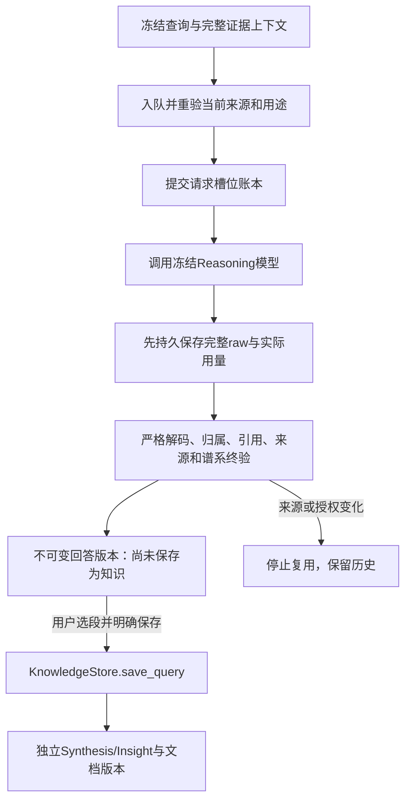

# ADR0023：有据 Query、持久请求槽位与显式保存阅读知识

日期：2026-11-04（Asia/Shanghai）。状态：Q05～Q07已实现，Q08实际验收另记[本轮报告](../p4-query-verification-20261104.md)。继承[ADR0018](0018-query-wiki-and-obsidian-lifecycle.md)和[ADR0022](0022-query-foundation-and-versioned-context.md)，不启动P5。

## 问题与边界

Q01～Q04已经提供项目级检索、图谱支撑扩展和版本化来源上下文。继续开发需要把它们接入真实全局Reasoning模型，同时保证默认问答只写执行记录；只有用户选择保存，才形成可复用阅读知识。跨篇回答不得挂到第一篇论文，模型输出也不能成为作者的新Claim。

软件必须区分“来源身份、引用和坐标校验通过”与“科学结论正确”。模型对内容的理解、归属与完整性仍需要实际评价；结构校验不是科学事实认证。

## P07运行传输与程序身份

新增独立运行模板`P07_query_grounded_v1`及`query-grounded-semantic-1`，不改参考P07/P08文件或R5的P02/P12/P13冻结协议。[运行DTO](../../services/engine/researchgraph/query_answer_contracts.py)和[wire规则](../../services/engine/researchgraph/query_answer_wire.py)生成输出Schema及Prompt规则，调用前校验Prompt标记和Schema哈希，冻结输入、模型配置、Prompt、Schema与manifest。

模型只输出`passages`和`limitations`；段落只有正文、归属、请求内`source_refs`和限制。S短编号来自已有`query-context-1`清单，正式回答版本、A段落编号、数据库ID和证据坐标由程序绑定。模型没有SQL、Shell、文件写入或外部浏览能力，论文、表格、Wiki和笔记中的指令均是不可信数据。

严格JSON拒绝重复键、NaN/Infinity、未知字段和请求外引用。科学段落必须回到论文根证据；`user_view`必须引用获本次用途授权的笔记根，并与科学段落分开。跨论文或AI综合保持`model_synthesis`；候选中的被引作者归属不能被改作本论文作者主张。题名只能提供元数据，不能独立支持科学结论。独立Annotation引用仍未接入Query，不能把已有批注导入等同于已完成该来源适配。

Provider沿用冻结的严格/JSON/Prompt输出策略。兼容接口的连接成功或可用Token容量不代表严格Schema能力；不付费探测，不自动降级后重发。准备、入队、实际请求前、收到响应后、读取回答和首次保存均重新终验来源、权限、模型及原始响应谱系。

无原始证据或已知容量不足时，程序产生带原因的`insufficient`结果，新增模型调用为0；保留完整支撑组，不切掉表头或必要条件。模型没有可支持段落、或上下文本身存在覆盖缺口时，保留不足状态，不能借非空段落冒充完整答案；非空回答仍可有明确限制，不能据此推断覆盖完备。未通过终验的中间文本不作为可保存回答。

## 发送前持久账本与恢复

Query使用统一Job调度，新增类型`query_answer`。用户必须明确允许网络发送，原始请求的`purpose`也须为`model`；仅本地搜索不能顺带发出模型请求。项目级`QueryModelRun`记录完整多源manifest，旧单篇ModelRun和抽取历史保持。

每个Query最多两个已发送槽位，初次执行只获一个；失败后只有明确“继续”才可使用第二个。槽位在网络I/O前提交，超时、中断或未知供应商接收情况同样占用；重新运行同Job不重发已发送槽位。该保守规则可能放弃一次实际上未送达的请求，但能避免软件不确定状态下反复收费。

完整raw已收到但发布前崩溃时，继续先做全部终验，合格响应可零调用恢复。存在完整raw不等于一定可恢复：非法JSON、字段、引用或归属不能反复作为成功缓存；两个槽位都无合格响应时停止追加调用。来源、权限、解析或冻结协议冲突不属于网络重试，须重新准备上下文。旧Job、raw、实际Token和未知金额保留；来源变动只登记复用诊断，不把原本合格的响应改写为模型格式错误。

运行阶段复用现有`reasoning`，完成后阶段为空，保持通用JobView兼容。通用Job“重试”和Query“继续”共用上述入口；幂等返回重载实际后继Job，不能把缓存中的`queued`当成后继当前状态。取消前未发送则无槽位，发送后的取消不释放槽位或自动重试。

## 明确保存与P08决策

当前保存是已终验段落的确定性复用，记录`transformation=validated_passage_copy`、`model_calls=0`。复制不需要模型再生成同一段正文，因此不新增收费P08请求；未来若加入真正的提炼或改写，必须另建版本化运行契约、模型记录和调用预算，不能静默复用本决定作为模型写入权限。

`KnowledgeStore.save_query`是用户保存入口，绑定项目、来源Query、不可变答案版本、所选段落、输入哈希和目标基线。拒绝草稿、不足或坏答案、跨项目、失效来源和无权限资料。首次保存重验P07原始输出与绑定后答案；保存后不修改原答案、模型raw、论文Claim、科学关系、核心选择或布局。

迁移0013只新增`query_saved_knowledge`：稳定Synthesis/Insight身份、来源Query/答案、对应内部文档版本、选段、根依赖manifest、幂等指纹和图修订。默认新建`synthesis`文档，`insight`仍保持独立知识类型；不是伪造Paper，也不新建平行知识库。

相同答案、选段集合、kind和明确目标去重，不因点击顺序、换幂等键或断线重试重复写知识。幂等键复用于不同请求则拒绝。成功保存只推进一次GraphRevision和`QUERY_KNOWLEDGE_SAVED`事件；普通搜索、生成、取消、权限扫描和历史读取只写派生/执行/审计数据。

显式选择现有Wiki/综合文档时必须给当前保存基线，只追加已验证段落并生成新不可变版本，保留原段落和旧版本。文档包装依赖展开到chunk/evidence/node/note根，原passage版本、hash和来源引用保存在lineage中。同Wiki追加不会让新保存因文档head变化立即失效或产生循环自证。已经成功的幂等重放重验保存对象的根依赖、权限及冻结答案/raw谱系，不因本次追加改变源文档head而再次追加或发模型请求。

新保存的node依赖同时绑定revision、原文hash与`payload_sha256`，后者检查语义payload，即使错误写入未递增revision也不能继续作为有效依据；旧文档wrapper穿透后的node同样补冻此值。该字段只允许node，旧无字段依赖保持可读，空值不进入序列化以保留历史文档请求hash。读取、派生索引和幂等回放共用重验；不追改历史行或增加数据库迁移。

此操作不调用P10/P11，不整理主题、不重写既有Wiki正文、不渲染或发布Markdown。外部文件写入、可靠发布和Lint留在P5。

## 查询页面与独立衍生图层

项目新增问答入口，提供本地命中预览、论文范围、独立个人资料开关、明确网络授权、生成/取消/继续、逐段引用、限制和实际调用/Token/未知金额。Query历史是执行记录，与已保存知识区分；来源面板展示必要片段、页码/区间、内容/文件状态、原文或Zotero入口，不铺满整篇解析文本。

已保存对象仍从同一文档/来源适配进入检索。独立衍生图层显示保存对象到根来源的`DERIVED_FROM`引用，标`epistemic_status=derived_reference`；不将这些线变成科学支持关系或论文核心。图层隐藏只改变显示，不能让已保存知识从检索中消失。个人来源撤权穿透答案缓存、保存回放、索引和衍生图层，历史保留不等于继续授权。

## 验收边界

迁移与故障注入使用隔离合成库，先备份；0012旧列/行、Query/raw历史和旧来源保持，重复启动不多次迁移。实际API集成覆盖HTTP入口、完整P07 raw终验、保存/检索/重启、超时两槽位、取消、非法响应、跨项目、来源变化、稳定历史分页和笔记用途撤销。界面、真实模型、性能、打包宿主和用户原生反馈分别记录，不能相互替代。

离线Provider只验证执行和契约；实际回答语义、归属与科学质量仍由真实验收限定。大库性能、真实strict、复杂PDF、跨平台/干净机及不可用的外部补充原文按实际报告保留限制。P5尚未启动。

## 真实验收触发的召回与性能修正

显式多论文范围不能由单篇高相关结果独占：新lexical-graph-scoped-2先为各选中论文保留最高相关真实命中，再补原排名；没有匹配不伪造，limit不足不暗增上限。scope_coverage在上下文中按实际chunk/evidence根重新验证，题名和个人笔记不算论文科学覆盖，缺论文则明确不足且零外发。旧检索快照无该字段仍保持原manifest/hash，不重算旧排序、原raw或已保存答案。

可重建FTS采用项目内分批删除/批量插入，权威行缺失时也清理撤权孤儿FTS；不让派生索引保留旧私人正文。单次同步retrieve局部显式复用已验证候选，下一次调用仍重验，不跨事务缓存；合法边/根证据/seed/scope继续校验。独立reindex保留完整fingerprint诊断，普通retrieve省去未使用的大JSON诊断哈希。优化不删除必要支撑，性能与复杂分布限制见实际报告。
