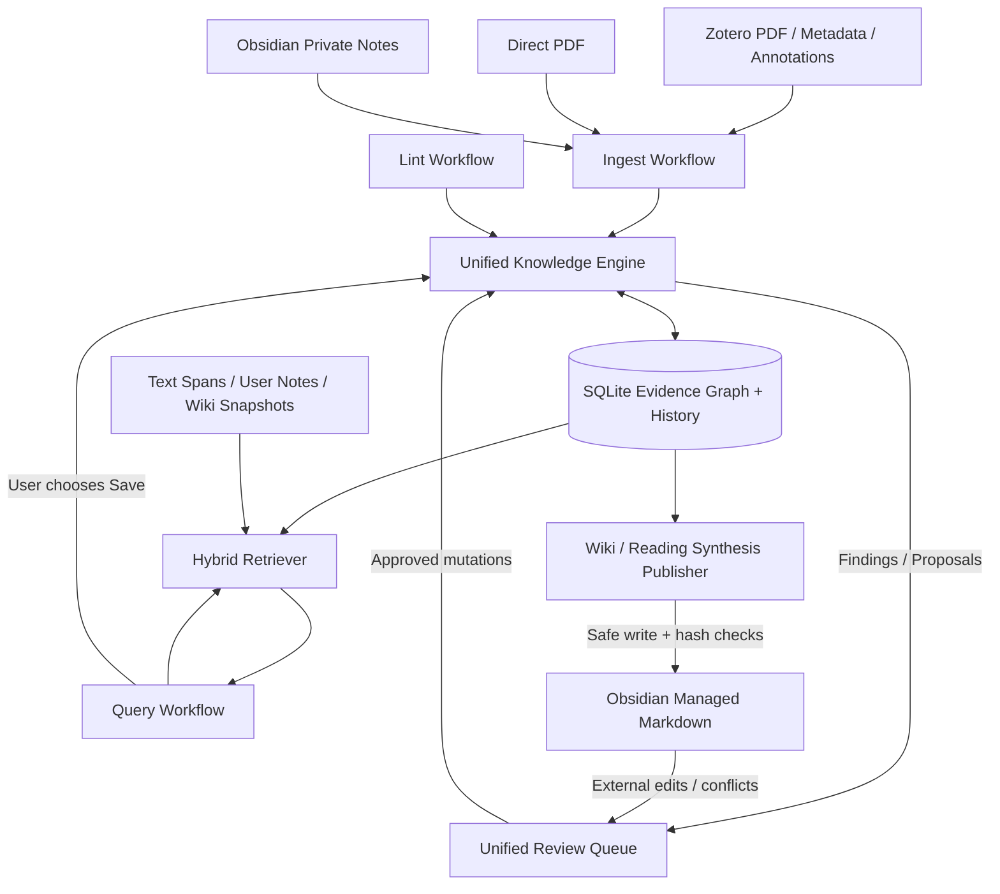
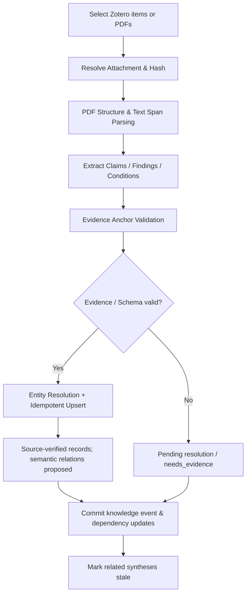
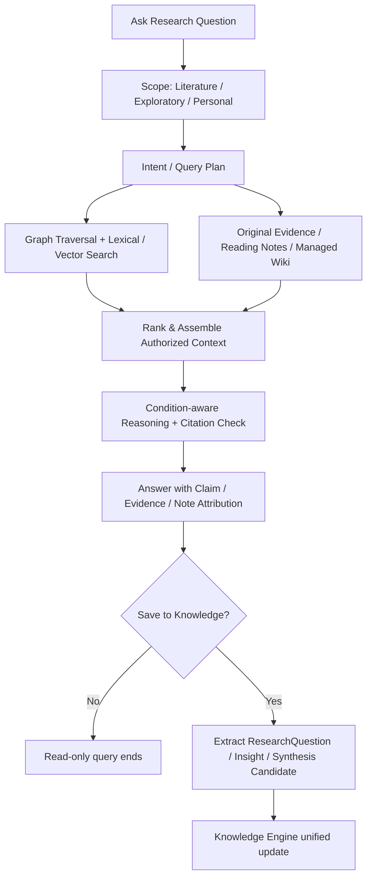
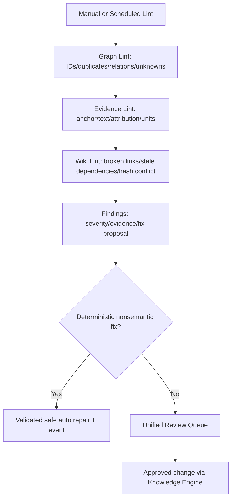
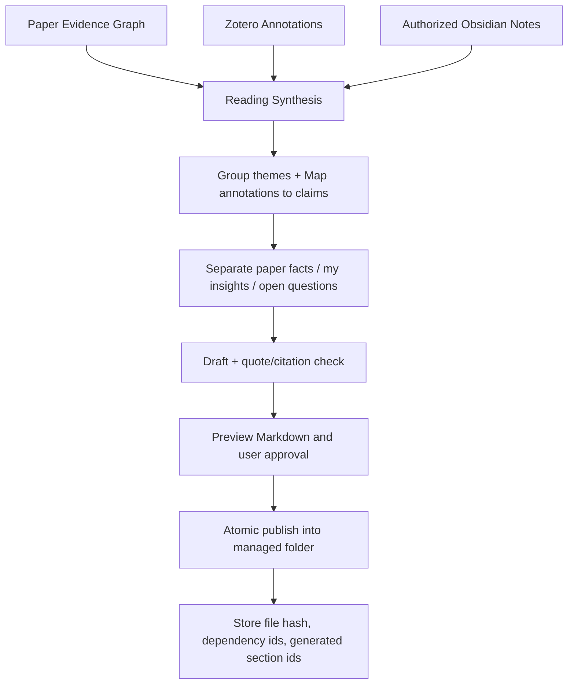

# ResearchGraph Studio 产品设计说明书

> 历史归档（2026-11-02）：v2 设计包已由 [v3 规范包](../../README.md)接替。下文保留当时设计、指令模板及实施语境，不作为当前施工指令；现状见[实施进度](../../progress.md)。

> 版本：v2.0（2026-11-01）
> 状态：设计基线，供 Codex 按阶段开发；尚不代表功能已实现
> 核心定位：Graph-Centric Knowledge Lifecycle / 图谱驱动的科研知识生命周期
> 首发：Windows 10/11 x64 本地优先桌面应用
> 配套文档：`02_development_plan.md`、`03_knowledge_schema_and_prompts.md`

## 1. 执行摘要

ResearchGraph Studio 不是另一个“PDF 聊天助手”，而是一个让研究者**把论文及精读批注转变为可追溯的科研知识图谱，并在查询、比较和知识审计中持续形成高质量研究认知**的本地科研工作台。

**本次架构决策（取代旧版三引擎设计）**：

- 将原 Knowledge Extraction Engine、Knowledge Evolution Engine 统一为 **Knowledge Engine**；其中包含 Extraction、Resolver、Reasoner、Auditor、Knowledge Store、Dependency Tracker。它们操作同一份规范知识模型和事件日志。
- **Ingest / Query / Lint 是使用 Knowledge Engine 的三种工作流**，不是三套分别保存知识的引擎。
- Ingest **不设重复的第二道审核门禁**；统一写入策略为机器可验证的来源对象自动写入，LLM 语义推断以候选状态写入；覆盖已确认结论、危险实体合并、删除证据等操作需要审查。
- Query 默认只读。用户点“沉淀知识”后，才将综合结论、研究问题、用户观点等送入统一 Knowledge Engine。
- Lint 以**图谱审计为主**、原文证据校验和 Wiki 一致性检查为辅；审计发现只产生问题/修订建议，不直接更改科学性结论。
- Obsidian 是**精读笔记与生成的长文本知识视图**，不保存 PDF，也不充当结构化科学事实的第二个权威数据库。

### 1.1 目标用户与核心价值

| 用户 | 任务 | 直接价值 |
|---|---|---|
| 正在开始新研究方向的研究生 | 读懂多篇论文、整理方法与差异 | 用图谱连接论文中的 Claim、Evidence、Method、Condition |
| 已积累大量文献的研究者 | 对比实验结论、回溯依据 | 条件化对比与原文锚点，减少“看起来矛盾”的误判 |
| 长期维护科研 Wiki 的用户 | 将精读、提问、心得长期积累 | 知识增量更新、可审阅 Wiki 生成与过期检测 |
| 进行算法实验的开发者 | 对比抽取、推理、更新策略 | 固定数据集、模型配置、结果与错误案例，支持复现 |

### 1.2 非目标（第一版）

- 不制作新的 Zotero；不把原始 PDF 复制进 Obsidian；不修改 Zotero 原始数据库。
- 不自动证明论文结论的科学真实性，不保证发现真实的新知识或独创新假设。
- 不把 Query 的自由生成文本自动写作“已确认事实”。
- 不自动重写用户精读笔记；不允许 Agent 绕过状态控制直接改数据库。
- 不引入完整 Neo4j、自治多 Agent 集群、MCP 基础依赖、全量网络学术搜索和复杂 OCR。
- 不强制随安装包分发大模型权重；离线查看/维护图谱与AI离线推理是不同能力。

## 2. 角色分工与数据所有权

| 系统 | 权威内容 | ResearchGraph 对其权限 | 交互 |
|---|---|---|---|
| Zotero | 文献条目、Collection、PDF、Zotero 高亮及批注 | **只读**；使用本地 API，获授权后访问 PDF 附件 | 选择文献、读取增量、回跳原文 |
| ResearchGraph | 文档解析结果、证据锚点、科研图谱、知识状态、审计与演化事件 | 本地 SQLite 事务化写入 | 抽取、对比、探索、问答、质量维护 |
| Obsidian | 用户精读笔记、私人想法、个人研究目录 | 用户笔记默认**只读**；仅允许写入用户指定的生成文档目录 | 导入批注、导出精读综合与 Wiki |
| LLM Provider | 计算服务（不拥有事实源） | 仅接收最小必要的授权文本与 Schema | 结构化抽取、条件判断、证据综合 |

**入口**：默认 Zotero 本地 API + 读取本机附件；备用拖入 PDF；未来 MCP 是扩展接口，不是 Ingest 的必需依赖。必须适配 Zotero 未启动、没有 PDF、附件移动、权限不足和文件未同步等失败情形。

## 3. 统一知识生命周期与系统边界



**设计解释**：图谱不仅是“节点-边”，还必须保存原文段落、批注、证据锚点、知识作者、模型调用记录、审核状态、来源依赖和版本。**Wiki 是图谱与个人理解的长文本表达视图**，不是取代图谱的事实来源。

## 4. 首版业务流程

### 4.1 Ingest：论文/批注 → 自动入图



**规则**：识别“作者在论文中如此陈述”可以自动入库，*不等于认可其科学真实性*。多论文 `SUPPORTS` / `CONTRADICTS`、语义合并和需要改变已审核结论的修改，必须标注候选状态或走统一审核。PDF 解析质量差时拒绝“伪造页码”的补救方式。

**用户可见反馈**：任务进度、成功/失败论文、原文定位率、候选 Claim 数、待校验数量、调用成本、错误重试入口。

### 4.2 Query：Graph + Source + Notes + Wiki



**回答必须**：区分作者原文、系统推断、用户观点；为论文性陈述提供 `claim_id` 与 `evidence_id`；证据不足直接说明。默认只读，不暗中修改图谱或文档；保存知识需用户动作。

### 4.3 Lint：图谱 → 证据 → Wiki



Lint 使用与 Ingest 一致的 Schema、证据锚点和 Reasoner，不再开发第二套“语义评判模型”。但**Markdown 文件一致性**仍需单独检查，因为用户可能从 Obsidian 修改生成页面。

### 4.4 Reading Synthesis：精读总结沉淀



**产物**：精读综合报告作为独立 Markdown（例如 `Research/Paper-A-Synthesis.md`），私人 `Literature/Paper-A.md` 保留原样；跨论文 Wiki 放 `Wiki/`。生成文档与图谱通过稳定 ID 建立依赖；外部手动编辑时触发 diff/冲突，不覆盖。

### 4.5 Wiki演化：不是简单增加页面

- **知识融合**：同义概念对齐、比较研究方法、条件化形成知识联系。
- **知识修正**：新增证据触发旧结论/综合段落的 staleness 标记，不隐式覆盖已审核知识。
- **知识综合**：把稳定子图、研究问题和用户 Insight 转化为概念页、方法对比页、研究进展页。
- **版本**：节点、关系、综合段落保留 `revision` 与依赖；新文献只分析受影响范围；重要语义变更生成 diff 并经审核发布。
- **术语**：这里的“自进化”指外部知识结构与综合文档可追溯地变化，不涉及模型权重自我训练。

## 5. 信息架构与五个主工作区

### 5.1 Workspace — 科研工作区

**目标**：用户明确项目边界、文献来源与当前知识健康状态。

- 创建/切换Project；研究问题、描述、领域扩展版本。
- 连接Zotero状态（连通、无权限、未启动）、Collection树、导入任务和直接PDF导入。
- 项目仪表盘：论文、抽取成功、待核验证据、候选关系、Lint问题、待更新Wiki、成本。
- 模型配置、隐私同意、Obsidian管理路径与读写范围。

**交互验收**：10篇文献导入时可追踪逐篇状态；断开Zotero不影响已入库图谱浏览。

### 5.2 Paper & Reading — 论文与精读

三栏：左侧章节目录/批注过滤；中部PDF或Zotero回跳 + 原文高亮；右侧Claim/Method/Finding/Condition卡片。

- 点击 Claim → 原文 evidence span（页码、坐标或文本范围）；原文定位失败显示“待修复”，不可伪造。
- 概念/方法/结果的人工修订；“这是作者转述他人”归因标注。
- 批注导入：高亮、评论、所在原文范围与用户 Insight 分离；允许在 UI 中编辑映射。
- **生成精读综合**：研究问题、核心机制、实验设置、原文证据、批注主题、个人理解、未解决问题、跨论文联系 → 预览 → 保存到Obsidian指定目录。

**边界**：不代替完整Zotero阅读器；允许打开原文并定位证据。

### 5.3 Knowledge Explorer — 图谱与条件化比较

- 默认研究问题中心子图，不默认渲染全库所有节点；可切换 Paper / Concept / Argument / Evolution 视图。
- Claim Comparator 两侧选择主张，按方法/任务/规模/数据集/指标/基线/单位比较；每个判断回链证据。
- 两步判定：可比性（comparable/limited/not_comparable/unknown）→ 关系类型（SUPPORTS/CONTRADICTS/QUALIFIES/EXTENDS/RELATED 或 NO_DECISION）。
- 候选关系可保存为 `proposed`；不可强制把 `NO_DECISION` 写成科学关系边。
- 子图过滤：可信状态、论文年份、方法、可比性、证据质量、与当前研究问题的关联。

**验收**：两篇真实PDF可抽取主张并完成一次可证据回查的条件比较。

### 5.4 Research Assistant — 科研问答

- 问题输入与 3 种检索范围：`literature_only`、`research_exploration`、`personal_recall`。
- 回答分区域：回答要点、证据与不确定性、对比矩阵、关联图谱、引用来源、来源的归属类型。
- 支持选择“保存为 ResearchQuestion / Insight / Synthesis / Markdown”，而非每个问答自动入库。
- 支持无图谱命中时回退原文全文检索；用户笔记范围未经授权不可使用。

**验收**：文献证据模式输出不引用用户笔记为科研事实；无足够证据时拒绝伪造引文。

### 5.5 Knowledge Maintenance — 知识维护

- 统一审核列表：候选关系、证据错误、概念合并、更新提案、Wiki冲突。
- Lint视图：Graph / Evidence / Wiki 按风险筛选，点击定位受影响实体。
- 演化时间线：触发事件、修改人/模型、原因、依赖、前后版本、撤回/恢复入口。
- Wiki发布队列：段落级 diff、变更原因、依赖图谱版本、文件哈希冲突恢复。

**验收**：语义修改未审核时不覆盖 `accepted` 的旧知识；用户编辑过的Obsidian文件不会被静默覆盖。

### 5.6 Experiment Lab（研究模式，非主导航）

- 数据集注册、人工标注导入、冻结文档/Schema/模型与Prompt版本。
- Baselines：自由抽取 vs Schema+证据对齐；直接LLM分类 vs 条件化推理；全量 vs 增量更新。
- 原始预测、置信区间（视样本规模）、错误案例、Token/成本/耗时、安装打包测试。

## 6. 操作原型（文本示意）

```text
┌───────────────────── ResearchGraph Studio ───────────────────────────┐
│ Workspace  Paper & Reading  Knowledge  Assistant  Maintenance         │
├──────────────┬────────────────────────────────┬─────────────────────┤
│ Collections  │  Evidence graph / PDF / Chart  │  Claim detail       │
│ Papers       │  (context-dependent main area) │  Evidence anchor    │
│ Questions    │                                │  Condition compare  │
│ Filters      │                                │  Status / Actions   │
├──────────────┴────────────────────────────────┴─────────────────────┤
│ Running jobs · Ingest 3/5 · Evidence warnings 2 · Wiki stale 1        │
└─────────────────────────────────────────────────────────────────────┘
```

**关键交互**：节点→证据→PDF、问题→回答→引用、精读→总结→Obsidian、Lint→问题→修复diff、Wiki→依赖→受影响Claim。

## 7. 统一数据、状态与权限

- **SourceVerified**：证据锚点和原文存在，可自动持久化；不等于科学有效。
- **Proposed**：LLM判断、合并、跨论文关系、AI综合的候选。
- **Accepted / Rejected / NeedsReview / Superseded**：用户或授权审核者明确决定；保留事件记录。
- **科学语义风险**：覆盖已接受主张、重要数值修改、关系类型改变、实体不可逆合并、证据删除 → 人工审核。
- **低风险自动化**：确定性的去重、索引修复、坏链接检测、stale标记、未审核候选写入。
- **强制溯源**：论文性Claim→至少一条锚定Evidence；AI跨论文断言→列出两侧主张+来源证据；用户观点独立标注身份。
- **隐私**：本地存储默认；云模型传输需用户配置且页面明确提示；不给模型传递未经授权的整个Vault或API密钥。

## 8. 稳定性、可靠性与可复现性

| 质量属性 | 设计要求 |
|---|---|
| 安装可用 | Windows全新机器不需要Python/Node环境；Sidecar随应用打包；启动/退出正常 |
| 离线查看 | 没有Zotero/网络/API时已有图谱和Wiki列表可浏览，允许手动编辑状态 |
| 幂等导入 | 同一 `(source_id, attachment_hash, parser_version, extraction_version)` 不无故重复产生对象 |
| 引文可靠 | 支持原文段落偏移/页码验证；无锚点时显示未知/待核验，不生成虚构页码 |
| 查询引用 | 所有声明的证据ID来自实际召回集合；超出集合的模型输出直接校验失败 |
| 可恢复发布 | Markdown先生成临时文件、检查目标hash，再原子替换；失败重试不生成多份 |
| 并发冲突 | Wiki发布对文件hash进行乐观检查；图谱变更携带expected_revision |
| 评测透明 | 保存语料哈希、模型名称、Prompt版本、参数、schema版本、输出及错误报告 |
| 性能 | 10~30篇英文CS PDF为MVP基准；长任务异步队列且界面不卡顿（具体指标靠实测） |

## 9. 关键风险与应对

| 风险 | 可能的错误 | 对策 |
|---|---|---|
| PDF解析错位 | 数字、表格、页码不对 | 保存块坐标和原文版本；低质量页人工修复；首版不宣称可靠理解复杂图表 |
| 错误归因 | 引文被认为是作者实验证据 | 增加 claim_origin（own/cited/background）和证据角色 |
| “假矛盾” | 任务/指标不同却判断CONTRADICTS | 可比性先于关系判断；不能比较则NO_DECISION |
| 知识污染 | Query把幻觉保存为事实 | Query只读默认，保存为candidate，证据校验与审核分类 |
| 两份事实库 | Wiki与图谱互相覆盖 | Graph为结构化权威、Wiki为有依赖的表达视图；检测外部变更 |
| 导入不一致 | 同一论文多份/新版PDF | 稳定来源ID+附件hash+版本与项目关联；保留历史引用 |
| Agent过度自治 | 自动改Schema/用户笔记 | Schema需审批和迁移；私有笔记只读；限制文件访问路径 |

## 10. 验收场景与首个端到端闭环

**MVP必须走通：** (1) 选择Zotero真实论文及PDF和批注；(2)解析与锚定Evidence；(3)抽取Claim/Method/Finding/Condition；(4)结构校验并分类入图；(5)结合批注生成独立精读总结；(6)预览并保存Obsidian授权目录；(7)Query可以联合查到图谱、原文、精读成果；(8)下一次导入/批注更新后能报告总结失效及依赖影响。

**创新闭环扩展：** 再导入第2篇论文 → Claim Comparator条件化推理 → 生成候选关系 → 审核 → 更新跨论文Wiki → Lint检测与演化日志可回放。

## 11. 研究验证

- **RQ1 证据抽取**：自由LLM抽取 vs 约束Schema+原文对齐。Precision/Recall/F1、锚点准确率、错误归因率。
- **RQ2 条件化推理**：直接LLM关系分类 vs 比较实验条件+证据约束。Macro-F1、错误冲突率、NO_DECISION识别能力。
- **RQ3 演化效率**：全量Wiki重写/全图重算 vs 依赖索引局部更新。时间、调用Token、受影响关系召回率、错误覆盖率。
- **RQ4 用户价值（可选）**：传统PDF笔记/总结 vs ResearchGraph，在相同任务下比较任务正确率、用时、证据核验行为。

目标阈值仅可作为产品管理指标，不能当作实验已证实的研究结论。必须保留负结果与失败样本。

## 12. 设计参考

- Zotero Local API: https://www.zotero.org/support/dev/web_api/v3/local_api
- Tauri 2 Sidecar: https://v2.tauri.app/develop/sidecar/
- PyMuPDF: https://pymupdf.readthedocs.io/
- Microsoft GraphRAG: https://microsoft.github.io/graphrag/
- Karpathy LLM Wiki（设计参考，不能等同于可验证科学推理）：https://gist.github.com/karpathy/442a6bf555914893e9891c11519de94f

> 若产品设计与旧版 `development_plan.md` 冲突，以**本次 v2.0 三份文件**及后续经明确批准的ADR为准。
