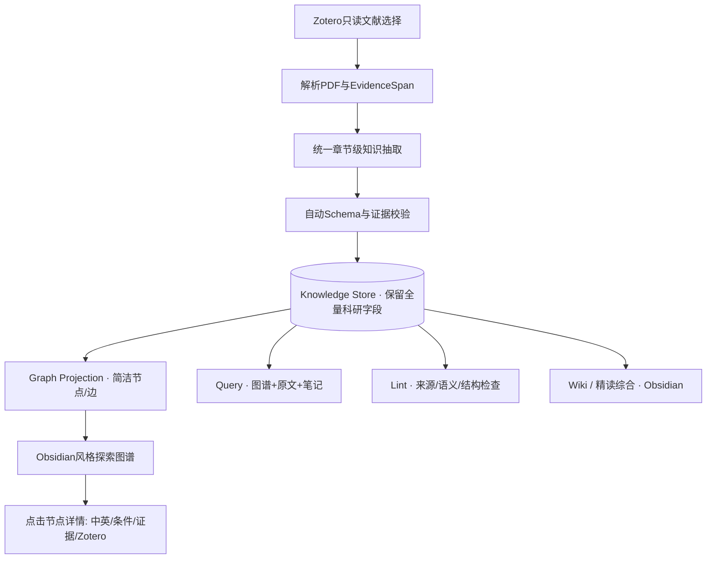
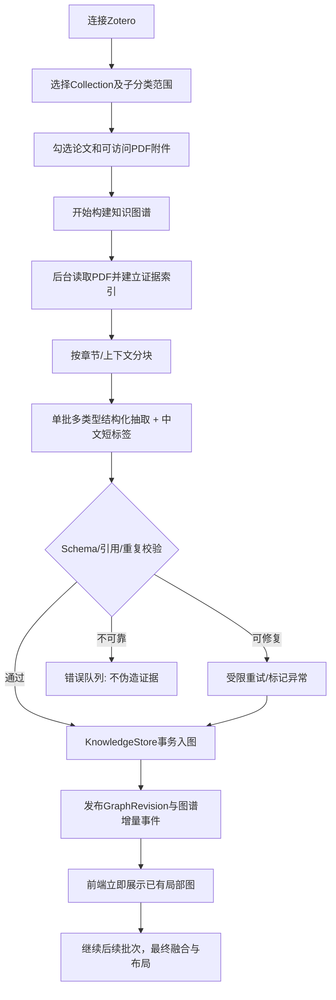
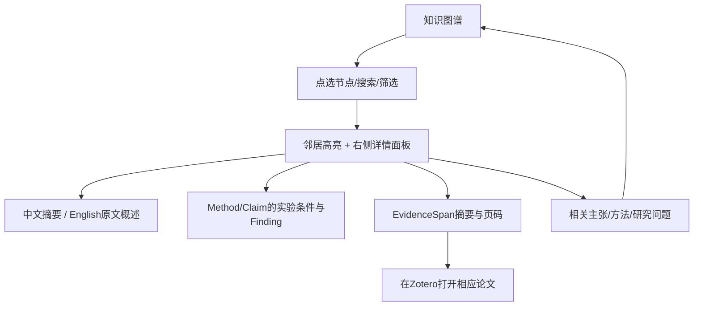
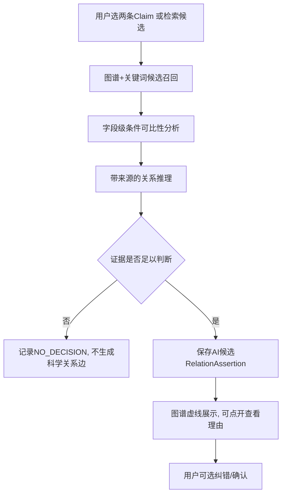

> 历史 v3 平铺图谱设计，已由当前 [阅读辅助设计](../../README.md)取代；不作为新实现要求。

# 01 — ResearchGraph Studio 产品设计说明书（v3）

## 1. 产品愿景

一款面向中文科研工作者的本地优先、论文证据可追溯的知识图谱工作台。研究者选择Zotero中的论文后，应用自动生成**短标签、可拖动、可探索的科研知识网络**；点击节点查看完整中英对照、研究条件和来源证据。随着新文献加入，图谱持续扩展；未来Query/Lint/Wiki复用此知识底座。

**一句话体验**：选择论文 → 开始建图 → 在图谱中探索 → 点击节点回溯科研依据。

## 2. 目标用户与典型场景

- 正在建立领域知识体系的研究生：快速理解多篇论文的研究问题、方法和主张。
- 在某一细分领域持续追踪文献的研究者：从不断更新的图谱中发现术语、方法和结论关系。
- 中文读者：用中文标签浏览，用英文原文与论文来源核验。
- 算法研究人员：保留Schema、提示词、模型参数、抽取批次、证据链和错误数据，开展可复现实验。

## 3. 主要信息架构

**重点**：图谱是长期科研知识的交互入口，PDF全文与Zotero元数据不占用主工作区大面积界面。

## 4. 核心流程一：从Zotero自动建图

用户不需要先进入Review Queue。真正失败的批次以状态和重试入口呈现。已完成批次可即时浏览。默认“只建索引”或“索引+模型抽取”的费用行为须明确。

**最少UI步骤**：项目 → 选择Zotero论文 → 选中“构建知识图谱” → 进入图谱。重复打开项目，直接看到上次图谱，未完成任务可继续。

## 5. 核心流程二：图谱探索与详情回查

默认节点五类：Paper、Concept、Method、Claim、ResearchQuestion。详细子实体仅在节点详情或“展开实验细节”中出现。点击边显示关系类型、证据依据、AI状态及推理限制。

## 6. 核心流程三：跨论文条件化推理（Phase 3基础）

不同任务类型/评价指标不能默认构成直接冲突。RelationAssertion中保存Comparability、Evidence、ModelRun、状态及知识版本。用户可选择不审阅，仍能探索候选关系。

## 7. 后续生命周期（不抢当前自动建图主路径）

- **Query**：默认检索已持久化的图谱+原文证据+经授权的Obsidian笔记+Wiki派生知识；回答用引用和状态分层，用户主动选择沉淀Insight/Synthesis时才写图。
- **Lint**：基于图谱Schema、证据锚点、重复实体与旧的AI推断做审计；可自动修复可确定错误，科学语义修订保留候选状态。
- **Wiki / Reading Synthesis**：按图谱节点依赖生成中文/英文术语、研究方法、争议和开放问题的Markdown综合；精读批注产出单独报告到Obsidian授权目录，不覆盖用户原笔记。
- **Evolution**：新增论文触发依赖分析和局部推理、增量图谱更新；不是重新生成每个Wiki文件。图谱作为唯一结构化知识权威库。

## 8. 软件页面重新划分

| 页面 | 用户主要操作 | 去除的冗余内容 |
|---|---|---|
| Workspace | 项目、最近图谱、处理中任务与错误 | 欢迎宣言、长介绍性卡片 |
| Sources | Zotero分类、PDF勾选、选择建图范围 | 复制原始PDF到本地库的强制步骤 |
| Graph Explorer（默认核心） | 自由拖动、查看节点、搜索、过滤、布局保存 | 大量原文解析块和繁琐审核表单 |
| Node Inspector（侧栏） | 查看双语描述、实验条件、证据和Zotero链接 | 强迫用户在建图前逐一确认 |
| Claim Comparator | 条件字段对照、候选关系理由、来源引用 | 纯自然语言“有矛盾”黑箱结论 |
| Tasks | 进度、已完成批次、错误重试、费用使用 | 无法恢复的一次性长任务 |
| Settings & Diagnostics | 模型配置、Zotero、Obsidian、日志、布局偏好 | 应固定于导航左下方 |

### 首页布局原则

主操作入口优先；项目列表、正在运行的任务、最近图谱作为内容；不用大型宣传卡片。左侧导航支持折叠，折叠后只保留图标+悬浮提示；设置项始终在底部。

## 9. 文献阅读策略

ResearchGraph不充当PDF阅读器：默认只显示论文标题、状态、抽取结果和可选的简短Evidence片段。阅读原文通过Zotero跳转；不能确定Zotero页内定位时只打开附件并显示应用内页号提示，绝不能伪称精确跳转。解析器内部保留页码/段落/规范化偏移，保证可核验。

## 10. 中英双语

- 图谱节点中文优先，提供切换中文/英文/双语；默认短中文标题（建议约4–18个汉字或同等宽度；过长按视觉折行或省略，详情保留全文）。
- 英文主张与真实证据原文不经翻译覆盖；译名、摘要、关系解释分别作为可重新生成的派生字段。
- 专业词汇可使用领域词表/已选规范实体，不一致翻译进入Lint提醒，不能凭译名相似直接合并实体。
- 原文证据与中文翻译在详情中相互对应，但中文翻译不是原始证据。

## 11. 非目标与质量边界

不在第一版承诺高精度公式、扫描文献OCR、全面图表证据、无需人工校验的科学真实性；明确PDF文本解析/附件来源限制，记录解析失败，并提供人工纠错入口但不强制每个节点审核。
