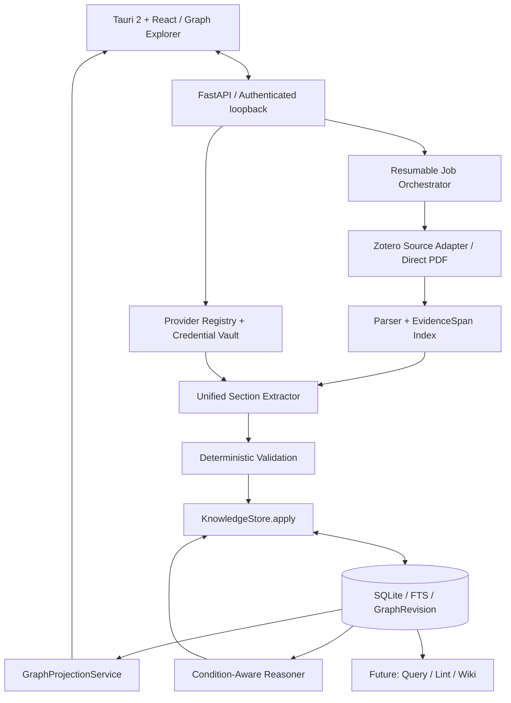
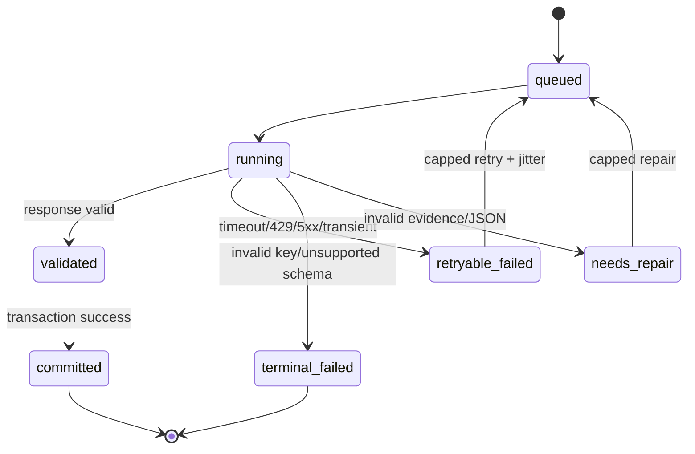

> 历史 v3 平铺图谱设计，已由当前 [阅读辅助设计](../../README.md)取代；不作为新实现要求。

# 02 — 系统架构、数据管道与运行时规则

## A. 模块边界



**实现边界**：Parser负责源文本与定位，LLM仅负责语义理解，Validator负责格式/存在性/锚点，KnowledgeStore负责事务/幂等/事件，Projection负责外观，Frontend负责交互，不能把这些职责混在某个React组件或Prompt里。

## B. Zotero读取与所有权

1. 本地API `http://localhost:23119/api/` 只读获取Library、Collection、item、attachment信息；本地只读无需API Key，用户需启用Zotero通信权限。读取附件可调用文件定位接口，视附件类型判断文件存在且为PDF。
2. 在可获取时记录`zotero_server_id`、`library_id`、`item_key`、`attachment_key`、`local_version`、`source_file_hash`。同一item key在不同server/library下并非同一论文身份。
3. 对PDF使用读取时快照的一致性检查：先取得hash和大小，解析完成后复验hash；源变更则生成新DocumentVersion、保留旧证据，不在原Version上直接改偏移。
4. 应用不长期存储PDF副本；解析文本/章节索引按存储策略保留在应用数据库用于证据回查与增量任务。支持清理原始长文本缓存后按需重建；若Zotero附件已离线/移动，标记`source_unavailable`并保留知识历史。
5. Zotero附件打开只做应用内安全调用；若系统只能定位文献或附件而不能保证目标页跳转，向用户展示“PDF第N页”，不要声称自动打开该页。
6. 直接PDF是备用来源，只有在用户主动选择时引用源文件路径或授权复制；遵守原有文件权限边界。

## C. “更短”但不牺牲正确性的自动抽取

**推荐主路径**：解析全文结构（可选P01）→ 按章节/段落分块 → P02一次产生Concept、Method、Claim、ResearchQuestion及其嵌套实验细节 → 程序校验 → 同批事务入图 → 增量发布Projection。P03统一实体候选可后台延后执行，P04补充不合规中文显示标签可按需调用。

- 章节优先分块，严禁因固定分块边界破坏表格/否定结论；每批传`allowed_evidence_ids`及原文文本。
- 对重复背景段落进行内容哈希去重；单次抽取不强制逐实体Prompt调用。
- 解析分块可以并行，但Provider并发和单项目同时任务数受到限制；返回结果按`chunk_index`和`input_hash`幂等合并。
- 支持在线“局部图谱”：每批成功可立即出现其节点/边；跨块融合时通过canonical node alias映射避免删除已渲染节点造成闪烁。
- 特殊情况（跨页实验表格/引用失配/语言标签缺失）允许专用修复任务；修复失败时不伪造源信息。
- `estimated_tokens`基于Provider能力与模型上下文预算计算；输出上限由模型能力元数据自动确定，未公布时省略限制参数并使用服务默认；输入按内部有界预算合并，不设置“一篇论文必须一次完成”规则。

## D. KnowledgeStore自动入图策略

| 输入 | 自动检查 | 图谱可见性 | 写入后的状态 |
|---|---|---|---|
| 有有效EvidenceSpan的论文Claim/Method/Concept | Schema、允许引用ID、Span哈希、局部引用合法 | 立即可见 | `epistemic_kind=source_reported`, `source_status=anchored`, `review_status=unreviewed` |
| Evidence不完整的知识 | Schema及可用证据、错误原因 | 默认隐藏或在诊断视图可见 | `source_status=needs_evidence` |
| 实体对齐建议 | 名称/别名/范围/证据一致性 | 默认保留两个节点，用弱关联 | `alignment_status=candidate` |
| AI推导跨论文关系 | Claim存在、引用合法、可比性合规 | 虚线候选边；明确“AI推断” | `epistemic_kind=model_inferred`, `review_status=unreviewed` |
| `NO_DECISION` | 保存InferenceRun和原因 | 不创建科学关系边 | `decision=no_decision` |
| 用户修改/接受的关系 | 一致性检查、冲突检查与版本 | 适当更新线型与状态 | `review_status=accepted`或`edited`，保留历史 |

**重要**：用户审核不再是图谱展示的前置条件，但程序验证与来源状态仍是自动发布逻辑的一部分。不可因为展示简化而降低证据约束。

## E. KnowledgeStore.apply伪代码

```python
async def apply_extraction(batch, *, context):
    assert context.document_version_id == batch.document_version_id
    validated = validate_schema_and_allowed_evidence(batch, context)
    anchored, quarantined = partition_by_source_integrity(validated)
    async with db.transaction():
        ids = upsert_by_stable_fingerprint(anchored, context)
        write_graph_relations(ids, context)
        append_knowledge_events(ids, context)
        revision = increase_graph_revision(context.project_id)
        record_batch_commit(context.batch_key, revision)
        store_quarantined_issues(quarantined, context)
        enqueue_graph_outbox(revision, ids)
    return {"revision": revision, "committed": len(ids), "quarantined": len(quarantined)}
```

**稳定幂等键建议**：`sha256(project_id, document_version_id, parser_version, prompt_version, schema_version, provider_model_id, chunk_id, normalized_claim_or_entity_fingerprint)`；模型换版本可能生成候选新版本，旧知识不被静默覆盖。对于同一来源的概念跨块融合，应有`canonical_id`别名映射并维护历史ID。

## F. 分块任务失败、超时、断点续跑

2026-11-02 运行补充：新计划目标 8000 字符/64 条证据，旧计划保留；明确响应等待/读取或总时限超时只二分未拆根批一次，子批仍失败则停止，不原样连续重发。连接/限流/服务错误仍有界退避。记录发送结束、响应头、响应体字节和 timeout_phase 以区分来源。原始响应中的已知 null findings_placeholder 可在审计下移除，其他 Schema 与证据约束不变。见 [ADR 0007](../../adr/0007-extraction-null-markers-and-timeout-adaptation.md)。



- 记录任务`job_id`、`batch_id`、输入哈希、已提交revision、请求耗时、模型参数、Token使用量及错误类型。
- 区分连接超时、首Token超时、总请求超时、响应解析失败；并发上限与输入/输出Token预算按配置控制。
- 仅对幂等/无副作用任务重试；429按Retry-After和指数退避随机抖动；401/403/模型不存在需用户修正配置，禁止盲重试。
- **超时后的不确定请求成本**：超时后服务端可能已执行收费；重新发起前警示费用和潜在重复。仅已成功持久化批次绝不重新调用。
- 任务取消需先保留已完成批次，重新开始从未提交的batch恢复；如改变文档版本、Prompt或模型配置，明确是“重跑新版本”而不是继续旧任务。
- 前端通过Job事件流或轮询更新`completed/total`、`committed`, `failed`, `pending`和当前批次，避免“已保存1/7”但不解释问题。

## G. GraphProjectionService

从完整KnowledgeGraph生成限定范围内的视觉节点和边。默认针对当前项目或当前论文/问题返回邻域，支持`cursor`或`limit`，并按`GraphRevision`/过滤器作缓存键。

- 可见类型：Paper、Concept、Method、Claim、ResearchQuestion。
- 内部Experiment/Finding/Condition/Metric/Evidence引用不丢失；合并为`detail_ref`、节点属性、折叠计数等。
- 关系由合法源关系与有状态的RelationAssertion映射；不得由前端根据名称自动推测`CONTRADICTS`。
- UI状态`x,y,pinned,viewport`存入独立`graph_layouts`表，**不写KnowledgeNode属性**；用户拖动不构成科研知识更新，不增长GraphRevision。
- 渲染切换语言时只改变标签，不影响节点ID、关系、证据及布局。
- 节点很长时缩短显示标签，但不能直接缩短`statement_en`和证据quote。

## H. Query/Lint/Wiki兼容接口（后续Phase）

- Query检索`GraphProjection`不够；必须直接访问完整KnowledgeStore+Evidence文本+用户授权笔记+Synthesis，引用仍返回SourceRef。
- Lint在完整图谱与EvidenceSpan上检查，而不是对图形坐标或节点标签进行推理。
- Wiki在图谱更新后按`knowledge_dependencies`定位受影响段落，生成差异提案，避免覆盖用户修改的Obsidian文件。
- 因本轮没有强制审阅，后续Query必须用状态标注“原文报告/AI推断/用户观点”，并允许限定只读已经有来源锚点的信息。

## I. 安全和部署

Tauri管理FastAPI Sidecar生命周期，Windows正式构建不得出现独立空PowerShell窗口。仅监听回环地址并验证会话令牌；API Key只在系统凭据存储保存。外发论文片段前由用户配置并知悉远程模型服务；Mock仅保留在显式离线测试/兼容代码中，正常设置、抽取、推理入口不提供Mock。Github提交前扫描密钥、原始PDF、用户Obsidian Vault、SQLite、日志和缓存（不依赖.gitignore保护已跟踪文件）。
