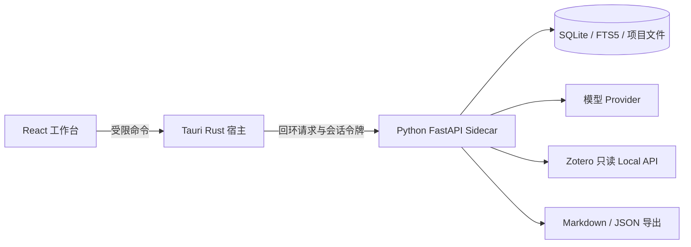

# ADR 0002：按 QA 采用 Tauri 证据推理工作台

日期：2026-10-27。状态：**已采用为开发基线；运行和打包仍待验证。**

补充：工具所有权、受控 Wiki、来源版本和新阶段路线由 [ADR 0003](0003-controlled-knowledge-evolution.md)细化。本文的技术栈继续有效；早期 Phase 1 构建任务在新计划拆为 Phase 0 安装探针与 Phase 1 导入器。

依据：[QA.md](../../QA.md) 第 234–244、578–618、778–786 行，以及用户本轮更新要求。本决策替代 ADR 0001 中 Electron/Forge 与独立 Web 工作台的暂案；保留源码根目录、Conda、数据隔离和 GitHub 远端决定。

## 技术组成

| 层 | 采用方案 | 实现边界 |
| --- | --- | --- |
| 桌面与 UI | Tauri 2 + React + TypeScript；Vite 构建；React Flow 图谱 | 位于 apps/desktop；Rust 管理生命周期与受限命令，React 聚焦证据审核 |
| 算法引擎 | Conda Python 3.12.16 + FastAPI + Pydantic | 单个本地 Sidecar，模块化组织；耗时任务可由独立工作进程执行 |
| 解析 | PyMuPDF 首选；GROBID 为复杂学术结构的后续候选 | 页面/文本/坐标可追溯；扫描件与复杂表格不承诺自动准确解析 |
| 存储与检索 | SQLite、关系表和 FTS5，向量相似度用于候选召回 | 初期不引入 Neo4j/Redis/PostgreSQL 服务；嵌入模型和索引实现经样本实验确定 |
| 模型 | Provider 接口，可接云端 API 或本地模型服务 | 结构化输出和引用校验；开发替身与真实结果分别标记 |
| 集成 | 直接 PDF；后续 Zotero Local API 只读导入；Markdown/JSON 导出 | Zotero 路径只定位程序，不直接修改其数据库；MCP 后续评估 |
| 分发 | Tauri Windows x64 安装包 + 打包后的 Python 引擎 | 优先验证 NSIS exe；MSI 按需要增加；不要求用户安装 Conda/Node/Rust |

PyInstaller 是 Sidecar 打包的首选验证方案，先测试 onedir 及资源收集。这是本轮实现选择，并非 QA 锁定的唯一打包方式。Conda 开发环境不直接整体复制给终端用户；需验证引擎依赖、DLL 和资源已收齐。

## 进程与数据路径

本轮选择经 Tauri 命令转发业务请求，减少前端持有系统权限和会话秘密的范围；长任务状态由宿主转为 UI 事件。引擎负责 schema、审核状态、事务和数据迁移，前端不直连数据库。

Sidecar 仅监听回环地址，端口和会话令牌由宿主协调，限制允许的请求来源。启动需有就绪握手、版本匹配和可见错误；关闭及崩溃恢复不能遗留子进程或重复写入。文件路径由受限文件选择/导出命令提供，模型文本不作为可执行命令。API 密钥通过操作系统凭据存储适配器管理。

开发数据使用被忽略的 `.local/`；安装后使用平台用户数据目录，Windows 暂定 `%LOCALAPPDATA%\ResearchGraphStudio\`。导出由用户选择目标，已有人工笔记不被自动覆盖。

## 可安装关卡与当前差距

本轮只读检查发现 WebView2 Runtime `155.0.4283.62`；PATH 和常见 `.cargo/bin` 路径未发现 Rust，常见 Visual Studio Installer 的 `vswhere.exe` 也未发现，MSVC/Windows SDK 可用性尚未确认。详见[环境报告](../environment-check.md)。

Phase 1 先补齐并验证 Rust MSVC、C++ Build Tools/SDK，建立最小 Sidecar，再打包 PDF 导入器。安装测试覆盖无开发依赖机器、中文/空格路径、引擎启动失败、正常退出和重启后数据保留。Windows 10 与 11 分开记录实测；未测平台不写通过。

可离线浏览已有项目与缺失 WebView2 时离线安装是两种要求。首轮确定 WebView2 分发策略：联网 bootstrapper 需要网络；离线安装测试使用离线 Runtime 安装资源。不捆绑大型模型权重。

## 官方依据

- [Tauri Windows 前置依赖](https://v2.tauri.app/start/prerequisites/)说明 Rust/MSVC、C++ Build Tools 与 WebView2 要求。
- [Tauri Sidecar](https://v2.tauri.app/develop/sidecar/)支持分发外部可执行程序，并要求匹配目标架构的二进制命名。
- [Tauri Windows 安装包](https://v2.tauri.app/distribute/windows-installer/)列出 NSIS/MSI 与 WebView2 分发选项。

核对日期：2026-10-27。精确版本将在首次兼容性构建后写入锁文件；这些资料不代表本项目已经构建成功。
