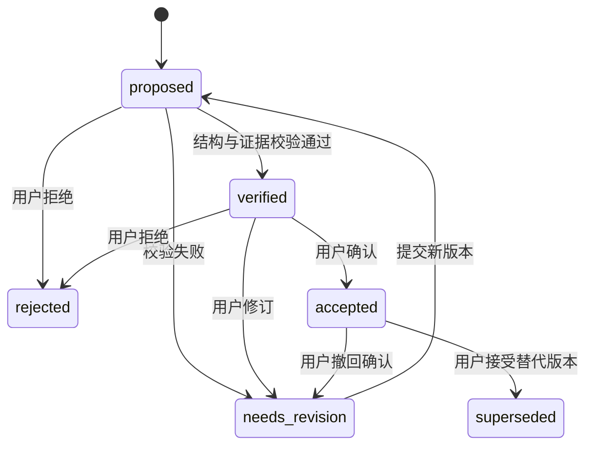

# 证据、关系与知识审核的实施约定

版本：v0.2；依据：[QA.md](../../QA.md) 第 437–576 行，以及[补充材料 S2–S4](source-register.md)。与[计划 v0.4](../development-plan-v0.4.md)一致。以下是后续 schema/API 约束，尚未创建数据库或运行代码。

## 数据对象

| 表/对象 | 基本信息与约束 |
| --- | --- |
| projects | 名称、研究问题、创建时间、schema 版本；项目内对象隔离 |
| papers | 题录、DOI、文件哈希、导入来源、解析版本；重复导入幂等 |
| paper_sources | 本轮补充的来源映射：PDF 路径或 Zotero library/item/attachment 标识；一本论文可有多个来源 |
| sections / chunks | 章节、段落/块 ID、文本、PDF 页索引与字符区间；规范化文本到原文的映射 |
| evidences | paper/section/chunk ID、quote、页码、偏移、可用 bbox、来源哈希；引用指向实际解析文本 |
| claims | statement、subject/predicate/object、conditions、来源、六态 status；支持一文多主张 |
| claim_evidences | 主张与证据的多对多关系、证据作用；无来源摘要不能代替证据 |
| relation_assertions / relation_evidences | 独立 RelationAssertion ID/版本、source/target claim ID、五类 type、条件对照、rationale、双方多条证据、status、run ID；替代暂称 relations |
| reviews | 目标 ID/版本、审核决定、修改前后值、reviewer、理由、时间；保留模型原提议 |
| knowledge_events | 事件序号、目标版本、类型、前后状态、actor、原因、来源、时间；与状态写入同一事务 |
| experiment_runs | 数据划分/哈希、代码 revision、Provider/模型版本、提示词、参数、原始输出、指标和耗时 |
| jobs / snapshots | 任务状态、幂等键、重试/取消；后续快照关联事件游标与 schema 版本；tasks 统一名为 jobs |

PDF 内部页索引与界面显示页码分开约定；印刷页码不等于 PDF 页序号。跨页证据保存多个片段，不能假定一个 bbox 覆盖整条证据。规范化、断词和空白处理必须保留可回溯映射。

## 主张与条件

条件包括任务、领域/数据集、实验对象、规模、方法设置、评价指标和适用范围。接口以 `state=unknown, value=null` 显式标记未知，保留证据或缺失原因，不以模型猜测补全；0、空字符串不能表示未知。已知条件保存 value、单位/范围和 evidence_ids。Pydantic 检查结构/类型，语义判断由证据和审核流程处理。

主张描述论文声称了什么，不是科学事实的无条件认证。用户推测标记为人工假设，与论文主张区分；首版正式证据关系需满足来源要求。

## 五类关系与两阶段推理

| 类型 | 条件 |
| --- | --- |
| SUPPORTS | 在可比较条件下，有证据支持另一主张 |
| CONTRADICTS | 在可比较条件下，结论存在实质冲突，不能只凭相反措辞判断 |
| QUALIFIES | 有证据给另一主张增加适用范围或限制 |
| EXTENDS | 有证据表明方法或研究范围得到扩展 |
| INSUFFICIENT | 缺少必要证据或条件，无法确定有依据的关系 |

第一阶段通过研究主题、关键词/FTS5、向量相似度筛选跨论文候选对，保存召回配置。第二阶段比较研究条件与证据，再生成关系、解释和引用；输出通过 schema、ID/引用存在性、原文匹配和状态规则校验。

条件差异本身不自动构成 QUALIFIES；缺少明确限定证据时使用 INSUFFICIENT。该标签是关系评估结果，需保留以便评测，默认不画成已成立的论证边。分类准确率不等于整体系统效果，需另测候选召回。

## 知识状态与审核

统一六态：`proposed`、`verified`、`accepted`、`rejected`、`needs_revision`、`superseded`。QA/S4 的 `pending`/`pending_review` 作为 UI 队列，S4 的 machine_checked 映射 verified，实际知识接口不混用；UI 的待审核队列显示 proposed/verified 对象。

`verified` 只表示机器定位和结构检查通过；`accepted` 表示用户接受该版本，均不意味着科学真理已被证明。被接受的 SUPPORTS/CONTRADICTS/QUALIFIES/EXTENDS 关系必须引用已接受主张及有效证据，缺证据不得绕过审核直接接受。

模型、提示词、证据或条件变更创建新提议/版本；新论文不得静默覆盖 accepted 关系。旧版本可查，新版本等待审核。撤回或删除关系保存审核/撤销事件，不默认物理抹去历史。编辑已接受主张需同时标记依赖关系待复查，旧快照保持可读。

## 演化机制分两步实现

v0.1 就记录审核与修订事件，事务性维护当前知识表；v1.0 再加入版本快照、差异视图和自动影响分析。

增量流程：新论文/人工修订 → 基于主题、实体、条件和图邻域确定影响集合 → 局部重新评估 → 变更提议 → 人工审核 → 追加事件、更新物化状态。任务使用幂等键，重复事件不重复应用；回放使用单调事件序号，时间戳用于说明。

全量重算作对照，检查漏召回和状态差异。论文发表日期、系统导入时间、审核事件时间分别存储。

## 补充材料整合后的字段与对象

内部 ID 采用 UUIDv4；来源外部键单独保存。表随 Phase 迁移，不把下列全部对象一次建入首个数据库。

| 对象 | 约束 | 阶段 |
| --- | --- | --- |
| AttachmentRevision | 来源键、文件 sha256、原路径/托管引用、版本；证据绑定确定附件/解析版本，不原位替换历史 | Phase 1 |
| Claim 归属 | claim_kind 区分主张/实验发现/假设；attribution 区分本论文/转述他文/未知；含否定、数值、比较基线和 uncertainties | Phase 2 |
| ModelRun | Provider/模型、提示词/Schema/解析器版本、输入哈希、参数、原始输出、用量/耗时、失败与每次重试 | Phase 2 |
| Concept / MergeProposal | 规范名、别名、范围、候选依据；合并经审核，保留旧 ID/可逆映射和依赖影响 | Phase 3 |
| UserInsight / Hypothesis | authorship、note_id、源哈希、证据状态；与论文 Finding 隔离，无证据的假设不能伪装成实证主张 | Phase 4 |
| WikiPage / WikiRevision | 稳定 ID、标题、授权路径、内容哈希、graph_revision、draft/published 状态；文件状态与知识审核态分开 | Phase 4 |
| Dependency | 源对象 ID/版本、目标页面/段落/关系、依赖类型；可从证据到主张/关系再到页面查询影响 | Phase 4 |
| EvolutionProposal | 触发、基版本、目标版本、diff、证据、风险、审核、stale 冲突状态；不复用知识六态强行表示发布进度 | Phase 4 |
| WikiOutbox | proposal/revision、授权根、expected_hash、new_hash、staging、幂等键、pending/writing/published/conflict/failed、重试 | Phase 4 |

Zotero 身份按 server_id 或来源配置 ID、library_type/library_id、item_key、attachment_key 分区；对象本地版本与附件哈希分开。DOI/文件名不能作为覆盖历史的唯一标识。paper_sources 可有多个来源，重复文件复用解析时不丢来源映射。

source_availability 与 evidence_validity 独立保存，不额外添加知识审核状态。来源离线不删除已接受历史；附件变化创建新修订并标记依赖陈旧。证据指向历史文本仍可回看，当前有效视图应提示变化并触发复核。

RELATED_TO 仅属于概念关联，不扩展五类主张关系。主张、关系、概念合并涉及科学含义的修改均须审核；验证语法/引用通过不意味着语义成立。

审核使用 expected_revision 和幂等键，状态/Review/Event 原子写入。撤回确认可改变当前可见状态，但保留旧接受事件和内容版本；编辑已接受内容以新提案完成。Wiki 批准后只是可发布，实际文件状态由 outbox 单独报告。

Wiki 文件发布/恢复规则见[新计划第 7 节](../development-plan-v0.4.md)：数据库与外部文件不是单一事务；文件哈希检查不是外部编辑器协作的 CAS。默认保留新修订文件，未经并发与恢复验证不启用原位覆盖。
