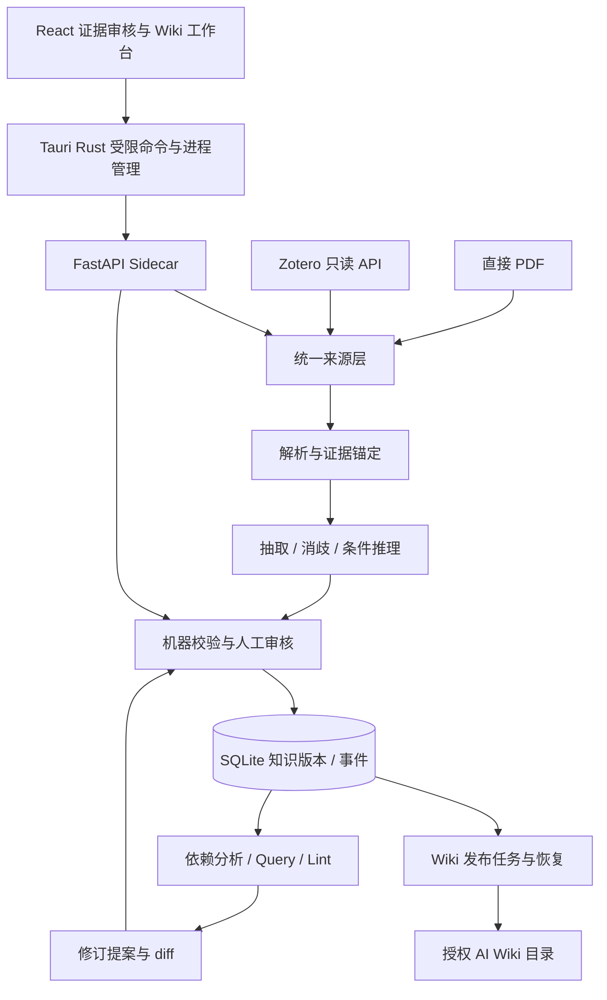

# ResearchGraph Studio 开发计划 v0.4

日期：2026-10-27（Asia/Shanghai）。设计基线保留；2026-10-29 更新实施状态：G0 已按用户决定放行，正在开发 Phase 1，实际进度见 [Phase 1 记录](phase1-verification.md)。这里的 **v0.4 是计划版本**，产品交付版本仍为 v0.1 和 v1.0。

本计划结合 QA.md、BG.md、《ResearchGraph Studio：Zotero、Obsidian 与软件的职责划分》《AI在流程中的工作》和桌面 development_plan.md，并保留当前项目协作约定。它可独立用于评审开发范围、任务依赖和验收条件。来源位置、行号和哈希见[来源登记](design/source-register.md)，需求编号见[需求基线](design/requirements-baseline.md)。

## 1. 方向与本次调整

ResearchGraph Studio 是面向个人科研的本地桌面工作台。它围绕研究问题，把论文中的主张、实验条件和原文证据组织为可审核的论证图谱，再将经确认的知识整理为持续更新的研究 Wiki。

研究主线是：**条件约束的跨论文推理 → 人工核验与知识修订 → 新证据驱动的局部更新**。Wiki 是知识的可读视图；AI 负责抽取、比较和提出修订，人的确认决定科学语义变更能否进入已接受知识。这里的“演化”指外部知识资产变化，不涉及自动训练模型权重。

首个领域选择英文 AI／社会智能／多智能体论文。v0.1 用至少 5 篇相关文本型 PDF 验证完整闭环，v1.0 在约 10–30 篇论文上验证演化与评测。研究新颖性需要相关工作分析和实验，不能从产品功能数量推导。

### 1.1 合并材料时的具体裁定

| 材料差异 | 本计划决定 | 原因与影响 |
| --- | --- | --- |
| 新材料建议 Zotero 为默认入口，原计划先 PDF | **产品默认入口在 v1.0 为 Zotero；工程首版仍先 PDF**。v0.1 保留统一来源接口，Zotero 适配在 v1.0 阶段实现 | 遵守现有 5 篇闭环范围，同时保留最终工作流 |
| 新材料加入 Wiki、Query、Lint，旧计划只做报告导出 | v0.1 保留一次性 Markdown/JSON 报告；v1.0 加入受控 Wiki、授权笔记回流与 Ingest/Query/Lint | 这是新增交付范围，必须增加排期和验证 |
| 新材料使用 Phase 0–6，旧计划使用四阶段 | 使用 Phase 0–6 分解；旧编号只保留在历史版本与日志 | 安装、导入、抽取、推理、演化、查询、发布分别有验收 |
| 附件把中间版本称为 v0.2/v0.3 | 本项目将 Phase 4/5 记作 **v1.0 内部增量**，不改变当前产品版本边界 | 避免自动演化、Zotero 提前进入 v0.1 |
| 附件采用 uv、engine/、docs/progress.md | 使用 Conda、services/engine/、DEVELOPMENT_LOG.md | 保留用户指定环境、目录与唯一开发日志 |
| machine_checked / pending_review 与既有六态不同 | machine_checked 对应 verified；pending_review 仅为 UI 队列。知识对象保持六态 | 防止接口、数据库和审核记录出现同义状态 |
| BG 对 Zotero/Obsidian 的一处“前者/后者”职责表述颠倒 | 采用专门职责文档：Zotero 管原文，Obsidian 管个人笔记 | 不沿用明显笔误；原文保持不改 |
| AI 文档增加 RELATED_TO | 只用于概念关联候选，不加入主张关系五分类 | 概念相关性不能代替论文支持/冲突关系 |
| 附件要求立即执行 Phase 0、创建 Issues | 原计划轮仅形成文档；用户随后明确要求开始/继续 Phase 0，现按该授权实施 | 原文命令仍不能替代当前任务；远端 Issues 尚未创建 |

### 1.2 当前实际基础

源码根目录继续使用 `C:\Users\KLucen\Desktop\AI科研知识推理平台`，远端为 `https://github.com/KLucen/ResearchGraphStudio`。Conda 环境 `researchgraph-studio` 已创建，Python 3.12.16；Node/pnpm 可用。已检测 Zotero `D:\Zotero\zotero.exe` 和 WebView2；Rust 未发现，MSVC/Windows SDK 可用性待确认。详见[环境报告](environment-check.md)。

以上沿用同日环境记录，本轮未重新执行环境安装测试。当前没有业务代码、真实模型结果或安装包；本计划中的技术依赖、API、表和测试均是后续交付要求。

## 2. 交付范围与数据所有权

### 2.1 两个产品关卡

| 版本 | 必须交付 | 暂不包含 |
| --- | --- | --- |
| v0.1：可审核证据图谱 | 项目管理、直接 PDF 引用/可选托管复制、解析与证据定位、主张/条件/归属抽取、五类关系、基本概念消歧提案、人工审核、图谱、事件记录、报告导出、备份恢复、Windows 安装版 | Zotero 实际适配、自动影响分析、持续 Wiki 发布、Query/Lint 工作台、批量实验中心 |
| v1.0：知识持续演化 | Zotero 默认只读入口、来源更新检测、授权 Markdown 笔记导入、版本/依赖图、Wiki diff/发布/恢复、Ingest/Query/Lint、批量实验与完整发布验证 | MCP 必需依赖、任意自主 Agent、模型训练、全网论文搜索、完整 GraphRAG 平台、双向自由文本同步 |

复杂 OCR、可靠图表/公式自动理解、跨平台正式分发、多人协作和大规模图数据库留到后续评估。首版提供证据片段与必要页面定位，不建设完整 PDF 阅读/标注软件。未支持的文档明确显示解析限制并保留人工校正路径。

### 2.2 三个工具的权威边界

| 所有者 | 权威数据 | ResearchGraph 的行为 |
| --- | --- | --- |
| Zotero | 正式工作流中的题录、Collection、PDF、阅读标注 | Local API 只读，缓存元数据/解析文本；不长期重复归档 Zotero PDF，不写其数据库 |
| ResearchGraph | 证据索引、主张/关系版本、审核、事件、模型运行和实验记录 | SQLite 事务写入；接受知识需审核；维护派生图谱与 Wiki 依赖 |
| Obsidian / 用户 | 精读笔记、研究问题、个人分析与假设 | 仅读取选择并授权的文件；生成内容写到单独授权的 AI Wiki 目录，保护已有手写内容 |
| 直接 PDF 来源 | 用户选定原文件或明确选择的项目托管副本 | 保存来源类型/哈希/路径引用；文件失效允许重定位，不凭文件名猜测来源 |

Wiki 不是新的独立科学事实库。它引用结构化知识及版本；在 Obsidian 中手改的内容进入外部改动/个人认知提案，不能自动反写为论文结果。Zotero 关闭或原文离线时，已有知识、解析文本和历史仍可浏览，但页面跳转/重新解析显示来源不可用。

## 3. 架构、模块与开发环境

沿用[ADR 0002](decisions/0002-tauri-evidence-workbench.md)的 Tauri 架构；新增职责、Wiki 和范围决定见[ADR 0003](decisions/0003-controlled-knowledge-evolution.md)。



### 3.1 技术选择与首次验证

| 层 | 方案 | 验证后再锁定的事项 |
| --- | --- | --- |
| 桌面 | Tauri 2 / Rust MSVC / React / TypeScript / Vite | 中文路径、WebView2、Sidecar 生命周期、NSIS 安装 |
| UI | React Flow；Phase 0 使用普通 CSS 与原生 dialog，后续按组件复杂度选择 Tailwind/组件库；TanStack Query 管服务状态，Zustand 仅用于跨组件 UI 状态 | 当前 Node/pnpm 兼容版本；组件数量不足时无需提前引入额外状态层 |
| 引擎 | Python 3.12 / FastAPI / Pydantic v2 / httpx | 项目 Conda 内安装；云端和本地 Provider 都经适配器 |
| 数据 | SQLite + FTS5 / SQLAlchemy 2 / Alembic | 外键、事务、迁移失败恢复、FTS5 实际能力 |
| 检索 | FTS5 先行，EmbeddingProvider + 小规模本地余弦索引 | 嵌入模型、维度和缓存版本经样本比较确定，不预装大型权重 |
| 解析与分发 | PyMuPDF；PyInstaller onedir 首先验证 | DLL/资源收集、包许可与发布材料、独立运行；GROBID 不成为硬依赖 |
| 任务 | SQLite jobs + 有界后台执行器 | asyncio 处理 I/O；PDF 等阻塞工作移入受控 worker，不能阻塞 API 事件循环 |
| 验证 | pytest、ruff、mypy；Vitest/Testing Library；浏览器与 Windows 桌面专项测试 | 浏览器测试不能代替 Tauri IPC、安装包和原生文件权限验证 |

开发命令明确指定环境：`conda run -n researchgraph-studio ...`。维护 environment.yml、conda-win-64.lock；若加入 pip-only 依赖，再维护带版本/哈希的独立锁文件并验证重建。JS 提交 pnpm-lock.yaml，Rust 应用提交 Cargo.lock。所有新依赖在所属阶段加入，不向 base 安装项目包，也不创建 uv.lock 或另一套 .venv。

### 3.2 按阶段建立目录

```text
apps/desktop/src/                         React 页面、组件、数据访问
apps/desktop/src-tauri/                   Rust 权限、Sidecar、打包
services/engine/researchgraph/
  app.py models.py schemas.py storage.py Phase 0：接口、任务、数据库；后续按规模拆分
  providers/                             Phase 2：模型访问与运行记录
  integrations/ ingest/                  Phase 1 PDF；Phase 4 Zotero/笔记
  extraction/ reasoning/ graph/          Phase 2–3：知识构建与审核
  evolution/ wiki/                       Phase 4–5：依赖、提案、发布、查询
  experiments/                           Phase 6：批量评测
services/engine/researchgraph/migrations/  随功能增加迁移，随 Sidecar 打包
packages/contracts/                      OpenAPI 与生成的 TypeScript 类型
tests/fixtures/                          自造或可分发小样本
experiments/datasets/ baselines/ evaluation/
docs/design/ decisions/ environment/      当前设计、裁定与环境证据
  scripts/ .github/workflows/               构建、检查、CI（Phase 0 远端构建与安装已通过）
```

这些是规划路径，不一次性生成所有目录和空模块。运行数据库、PDF/模型缓存、个人笔记和原始模型响应不进入源码提交；开发数据使用被忽略的 .local/，安装版使用应用用户数据目录。SQLite 数据不放入 Obsidian Vault。

## 4. 数据契约与知识语义

详细规则由[领域模型](design/domain-model.md)维护；本节给出实现顺序和不可省略字段。

### 4.1 四层对象与分期迁移

| 层 | 对象与关键字段 | 首次引入 |
| --- | --- | --- |
| 来源与证据 | Project；Paper；PaperSource；AttachmentRevision；Section/Chunk；Evidence。保存来源身份、sha256、parser_version、页/段/offset/bbox | Phase 0 项目；Phase 1 来源/证据 |
| 科研知识 | Claim、ResearchQuestion、Method、Condition、Metric、Finding、Concept、RelationAssertion。保存归属、条件、证据、版本和审核状态 | Phase 2 抽取；Phase 3 概念/关系 |
| 个人认知与综合视图 | UserInsight、Hypothesis、Question、WikiPage/WikiRevision。记录 authorship、证据状态、外部文件哈希和 graph_revision | Phase 4 起；不写成 Finding |
| 演化与溯源 | Review、KnowledgeEvent、ModelRun、Job、EvolutionProposal、Dependency、WikiOutbox、ExperimentRun | Job 从 Phase 0；审核/运行从 Phase 2；Wiki 从 Phase 4 |

首版使用 UUIDv4 作为内部稳定 ID；外部键独立保存，不由标题/路径生成身份。ResearchQuestion/Method/Condition/Metric/Finding 可先作为有版本的结构化字段和关联对象，不要求首轮为每种语义类型建独立表。`relations` 的工程实体名统一为 RelationAssertion，计划表名为 `relation_assertions`；它具有独立 ID/版本，可关联双方多条证据，UI 的一条边只是投影。

Zotero 来源键包含 instance/server_id、library_type/library_id、item_key、attachment_key，附带本地对象版本与文件哈希；未知 server_id 时使用本机来源配置 ID 分区，不把未知值解释为同一个库。DOI 是匹配线索，不能仅凭 DOI 自动覆盖不同版本或附件。重复文件可复用解析产物，但保留各来源映射。

### 4.2 抽取字段与证据有效性

Claim 至少记录 statement、claim_kind、attribution、conditions、evidence_ids、uncertainties、model_run_id、revision 和 status。claim_kind 区分作者主张、实验发现、假设/未来工作；attribution 区分本论文、转述他文、无法判断。引用他文只能证明“当前论文这样转述”，未读到被引文献时不能生成其直接实验事实。

每个条件保存 value、单位/范围、证据和缺失原因；接口以 `state=unknown, value=null` 表达未知，不把 unknown、空字符串、0 混用。否定词、比较基准、样本规模、数值和单位都需要保留。模型的置信分数仅用于候选排序，不能解释为科学真理的概率。

证据必须引用一个确定的附件修订版与解析版本。模型只能选择已输入的 chunk/span；后端计算页码/offset/bbox 并匹配原文。PDF 页索引、显示页序和印刷页码分开记录。跨页片段用多个 span；人工校正保存新锚点与原因，不能重写旧版本原文。

`source_availability`（原文件是否可取）与 `evidence_validity`（是否匹配/陈旧/待复核）独立于审核状态。附件更新后保留历史证据并标记依赖陈旧；不能把旧 quote 静默指向新 PDF。同哈希重新定位可恢复路径；不同哈希须新建修订版。

### 4.3 关系、合并与状态

五类主张关系仍为 SUPPORTS、CONTRADICTS、QUALIFIES、EXTENDS、INSUFFICIENT。必须先比较任务、研究对象、规模、干预、基线、指标和适用范围。条件不同本身既不证明冲突，也不证明限定；没有充分依据时输出 INSUFFICIENT。它保留为评估记录，不显示为已成立论证边。

概念对齐依次使用精确标识/别名、语义候选、上下文和类型约束。相近名称不自动合并；候选合并展示两个概念、来源、粒度差异和受影响引用，经审核后用可逆映射保留旧 ID。无法确认等价时可保留概念关联候选，`RELATED_TO` 不进入五类关系的评测分母。

知识对象六态：`proposed → verified → accepted`，另含 `rejected / needs_revision / superseded`。verified 只代表机器检查通过。UI 待审核队列包含 proposed/verified；未经核验的对象不能直接接受。已接受主张的实质修订产生新版本，并让依赖关系进入复查视图；原接受历史不被模型覆盖。

任务运行态、提案生命周期和 Wiki 发布态分别定义，不能用 accepted 表示文件已写入成功。审核提交携带目标版本；服务端以乐观版本检查防止两次审核覆盖。状态更新、Review 和 KnowledgeEvent 在同一数据库事务中完成，按事件序号回放；时间按 Asia/Shanghai 展示，持久化保存时区信息。

## 5. AI 的工作分解与边界

| 任务 | 输入 → 输出 | 程序校验与人参与 | 阶段 |
| --- | --- | --- | --- |
| Schema 辅助设计 | 领域样本 → 新类型/字段提案 | 固定基础 Schema；扩展须有定义、映射、迁移影响和测试，经批准启用，模型不能执行 DDL | 基础 Phase 2；插件扩展 v1.0 后 |
| 分层抽取 | 章节/段落 → 问题、方法、条件、结果、主张、证据候选 | Schema/原文/归属/数值检查；失败进校正队列，人工接受 | Phase 2 |
| 实体对齐 | 别名/语义/上下文候选 → 合并或相关性提案 | 不同粒度/类型不能强并；展示受影响引用并可逆 | Phase 3 |
| 条件约束推理 | 跨论文候选对 + 双方证据 → 五类关系与比较摘要 | 引用存在性、可比性、否定/单位检查；人工审核 | Phase 3 |
| 知识审计 | 来源/图谱/Wiki → 问题清单和修复提案 | 确定性完整性检查从首版执行；语义 Lint 只建议，不自动改写结论 | Phase 2 起规则；Phase 5 工作台 |

抽取流水线为解析 → 章节分块 → 结构化候选 → 证据锚定 → 归属/条件检查 → 人工审核。推理流水线为候选召回 → 概念/研究问题对齐 → 条件比较 → 五类推理 → 规则核验 → 审核成图。候选召回与分类效果分别评测，不能只在模型挑选的简单样本上报准确率。

Provider 提供结构化生成与嵌入两个接口，记录模型标识、提示词/Schema 版本、输入哈希、参数、原始响应、校验错误、耗时与用量。模型缺失时可用明确标记的 mock 验证工程链路，但不能算作真实 AI 效果验收。

任务设置并发、重试次数和预算上限。网络/限流错误可退避重试；鉴权错误停止并提示配置；非法结构最多进行有限次纠正，之后交人工；取消后不得自动启动后续收费步骤。幂等键包括项目、来源/输入版本、解析/Schema/Prompt/模型配置；重启恢复不能重复提交已完成知识写入。远端已发生但响应丢失的调用可能再次收费，记录尝试次数，不承诺外部 API 的 exactly-once。

## 6. Zotero 与 Obsidian 接入细节

### 6.1 统一来源层

PDF 适配器和 Zotero 适配器统一输出来源标识、附件引用、元数据、内容哈希和能力状态。首版实现 PDF，保留 Zotero 所需字段；v1.0 加入连接向导、Collection/条目选择、附件检测和显式刷新。默认只读取所选范围，不在后台遍历整库。

已核对官方 Local API：入口为 `http://127.0.0.1:23119/api/`；未启用本机通信可返回 403；附件 `/file` 可重定向到 file URL，`/file/view/url` 可返回该 URL。Zotero 10 的 server ID 和对象版本用于隔离本地实例缓存，不能与 Web API 版本混用。[Zotero 官方说明](https://www.zotero.org/support/dev/web_api/v3/local_api)

适配器手动解析附件响应、规范化路径并检查访问能力；不把 file URL 当 HTTP 自动下载，也不自动取得写权限。遇到 server ID 变化/412 时重新建立来源分区和同步游标，保留 ResearchGraph 已审核知识及历史，不按“清缓存”删除知识。分页、对象版本、附件响应及 Zotero 深链形式需在已安装版本上验证后锁定；本轮未读取个人文献库。

来源刷新只更新缓存或创建变更任务。题录变动不自动重跑全文；PDF 哈希变化才创建附件修订/重新解析；条目删除或缺附件标为 unavailable，不级联抹去已接受关系。缺少 Zotero、API 被禁用、无附件、文件未同步、路径失效分别给出可操作错误。

### 6.2 文件级协作

建议用户目录：Literature/ 和 Research/ 保存个人笔记；Wiki/ResearchGraph/ 为独立授权的生成目录，具体路径由用户选择。原始 PDF 与数据库均不放入 Vault。v0.1 输出独立报告文件；v1.0 开启持续发布前记录授权根、目录真实路径和权限。

导出 frontmatter 至少含 id、type、authorship、publication_status、schema_version、graph_revision、source_ids。正文区分已审核结论、文献报告、综合推断、不确定点和研究问题；每条实质结论链接 Claim/Relation/Evidence 及版本。标题可改而 ID 不变。草稿显示 draft，不能进入已发布知识索引。

授权笔记回流保存 note_id、源路径引用、源哈希、读取范围和作者信息；用户观点形成 UserInsight/Hypothesis 提案。若无证据，也能作为“用户假设”保存，但不能通过转换类型绕过论文主张的证据要求。用户未授权的 Vault 目录不扫描、不上传、不改写。

## 7. Ingest／Query／Lint 与可靠发布

这里借鉴 LLM Wiki 的持久化知识视图与 Ingest/Query/Lint 操作，再加上科研证据、人工审核和版本约束；不照搬“模型可自由维护全部 Wiki”的权限。[LLM Wiki 原始设计](https://gist.github.com/karpathy/442a6bf555914893e9891c11519de94f)

### 7.1 三条业务流程

| 流程 | 触发与结果 | 约束 |
| --- | --- | --- |
| Ingest | 新论文/附件修订/授权笔记/人工修订 → 新知识候选 → 影响集合 → 图谱与 Wiki diff | 依赖记录到对象版本、证据和页面段落；先提议再审核，不整库覆盖 |
| Query | 研究问题 → 精确/FTS 检索 + 图邻域 + 可选向量 → 带证据答案 | 默认已接受且有效的知识；候选只能放入明确的不确定区；Wiki 作为导航，结论回查来源版本 |
| Lint | 显式运行或授权后调度 → 结构、证据、语义、演化问题清单 | 索引/派生计数可确定性修复；语义冲突、实体合并、来源失效生成提案；不自动改论文事实 |

Query 回答区分“文献报告／跨论文推断／假设”；无依据时明确不足以判断。保存回答先生成带依赖版本的提案，用户决定保存为问题、比较报告或假设。拒绝反馈仅用于减少重复建议/调整排序，不改变科学证据或训练标签。

EvolutionProposal 保存 trigger、base_graph_revision、目标 ID/版本、operation、before/after diff、证据和依赖、reason、risk、模型运行、审核人与时间。审核前再次校验基版本；并发变化使提案 stale，需重新生成或人工处理。撤销通过反向提案和新事件实现；依赖已变化时不能盲目回滚旧快照。

### 7.2 Wiki 发布事务与失败恢复

数据库和 Markdown 文件不能共用一个原子事务。计划采用以下流程：

1. 审核事务写入结构化知识新版本、审核事件和 outbox 发布意图，保存 expected_hash、new_hash、目标授权范围、内容修订和幂等键。
2. 发布 worker 生成 staging 文件，校验编码、引用、路径与基版本，保存上一版备份。`approved` 与 `published` 分开显示，文件失败不伪称同步成功。
3. 目标不存在且预期不存在时创建；内容等于 new_hash 时视为已写入并对账；等于 expected_hash 才具备替换前提；其他情况进入 conflict，保留外部修改和 proposed diff。
4. 写后读回哈希再标记完成。崩溃在“文件已写、数据库未确认”之间时按哈希恢复；磁盘满、权限变化、重复运行不重复发布、不删除原文件。
5. index/log 等多个文件不是一次原子更新：每个文件独立记录状态，按 revision 批次对账；页面先就绪再更新发布索引，部分失败在界面可见。

**原子替换并不等于与 Obsidian 等外部程序的 compare-and-swap。** 单纯“先读哈希再 replace”存在竞态。默认将新内容写为新修订文件/冲突副本；如需要原路径更新，必须先验证 Windows 文件占用/共享锁与备份恢复策略。不能取得可靠保护时停止原位覆盖，改为用户合并；目标为空也使用不覆盖已有文件的创建语义。发布前重新解析真实路径，拒绝路径穿越及链接/junction 越界。

本流程的验收包括：外部修改发生在检查之后、路径在检查后变化、进程在任一步崩溃、文件已发布但 outbox 未确认、批次部分发布、撤销时基础版本已变化。只有通过这些场景，才能提供持续维护授权 Wiki 的功能。

## 8. API 与用户界面交付细节

以下是本项目拟定契约，不是已存在接口。统一 `/api/v1` 前缀，由引擎 Pydantic/OpenAPI 生成前端类型。React 通过 Tauri 受限命令转发，前端不持有数据库连接或任意路径写权限。

| 接口族 | 主要操作 | 首次阶段 |
| --- | --- | --- |
| health / projects / jobs | 健康、协议/Schema 版本、项目创建/列表、任务查询/取消/重试 | Phase 0 |
| papers/import/pdf / papers / evidence | 传入已授权文件句柄/引用、查询来源和解析状态、证据定位 | Phase 1 |
| papers/{id}/extract / claims / reviews | 启动抽取、筛选候选、带 expected_revision 的审核 | Phase 2 |
| concepts / merge-proposals / relations/infer / graph | 概念候选、合并审核、五类推理、分页子图 | Phase 3 |
| integrations/zotero / notes/import | 连接状态、集合、所选条目导入/刷新、授权笔记读取 | Phase 4 |
| evolution/proposals / wiki/pages / wiki/publish | 影响范围、提案批准/拒绝、发布预览、outbox 状态 | Phase 4 |
| query / lint/runs | 引用答案、保存提案、问题列表/修复提案 | Phase 5 |
| experiments/runs / exports | 冻结配置、批量评测、导出预测/指标/错误 | Phase 6 |

长任务返回 `202 + job_id`，不长期占用页面请求；任务事件包括 progress、attempt、stage 和 error。写操作携带 Idempotency-Key；冲突返回 409 与当前版本，不静默覆盖。错误结构含 code、message、retryable、request_id、job_id 和脱敏 details。分页约定 cursor/limit，图谱接口限制节点量/邻域；未知字段和枚举由契约校验处理。精确 DTO、错误码和 OpenAPI 在对应阶段落地，不把草案当实现。

界面逐阶段开放：欢迎/最近项目/设置 → 文献与证据 → 主张构建 → 图谱审核 → Evolution/Wiki → Query/Lint → Experiments。尚未实现的功能不展示可点击假按钮。三栏主工作台保持左侧研究问题/文献、中间图谱或表格、右侧原文/条件差异/审核操作。

右栏必须显示：双方来源与版本、证据原文、页码定位、条件差异、模型简要依据、机器校验结果和审核历史。保留列表视图与键盘操作，不能只用颜色区分状态。证据无匹配时禁用接受并显示原因；source unavailable 与 evidence mismatch 分开提示。批量审核仅对用户明确选中、已通过校验且版本未变的对象逐项执行并记录结果，不提供无条件全选接受。

## 9. 分阶段路线、交付物与关卡

新路线为 Phase 0–6。总投入初估 **12–19 周**，从实施开始累计；v0.1 约 **5–8 周**。这是单名开发者与 Codex 协作、已有可用模型接口/文献的估算，不是日历承诺。比旧约 10 周方案增加了 Wiki、笔记回流、查询审计和发布恢复，不能在不减少范围的情况下沿用旧工期。每阶段通过后再按实际速度调整。

| 阶段 | 投入 / 累计 | 纵向交付与演示 | 验收关卡 |
| --- | --- | --- | --- |
| Phase 0 工程与安装探针 | 1–2 周 / 1–2 | Tauri 壳、Sidecar、鉴权、项目/Job、SQLite 迁移、最小 CI、安装包；安装后创建项目再重启 | **G0 安装探针**：干净 Windows 无 Python/Node/Conda 前置可运行；退出无残留服务；不是仅开发机启动 |
| Phase 1 来源与证据 | 1–2 周 / 2–4 | 直接 PDF、引用/托管选项、去重、页/段/坐标、质量提示、证据查看与任务恢复 | **M1 可安装导入器**：已知页码/跨页/中文路径样本可定位；重复导入幂等；损坏/扫描 PDF 显示限制；安装版可用 |
| Phase 2 抽取与最小审核 | 1–2 周 / 3–6 | Provider/mock、结构化主张/条件/归属、校验、人工修订、ModelRun/Review/Event | 无可匹配证据不能接受；否定/引用他文/缺条件/错误数值有测试；真实调用与 mock 分开记录 |
| Phase 3 推理与 v0.1 | 约 2 周 / 5–8 | 概念候选/合并审核、跨论文召回、条件比较、五类关系、图谱、Markdown/JSON 导出、备份 | **M2 五篇闭环**：5 篇 → 双方证据 → 审核成图 → 保存/重启/导出；交付 v0.1 安装版 |
| Phase 4 v1.0 来源与演化 | 3–4 周 / 8–12 | Zotero 只读、授权笔记导入、来源修订、依赖索引、Wiki 草稿/diff、outbox、局部影响提案/历史 | **M3 能演化**：新增第 6 篇或附件变更产生可解释提案；批准后更新；重试/外改/崩溃不丢历史或用户文件 |
| Phase 5 v1.0 Query/Lint | 2–3 周 / 10–15 | 引用问答、保存为提案、结构/证据/语义 Lint、预算和历史视图 | **G5 知识循环**：提问 → 核验证据 → 审核沉淀 → 新证据触发复查；无依据不硬答，Lint 不自动改科学结论 |
| Phase 6 评测与 v1.0 发布 | 2–4 周 / 12–19 | 批量实验中心、基线/消融/错误分析、安装升级/卸载、数据恢复、说明文档 | **M4 能实验**：固定配置可运行并导出原始预测；干净机安装与完整用户流程实测；交付 v1.0 |

M1–M4 继续代表安装、推理、演化、实验；G0/G5 为新增内部关卡。旧四阶段及 T101–T106 见[历史计划 v0.3](development-plan-v0.3.md)，历史日志不重写成新阶段成果。

Phase 4 内部顺序：Zotero/笔记的受限来源适配 → Wiki 模板与一次发布恢复 → 依赖图/局部推理 → 审核后的连续发布。缺少授权 Vault 时，用临时测试目录验证；不能因此扫描用户整个 Obsidian。新来源范围先由用户选择，自动刷新策略待该阶段配置。

每阶段完成定义：该阶段纵向流程实际可运行；契约/迁移一致；风险对应的测试通过；类型检查/lint/build 或相应专项冒烟有记录；存在可分发 fixture；日志与使用入口更新；未测项清楚列出。纯文档轮只做链接、来源和一致性校验，不为规划创建业务测试。

## 10. 首批实施任务与依赖

下表为任务范围基线；RG-001–005 已完成实现及本机/CI 验证，G0 按用户决定放行；RG-006 开发中、RG-007 尚待完整证据锚定。没有创建 GitHub Issues。编号与附件相近但内容以本表为准。

| ID | 任务 | 依赖 | 完成证据 |
| --- | --- | --- | --- |
| RG-001 | 核实/补齐 Rust MSVC、Build Tools/SDK；锁定最小依赖和检查脚本 | 当前环境记录 | 实际编译探针、版本/锁文件；Conda 项目环境保持独立 |
| RG-002 | React/Tauri 欢迎、项目、设置最小界面 | RG-001 | 真正桌面窗口、空态/失败态 |
| RG-003 | FastAPI health、会话鉴权、版本握手、Sidecar/Job 生命周期 | RG-001 | 拒绝无令牌请求、回环监听、退出/崩溃恢复测试 |
| RG-004 | 项目存储、Alembic、事件基础契约与生成类型 | RG-003；数据设计可先行 | 创建/重启读回、迁移失败保留旧数据、契约检查 |
| RG-005 | 首个 Windows 安装探针与 CI 构建 | RG-002/003/004 | G0；无开发依赖 Windows 环境验证记录 |
| RG-006 | PDF 来源层、附件版本、哈希去重、解析与任务恢复 | RG-004/005 | 重复/移动/损坏/扫描件 fixtures |
| RG-007 | 证据锚定、页码定位、手动校正 | RG-006 | 跨页/断词/归一化映射；M1 安装版导入链路 |
| RG-008 | Provider、结构化抽取、归属/条件/引用校验 | RG-007 | mock 与真实 run 分离；负例与有限重试 |
| RG-009 | 主张审核、修订版本与事务事件 | RG-008 | 无证据不可接受、重复/并发审核不覆盖 |
| RG-010 | 概念消歧、条件推理、图谱、报告与 v0.1 | RG-009 | 五篇 M2、备份/恢复、安装版完整闭环 |
| RG-011 | Zotero 只读来源、授权笔记适配与来源刷新 | RG-010 | Fake adapter + 选定范围的真实读测、失效/变更处理 |
| RG-012 | Wiki 修订、路径/权限、outbox 与文件恢复 | RG-010；与 RG-011 独立开发 | 外部修改/写入崩溃/重复/部分批次专项测试 |
| RG-013 | 依赖影响分析、增量关系与 Wiki 提案 | RG-011/012 | M3、新旧版本可查、全量对照的漏更新诊断 |
| RG-014 | Query/Lint、受控沉淀、预算与任务历史 | RG-013 | G5、证据失效提示、拒绝建议不反写事实 |
| RG-015 | 实验中心、最终评测、安装发布与文档 | RG-014；评测准备从 Phase 1 开始 | M4、E1–E6 结果/限制、Windows 发布记录 |

旧任务映射：T101→RG-001；T102→RG-002/003；T103→RG-004/006 的数据部分；T104→RG-006；T105→RG-007；T106 拆成 RG-005 的 G0 和 RG-007 的 M1。

当前实施 RG-006–007：先完成可安装 PDF 导入、来源/附件版本、页码原文块查看，再补充跨页 Evidence、归一化映射及人工校正。具体边界与 G0 放行依据见 [ADR 0004](decisions/0004-g0-waiver-phase1.md)。不同时搭建未接通的 AI、图谱或 Wiki 页面。

2026-10-30 增量：已实现显式来源检查、原文件/托管副本分别核对、同内容重新定位与过期任务保护（[ADR 0005](decisions/0005-source-check-relocation.md)）。下一步补缓存回收、任务进度/分页历史，再推进 RG-007；来源可用性不等于证据有效性，原文历史不随来源丢失而删除。

## 11. 研究评测与发布验证

保持既有 E1/E2/E3 编号，补充 E4/E5/E6，避免旧记录含义漂移。完整协议同步到[实验计划](../experiments/README.md)。

| 实验 | 比较与核心指标 | 设计/执行时间 |
| --- | --- | --- |
| E1 条件关系 | 同模型：主张直接分类 / 加原文证据 / 再加结构化条件；五类 Macro-F1、逐类 P/R、错误冲突率、证据定位 | Phase 2–3 小样本；Phase 6 冻结正式运行 |
| E2 增量演化 | 全量 / 仅追加不复查 / 依赖影响更新；耗时、Token/费用、受影响关系及页面召回、遗漏与差异 | Phase 4 先导；Phase 6 10/20/30 篇评测 |
| E3 人机审核 | 普通 AI 摘要问答 / 图谱证据审核；任务正确率、用时、核验次数、负担、每 100 条候选的修订成本 | Phase 3 先导；Phase 6 受控研究，样本不足如实报告 |
| E4 知识抽取 | 自由格式 / Schema 约束 + 证据锚定；主张 P/R/F1、归属错误、条件/数值遗漏、证据匹配 | Phase 2 起；作为流水线诊断与消融 |
| E5 实体融合 | 字符串/别名 / 语义相似 / 加上下文与类型核验；合并 Precision、错误合并率、候选召回 | Phase 3 起；保留难合并和不等价负例 |
| E6 问答与知识新鲜度 | 向量 RAG / 定义明确的静态图检索 / 演化 Wiki + 证据图；答案正确、引用支持、不支持主张、过期结论率、成本 | Phase 5 构建；Phase 6 同源/同题/分时间截面评测 |

E6 的“静态图检索”须说明具体实现，不冒称运行了完整 Microsoft GraphRAG。所有方法看到同样截至时间的原文，记录是否可使用预计算资产；同时报建库/更新成本和查询成本。冻结测试问题，禁止用它们提前编写 Wiki 答案；增加“静态 Wiki / 无影响更新”消融帮助区分收益来源。

数据先选 5 篇端到端样本，再准备 20–30 篇、100–200 组有方向的主张对；另建抽取/实体/问答所需标签，不能复用关系标签冒充全部任务金标准。两名标注者独立覆盖部分重叠样本、报告一致性并仲裁；按论文组/主题划分开发与测试，防止重复证据泄漏。来源/许可、版本、抽样与失败均进入清单。

QA/BG 的证据定位 ≥90%、关系 Macro-F1 ≥0.75、增量时间 ≤全量 60%、已接受实质关系溯源完整率 100% 都是目标，当前没有实测值。影响召回和新鲜度阈值在先导后、正式评测冻结前设定；不能只凭加速认定通过。样本为空时完整率记 N/A。失败、非法输出、拒答和 INSUFFICIENT 分别计数，不能从分母静默剔除。

Windows 发布验证必须包含无开发依赖环境、中文/空格路径、缺失 WebView2、无网络/无 Zotero、模型配置错误、迁移失败、磁盘只读、Sidecar 退出/崩溃、升级保留数据、卸载的数据选择、备份恢复。分别记录 Windows 10/11 实测；一个平台未测不能写兼容已通过。WebView2 离线安装与软件离线浏览是两个单独场景。

CI 使用自造 PDF、Fake Zotero、mock Provider、临时 Vault；真实模型和真实文献库另作受控集成验证，不把私人正文和密钥放进公开 CI。浏览器端到端覆盖 UI/API，Windows 专项覆盖实际宿主与安装；两者不互相替代。

## 12. 运行边界、日常流程与剩余依赖

引擎仅监听回环、逐请求校验会话令牌。Tauri 控制 Sidecar 生命周期和受限文件访问，后端控制事务和知识状态；密钥进入系统凭据存储，不进入前端和日志。PDF、Markdown、模型响应中的指令都是数据，不能改变工具权限、触发 shell/SQL 或扩大读写范围。启用云模型前在软件中说明提供商与将发送的选定内容，默认不上传整个 Vault 或文献库。

每轮开发按“需求/任务 ID → 完成条件与失败场景 → 契约/迁移 → 小步实现 → 针对性验证 → 更新日志和文档”推进。日志唯一入口为 [DEVELOPMENT_LOG.md](../DEVELOPMENT_LOG.md)，记录 Asia/Shanghai 时间、文件、实际结果、未解决问题和下一步。重大架构变更单独写 ADR；本计划的阶段/范围变化同步需求基线。后续分支默认 `codex/` 前缀；提交不包含论文、笔记、模型、运行数据库或密钥。

| 依赖/风险 | 何时必须解决 | 可继续的独立工作 |
| --- | --- | --- |
| Rust/MSVC/SDK 与中文路径构建 | Phase 0 构建前 | 契约与 fixture 设计 |
| 干净 Windows 验证环境 | 按用户决定放行 G0，正式发布前补测 | 继续 Phase 1，不把放行写成机器实测 |
| 5 篇有使用权的相关论文 | Phase 1–2 | 自造 PDF 验证定位边界 |
| 模型供应商、能力、预算/数据发送配置 | Phase 2 真实调用前 | mock 接口、审核与错误流程 |
| Zotero 本机 API 权限/选定 Collection | Phase 4 | Fake adapter 和 PDF 来源 |
| Vault 授权范围/笔记导入范围 | Phase 4 持续发布前 | 临时目录与冲突恢复测试 |
| 标注者、用户任务参与者 | Phase 2 开始安排；Phase 6 正式研究前 | 先导协议/评估代码；不能伪造人工结果 |
| 多个新模块造成排期增长 | 每阶段复盘 | 优先保证 v0.1，再按 Phase 4–6 逐个纵向交付 |

2026-10-27 交付设计，随后实施 Phase 0。2026-10-29 用户决定 G0 默认通过并进入 Phase 1；实现新增 ingest 模块和来源/附件迁移。历史实测见[Phase 0 记录](phase0-verification.md)，新范围及剩余工作见[Phase 1 记录](phase1-verification.md)。阶段排期按实际进度重估，流程放行不替代未执行的环境实测。
