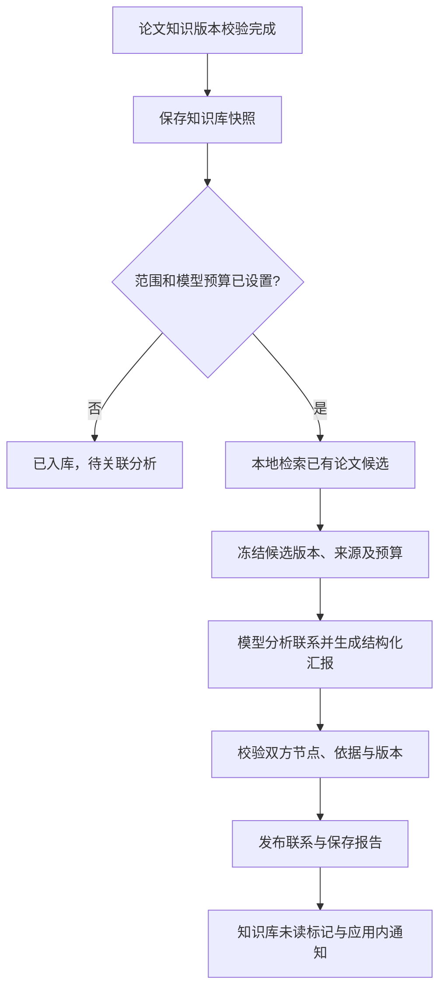

# 研究内容知识库实施方案

日期：2026-11-20（Asia/Shanghai）。状态：用户已授权依次完成K1–K3及回归并上传GitHub，三个阶段的运行代码和专项回归已实施，最终全量/安装/上传状态见[本轮验证](knowledge-library-verification-20261120.md)。新加性head为`lite0018`，正式用户库未用于开发实验。本文件保留最初源码评估与后续建议，其中当前事实以本节和[ADR0060](adr/0060-durable-research-knowledge-library.md)为准；K4仍为后续阶段。旧合同与历史数据不直接改写。

## 本轮实施状态与方案差异

| 阶段 | 本轮落地 | 验收边界 |
| --- | --- | --- |
| K1 | 独立入口/三视图、旧图收藏、题名根、不可变快照、多项目来源/可靠身份、专题/归档/备注/布局、导出和独立删除生命周期 | 零模型收藏与重启/迁移/保留/清理已做隔离专项；真实用户升级及原生体验另验 |
| K2 | `paper-knowledge-1`、本地阅读投影/模型片段adapter、逐节点及科学边精确引文、程序身份、版本和缺口、一次联合卡片/知识输出 | 当前完整材料容量不足整体拒绝，尚未实现长文自动拆批；引文合法不代表科学语义正确 |
| K3 | 双语词面召回、冻结范围/候选/策略与请求槽、增量版本对缓存、双侧依据关系/结构化汇报、未读/置顶/个人备注、地图与汇报双向定位 | 同项目/专题/全库候选，累计预算包含建模与关联；未测试真实模型科学质量，有限候选不代表全库穷尽 |
| K4 | 未启动 | 规模标定、实体聚合、语义召回及更深版本差异留待后续 |

默认一个个人库，`auto_collect`和`auto_connect`均关闭。当前`auto_collect`的实际含义为“后续解析完成后自动构建带来源知识”，会调用模型，不能与零模型收藏已有概览混用。启用任一自动策略必须明确允许在所选范围和预算内发送材料；没有授权时仍可浏览和收藏。策略保存不回溯全库补建。论文之间先建立关联，不物理合并同名节点。

当前候选召回使用已保存知识的中英文词和中文二元组，非向量语义检索。知识图按当前浏览页与选定论文展开，后台比较从库中合法版本取范围，不由画布分页决定。版本对完成检查点可跨关联模型配置复用；显式重新分析才另发请求且受预算限制。来源/版本变化停止发布，保留旧结果/raw。概览v1不替换，新知识联合输出保存在知识版本中，未承诺覆盖原概览历史。

## 1. 产品目标与推荐边界

研究项目负责组织论文和阅读；研究内容知识库负责保存可长期维护的论文知识、跨论文联系及历次汇报；任务记录负责显示这些工作的执行状态。新增入口位于“研究项目”和“任务记录”之间，名称使用“研究内容知识库”。

每篇论文以真实题名作为根节点，下面组织研究问题、概念、方法、贡献与结果。新论文成功入库后，在已设置的比较范围和预算内自动分析与已有论文的联系，自动保存图关系与联系汇报，并在应用内通知用户。浏览已有成果、拖动图谱、筛选和切换页面不触发模型。

推荐一个个人知识库统一管理，研究项目与专题集合用于筛选和决定比较范围。起步默认比较“该论文所在项目中已入库的论文”，可设置为指定集合、多个项目或全库；全库是检索范围，不代表每篇全文都被发给模型。专题集合可以共享条目，不复制PDF或重复生成图谱。

第一版优先做好三件事：论文知识可保存和回查；新论文与已有论文的联系可解释；汇报能长期保留。跨论文同义概念的自动实体合并、复杂条件推理和全库自动重写放到后续，避免一次恢复旧版完整知识引擎。

## 2. 实施前工程可复用的基础与缺口（历史评估）

| 能力 | 当前事实 | 实施建议 |
| --- | --- | --- |
| 五类知识 | `paper_overview_contracts.py`已有RESEARCH_QUESTION/CONCEPT/METHOD/CONTRIBUTION/FINDING | 保留五类及中英名称；“结果”映射FINDING |
| 单篇图 | v1最多12节点/16边，模型只输出局部编号，程序生成正式ID | 旧v1照常读取，新知识合同独立版本；展示节点数不是论文信息覆盖率 |
| 论文根 | 目前LightGraph没有PAPER根节点 | 程序根据知识库条目生成题名根和归属连线，不让模型生成文章身份；归属线不冒充科学关系 |
| 画布 | ForceGraph已有拖动、固定、缩放、位置/相机保存和图例 | 复用渲染器，增加多篇分组、折叠、跨论文关系筛选与报告定位 |
| 本地/模型来源 | 本地概览在paper_overview_results，模型稿在llm_document_outputs，已共用展示合同 | 增加统一来源adapter，保留local_revision/model_parse真实来源类型 |
| 引文 | 现LightGraph没有逐节点出处，旧Prompt明确禁止quotes/citations/page | 新知识合同增加当前来源中的短引用ID，后端验证后绑定实际片段；旧图不能自动变成有据知识 |
| 身份 | 旧节点ID按paper_id/type/规范化中文名生成，Paper仅属一个project | 新增知识库条目与版本身份；名称改写或同名概念不直接等同为同一实体 |
| 执行 | 现有Job、幂等、Provider、用量账本、批次检查点 | 新增知识库任务类型/作用域及预算，不把跨论文分析藏进原概览那一次调用 |
| 删除 | 目前删除论文会删除概览、模型解析/输出及布局 | 知识库要独立保存版本快照，先处理删除依赖，不能只挂现输出外键 |

重点代码位置：`apps/desktop/src/App.tsx`、`PaperOverview.tsx`、`ForceGraph.tsx`、`graphTypes.ts`；`services/engine/researchgraph/paper_overview_contracts.py`、`paper_overview_models.py`、`model_document_overview.py`、`model_document_models.py`、`paper_management_api.py`、`lite_usage.py`。

## 3. 工作空间与用户操作

左侧主导航为“研究项目 → 研究内容知识库 → 任务记录”，设置与诊断仍在原位置。知识库页面独立于当前论文阅读页，项目切换不会把知识库成果隐藏或覆盖。

知识库内推荐三个视图：

| 视图 | 主要内容 | 主要操作 |
| --- | --- | --- |
| 知识地图 | 初始显示论文题名根与论文之间的汇总联系；选中论文后展开五类知识 | 项目/专题筛选、展开论文、定位联系、查看两侧原文、保存视图 |
| 论文知识 | 入库论文、当前知识版本、来源完整性、个人备注和更新状态 | 收藏现有图、生成带来源版本、归档、切换版本、加入专题、返回阅读 |
| 联系汇报 | 按新增论文、时间、比较集合展示历次报告，标注新/已读/部分完成/版本更新 | 阅读汇报、打开对应图关系、核对双方依据、置顶、备注、导出 |

打开知识库优先展示“最近新增论文与未读联系汇报”，并保留用户上次视图。地图初始不把所有论文的全部节点铺开；可展开选定论文及其联系论文，未显示节点不代表未存储。画布分页/折叠不决定分析范围。

论文阅读页的概览保留，增加“已存入知识库 / 加入知识库”状态和入口。已有图可零模型收藏；需要新来源建模时明确显示这是另一次生成。首次设置项目策略后，新建成功知识版本可自动入库和分析，无须每篇反复确认。

用户管理的是“专题、显示偏好、备注、是否参与后续比较”等；模型分析通过程序校验后直接发布并标AI分析，不建设接受/驳回的强制审核队列。用户可以隐藏一条联系或记录不同意见，不修改论文原话或覆盖历史模型结论。

## 4. 单篇知识：保留题名根，补齐来源

五类节点的内容应能回答：研究解决什么问题；关键概念在本文如何定义；方法做了什么且依赖什么；作者宣称的新贡献是什么；结果在何种范围内成立。贡献标为“作者宣称的贡献”，不能仅凭已有知识库判断世界范围的新颖性。

建议新增`paper-knowledge-1`合同，与现有`paper_overview_graph.v1`并存。它只返回五类知识、必要关系、原文短编号和缺口说明；正式论文/节点ID、题名根、坐标、页码由程序绑定，模型不能编造。节点需要来源，科学关系也需对应支撑或明确是模型组织。说明可包含任务、数据/实验条件、适用范围和局限的轻量字段；未知就留未知，不创建完整Experiment/Condition/Metric体系。

来源分两条链：本地解析引用实际span/chunk和原文范围；模型提取稿引用parse/segment及精确文本版本，明确标为模型提取材料，不伪装成PDF原文逐字校验。图表/公式不可靠时保持待核对，不把扁平数字或模型LaTeX当成已证实实验事实。

同一请求可联合生成PaperCard和这份知识结构，再分别投影给论文概览与知识库，避免为同样材料再次生成一份近似图。兼容旧入口和旧快照，通过新任务/版本选择合同，不直接替换历史Prompt。多批长文保存成功检查点，容量不足时明确实际覆盖范围。

旧图可先收藏为“历史概览，缺少逐项原文定位”，用于浏览和候选检索；原文未补验前不发布强关系。用户选择补建或启用新知识建模后，创建新版本，而不是给旧图附上猜测的出处。

## 5. 新论文联系分析流程

本地检索先使用中英题名、问题、术语、方法、任务和结果摘要，加上项目/专题范围；可复用SQLite/FTS基础，首期不要求外部向量数据库。后续再加入可选本地语义检索，补充同义和跨领域联系。候选需兼顾相近论文与少量不同方向，避免只找相同关键词。

模型输入为新论文的结构化知识与必要来源、候选旧论文的相关节点与来源，不每次上传全库PDF。比较按完整论文对/支撑组打包，已比较检查点可复用；本次候选、排序规则、纳入/未纳入原因和知识库版本要冻结，运行期间新入库论文留到下次，保证结果可重现。

第一版可提供可调的“优先比较5–10篇”起始设置，该数字是产品建议，不是已测容量或固定运行上限；按模型实际容量和预算调整。界面必须显示“库内范围N篇，候选M篇，本次实际比较K篇”，并提供扩大比较或手动加入论文。没有候选/没有充分依据时照实汇报，不声称已证明与全库没有联系。

同一篇论文的新版本只和需要更新的关联增量比较，不重新分析所有旧论文对。筛选本地可扫描所选范围的摘要，但如果要求对每篇都进行模型深入比较，则长期总量仍会接近平方增长；软件应显示范围和成本，不宣称算法消除了这一开销。

## 6. 联系的类型和结论强度

| 首期联系 | 报告需要解释 | 边界 |
| --- | --- | --- |
| 共同研究问题 | 两篇各解决问题的哪一部分 | 同题名/关键词不等于问题相同 |
| 概念联系 | 定义是否相近、各自含义和差异 | 不因同名自动合并成一个概念 |
| 方法相关 | 方法的共同步骤、不同设计或明确继承依据 | 时间先后或相似设计不等于作者继承关系 |
| 方法互补 | 输入/输出、假设和使用场景能否衔接 | 可能组合属于建议，不当作已做实验 |
| 结果可比较 | 数据、任务、指标、单位、基线和条件是否可比 | 条件不足时不能断言更好或相互矛盾 |
| 后续研究线索 | 值得共同阅读或验证的问题 | 单独标记研究建议，不显示为作者结论 |

“支持/反驳/超越/改进”只能在双侧来源与比较条件充分时细化，第一版不强求生成这类边。直接文献引用关系也须由真实引用材料确认，不能仅由模型常识补出。

每条实质联系应保留双方`knowledge_version + node_ref`、类型/方向、简短解释、两侧来源引用、不同点及限制；直接作者陈述、模型对比判断、用户个人备注分别显示。不用模型自己给的百分比充当科学置信度。来源匹配和引用合法仅证明可回查，不等于语义正确或科学结论被验证。

## 7. 联系汇报：保存为知识成果

每篇新增论文生成一份持久汇报，至少包含：

1. 这篇论文加入后补充了什么：以本次比较的知识库为范围，不声称全球首次。
2. 最相关的已有论文及理由：指向双方知识节点和原文。
3. 共同点与关键差别：从问题、概念、方法、贡献、结果逐项说明有据的部分。
4. 结果能否比较及当前缺口：条件不足时保留未知。
5. 可继续研究/共同阅读的线索：明确标为建议。
6. 本次比较范围、未完成项、依赖版本、模型/时间、实际调用/Token及未知费用。

示例（虚构）：新增论文C与A研究同一问题，但分别采用方法M1与M2；C中的概念X与B定义相近，适用范围不同；当前两篇结果使用不同任务，不能据此判断C优于A。可进一步核查M2是否能用于A的场景。点击每条联系打开对应双方材料。

关联模型的一份结构化输出同时包含联系条目与带引用的总结，报告正文依此渲染，避免完成分析后再强制多调一次模型“写报告”。多批情况先按结构化条目合成可读报告；如果用户另需跨批深度综合，应另列任务/预算。校验失败不发布无来源句子；批次部分成功时清楚标部分完成，允许合法检查点续接。

报告自动保存、可标未读/已读、置顶和加个人备注；任务记录保存执行过程，知识库保存可长期查阅的成果。重新分析创建新报告并连接到上一个版本，不覆盖旧汇报。应用内未读提示即可，首期不依赖邮件、外部消息或常驻定时任务。

## 8. 数据与长期维护

下表是建议对象，不是已创建的数据库表或最终DDL：

| 对象 | 负责的内容 |
| --- | --- |
| KnowledgeLibrary / Collection | 个人库、专题、比较范围、自动策略和预算 |
| LibraryPaper / SourceLink | 独立论文条目、题名根、多个项目来源链接、归档/备注 |
| PaperKnowledgeVersion | 不可变知识快照、真实来源类型与版本、生成模型/合同、当前采用版本 |
| KnowledgeNode / SourceRef | 版本内节点与真实片段引用；新全局ID由程序生成 |
| RelationAnalysisRun / RequestSlot | 冻结比较集合、来源/模型、预算、请求槽、状态与成功检查点 |
| CrossPaperRelation | 双方版本节点、联系类型、依据、解释、限制和展示状态 |
| ConnectionReport / Dependency | 结构化汇报、所用关系和版本、前后历史与已读状态 |
| LibraryView / UserNote | 画布位置、镜头、筛选、置顶和个人观点，与AI语义分开 |

首期不要求每个对象都独立建表；知识版本可保存严格JSON快照，另建必要检索索引和关系/报告依赖，避免复制旧版重型Schema。知识库任务应有真实library/run作用域，用量能归到库及来源项目，不能为了适配现有project用量接口而造一个虚假研究项目。

关键维护规则：

- 同一论文被导入多个项目时，优先参考可靠Zotero身份、DOI及版本、已知同字节附件建立条目链接。题名相似仅作去重建议，不能自动合并；没有已知PDF哈希的模型稿不强制为入库先计算整文件哈希。版本/预印本与正式发表版保留关系而非盲目合并。
- 一篇论文可有本地与模型解析版本，知识库明确当前采用哪一个；两种来源不自动当成两篇论文比较。新版本成功后切换当前版本，失败保留旧版本。节点引用必须带知识版本，旧label派生ID不能直接变成全库实体ID。
- 跨论文的同义概念先建立对应关系，不直接把各篇节点焊接成一个节点。后续概念聚合视图可投影多个节点，并保留每篇定义与来源，合并/拆分须可恢复。
- 图谱更新后，依赖旧版本的报告保留“依据旧版”的历史状态，新版报告单独生成。原文文件暂时打不开、模型提取稿改变、知识结论失配分开处理；外部PDF缺失不自动证明冻结文本失效，也不能让新文本继承旧来源凭证。
- “从项目移除”“从知识库归档”“彻底删除论文及知识”分开。项目移除可保留已收藏快照；现删除接口需增加知识库依赖影响预览，明确保留或彻底删除。彻底删除不得以历史保留为由偷偷保留用户要求删除的文本；受影响报告保留可公开的删除标识或一并删除，不能留下看似有效的悬空引用。
- 收藏快照独立于单论文概览生命周期；普通重新生成不能覆盖旧知识。支持结构化JSON/Markdown导出与库备份，明确源PDF为引用还是另行托管，不默认复制Zotero原件。

## 9. 自动化、费用与失败恢复

自动策略建议在项目或专题中一次设置：新论文知识生成后自动入库；是否自动分析联系；可比较范围；每篇请求/Token预算与累计预算；可使用的模型角色。超出既定范围或预算时保留已入库结果并暂停后续阶段，展示原因，不通过静默扩范围或无限重试继续收费。

在已设置策略内自动运行，无须每篇反复弹确认。未配置的旧项目默认可零模型收藏，补来源建模和联系分析有明确入口；这份方案本身不授权现在执行任何真实模型请求。

新增`knowledge_extract`和`knowledge_connect`等独立用途配置，分别显示实际用量。费用粗略结构为“新知识建模＋所选候选关联分析＋显式失败重试”；已有带来源版本直接复用时没有建模调用，报告渲染/布局/搜索/重新打开为0新调用。具体单篇Token和金额需真实小样本标定，不在方案中承诺固定成本。

任务拆为建模、入库、召回、分析、汇报发布几个阶段：单篇成功而联系失败时，状态应为“已入库，联系分析失败/待继续”；无旧论文时正常入库并说明暂无可比较材料，不做空模型请求。发送前持久占槽，成功批次重启后复用；超时/崩溃后不自动重复发出已发送请求。缓存和幂等包含新旧知识版本、候选集合、来源、合同和模型配置，重复完成事件不能再收费。

任务/报告同时变化的发布要有短事务和一致性终验；等待模型不占写锁。若来源或选定版本发生变化，停止当前发布并保留历史诊断，不靠重发模型“修复”来源。程序继续采用严格DTO/安全JSON、来源白名单和本机raw保留，Prompt结构由合同生成，减少历史额外字段/枚举/重复编号问题。

多篇同时入库时使用持久入库序号安排增量分析，后入库者可检索到先入库者；同一版本对的比较键幂等，避免A/B重复比较或相互漏比。用户一次导入多篇可合并成一个明确批次汇报，仍保留每篇及每条联系的出处与处理状态。

## 10. 分阶段实施与验收

| 阶段 | 做什么 | 可交付结果与验收 |
| --- | --- | --- |
| K1 独立库基础 | 左侧入口、论文条目/快照、旧图收藏、题名根、列表/专题/独立视图、来源adapter、备份/删除边界 | 可零模型保存已有图，重启仍在；同篇不同项目不重复建模；无来源旧图清楚标记；项目/论文清理不导致知识静默消失 |
| K2 带来源的单篇知识 | 新合同/Prompt、节点/关系来源、local/model双适配、版本和缺口，概览复用同次结果 | 五类知识和作者贡献可回查；同一输入重放零额外请求；失败保留上次成功版本；旧v1/译文/精读保持兼容 |
| K3 增量关联与汇报 | 自动策略/预算、候选召回、冻结比较、关联DTO、持久报告/未读提示、图边定位 | 新论文完成后自动产出有双侧依据的联系汇报；无联系/不可比较可正确返回；重启/取消/部分失败不重复收费；范围与费用清楚 |
| K4 长期维护与规模 | 新旧版本差异、报告依赖状态、可选概念聚合、本地语义检索、批量整理/导出、性能 | 内容积累后仍可检索和定位；旧报告可重现，失效提示准确；规模验证不以小图演示冒充 |

K1是基础交付，不能说已实现用户整套目标；K1–K3完成并通过科学与产品验收后，才算“新论文加入后长期保存图谱并自动联系汇报”的首版闭环。建议先纵向跑通两篇合成论文再扩大，不先堆全部画布功能。

首版真实验收建议：用户明确选定的小样本，覆盖相关方法、同名异义概念、条件不同的结果和不相关论文；逐条核对双侧引用、联系是否成立、条件是否扩大、是否有无依据新颖性判断。真实请求次数/Token预算另行明确，合成Provider只验证机制。用独立库测试迁移备份、删除依赖、重启/幂等/失败槽；React及真实渲染E2E覆盖图和报告的双向定位、筛选、保存布局和只读零调用。

可用匿名合成100篇/约1000节点作为首轮性能评估规模，记录加载、检索、画布展开、内存与写入频率；这是测试规模建议，不是运行上限或已测SLA。画布按范围取子图，检索/分析按库中实际合法版本取数据，不能从画布分页推断全库。

## 11. 实施前落点与开工顺序（保留建议）

前端建议新增`ResearchKnowledgeBase`独立页面，逐步拆出论文知识列表、跨论文图、报告列表/详情；`App.tsx`增加knowledge路由和导航，`PaperOverview.tsx`增加入库状态/入口。ForceGraph继续复用，扩展PAPER根/归属边/跨论文边图例；新的画布布局独立保存，不覆写单篇概览布局。

后端建议新增`knowledge_library_models/contracts/api`、`paper_knowledge`、`knowledge_retrieval`、`knowledge_connections`、`connection_reports`等小模块，通过来源adapter读取现有本地与模型输出，沿现有任务与Provider执行。迁移从实施当时实际head新增，加性建表并先备份，不把本文件对象名直接当SQL执行。新的知识写入集中在知识库服务事务入口，引用/来源/版本在生成前、发布及读取时按需要重验，避免两个解析入口各写一套库。

还需同步OpenAPI/TypeScript、Tauri Host路由白名单、新模型用途/用量、导入后处理计划、论文删除与缓存失效，以及新增后的安装版验证。不能只接一个前端入口就宣称独立知识库完成。

实施前建议先落实K1的数据生命周期和来源adapter，并同时冻结K2/K3的最小合同，让收藏的快照以后能自然升级；本轮已按此顺序落地。首个贯通演示是“收藏论文A → 新建论文B知识 → 自动发现与A的联系 → 保存报告 → 重启后回到该联系和两侧材料”。

## 12. 本轮采用的默认值与后续建议

本轮采用：一个个人知识库、多专题/项目筛选；同项目为默认比较范围；自动建模和自动联系默认关闭，明确保存授权后对后续解析/新版本处理；跨论文节点先关联不物理合并；旧无来源图可收藏但不升级为强证据；报告自动保存并在应用内显示未读提示。默认候选8篇、每次关联最多2请求、输入48000/输出6000 Token、累计20请求可调，不表示真实模型容量、固定成本或全库穷尽。K4性能规模、可选语义检索、用户小样本真实科学验收仍为后续建议；本轮没有执行收费模型调用。
