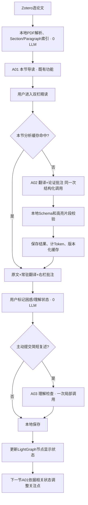

# ResearchGraph Lite｜章节精读改造说明：双栏论证批注 + 常驻中文翻译 + 理解状态追踪

> 文档用途：交付 Codex 的 **Lite P2（章节精读）增量开发规范**。
>
> 版本：`section_close_reading_v1`
>
> 基础：ResearchGraph Lite A+B+D；B 中已加入 PaperCard + LightGraph。本文件 **只修改章节精读（A）以及与 LightGraph、D 问答的少量联动**，不重复产品全案。
> 关键变更：**选中小节进入“双栏精读”后，英文原文下方的中文译文始终展示，不再采用点击展开或按需显示译文。**

---

## 0. 给 Codex 的简短执行指令（可直接复制）

> 请按附件 `ResearchGraph_Lite_Section_CloseReading_Bilingual_Annotation.md` 对现有 Lite P2 章节精读做**增量改造**，不要重建 A+B+D，也不要恢复旧版完整 Knowledge Engine。保留已有小节导读 A01、Zotero/PDF 本地解析、Section/Span、模型 Provider 和缓存；新增“**双栏精读**”：左栏逐段英文原文（5色论证标注）+ **常驻中文译文**，右栏逐段对应的中文论证批注，并在小节末尾显示论证结构摘要。按文档定义的 `SectionReadingAnalysis` Schema 与 `A02` Prompt，一次小节级调用生成译文和批注，英文原文由本地读取，不让模型重复输出；长小节按用户选择的段落范围分批。新增 ReadingState/ConceptUnderstanding 和按需理解检查 A03，使理解状态可以联动现有 LightGraph；下一节导读根据少量状态调整侧重点。翻译覆盖当前选中范围的每段，常驻显示；不默认翻译整篇论文，不默认对全部章节预生成。实现缓存、版本失效、段落ID与高亮原文校验、真实 Token 记录。保持 Zotero 为 PDF 原文来源，外部数据不可删除。完成当前阶段后报告界面、数据模型、Prompt、测试和成本，不提前开发其他阶段。

## 1. 改造目标与保留边界

### 1.1 现状（Lite A 原设计）

- 左侧按论文的章节 / 小节导航，选择当前小节。
- `A01_section_guide`：用户触发后生成该小节的 **内容介绍、重点、带着读的问题、必要术语**，默认 `standard`，可选 `quick/deep`。
- 来源由现有 PyMuPDF/Section/Span 提供；本地索引、模型配置、Token 计量与版本化缓存继续复用。
- 不建立完整证据知识图谱，也不自动翻译整篇论文。

### 1.2 本次新增

1. 在 **当前小节**增加“双栏精读”视图：左英文 + 常驻中文译文，右中文批注；原有 A01 导读作为阅读前引导继续存在。
2. 英文段落支持五色论证高亮：黄色核心论点、红色关键概念、蓝色证据/数据、绿色让步/反驳、紫色方法论。
3. 每段右侧批注包含：**段落功能、在本节论证链中的逻辑角色、可核查的论证技巧或潜在疑点**；重要段落最多一个阅读思考问题。
4. 小节结束展示：**当前小节论证骨架、核心主张一句话、论证较强处/需核查处**。若未读完整篇论文，不得声称是“全文”逻辑总览。
5. 加入用户自评、疑问记录、概念理解状态；允许用户主动提交短复述，获得一次基于本节内容的理解反馈。
6. 下一小节的 A01 导读可读取少量相关状态以调整重点；轻量图谱节点显示“尚未读 / 有疑问 / 自评已理解 / 已检查”等状态。

### 1.3 明确不做

- 不把整篇论文一次性发送给 LLM 生成双栏 HTML。
- **不重复输出英文原文**；英文由本地 PDF 解析内容直接渲染。
- 不默认对整篇论文的所有章节进行逐段翻译和批注。
- 不自动调用旧版 Claim/Experiment/Condition/Evidence、跨论文关系推理、Wiki/Lint。
- 本阶段不开发完整 PDF 阅读器、OCR 全流程或学术论证真伪自动鉴定。
- LightGraph 仍是论文概览中的概念导航图，不要求补充旧版段落级证据链；本功能的 `paragraph_id` 仅用于**同步显示、校验高亮及章节跳转**，并非旧版重型 Evidence Schema。

## 2. 页面与交互设计

### 2.1 信息架构

```text
研究论文 / 当前小节
├── 顶部：论文标题、当前章节、阅读进度、五色图例、Token用量
├── Sticky小节导航：当前章节标题与段落范围导航
├── 阅读前导读（沿用 A01；可折叠、可查看缓存）
├── 双栏精读区域（A02）
│   ├── 左栏（约 60%）：每段英文原文 + 紧随其后的常驻中文译文
│   └── 右栏（约 40%）：与该段垂直对应的中文批注卡片
├── 当前小节论证结构总览
└── 我的理解：自评、困惑概念、简短复述/理解检查（可选）
```

### 2.2 左栏：英文原文 + 常驻中文译文

每个 `paragraph_id` 产生一个不拆分的阅读单元：

1. **英文原文**：优先使用 Lora 衬线字体（系统无字体时回退 Georgia/serif），保留必要的公式与英文术语；5色标注直接应用于英文片段。
2. **中文翻译**：紧接英文段落显示，**始终可见**，浅米色 `#f0ece2` 背景、左侧细竖线、英中之间 1px 分隔；译文不着五色高亮。
3. **翻译原则**：准确、流畅的中文学术表达；保留术语、数字、单位、公式、引用编号、比较关系、否定和实验适用条件；不要随意删掉复杂论证，也不要自行补充论文未说的意思。
4. **译文缺失或生成失败**：该段仍要保留中文区域，占位“译文尚未生成/生成失败”，并提供明确的重试入口；不得将英文原文伪装成中文翻译。
5. 点击英文高亮或正文段落，可联动选中右侧批注、相关 LightGraph 节点，或以该段为范围打开已有 D 问答。

**“常驻”指已生成译文在当前精读界面始终可见，而不是导入 Zotero 后自动翻译全文。** 用户第一次选择某个小节并点击“生成双栏精读”，才开始为这个小节生成翻译与批注；之后通过持久化缓存立即回显。

### 2.3 五色图例

| 类别 | 常量 | 颜色 | 识别内容 | 推荐阅读检查 |
|---|---|---|---|---|
| 核心论点 | `THESIS` | 黄色 `#eab308` | 作者的主张、假设、关键结论 | 作者到底主张什么？ |
| 概念术语 | `CONCEPT` | 红色 `#dc2626` | 关键术语、定义、区分 | 与相邻概念有何不同？ |
| 证据数据 | `EVIDENCE` | 蓝色 `#2563eb` | 实验结果、统计数据、支持材料 | 证据能支持什么、不能支持什么？ |
| 让步反驳 | `COUNTERARGUMENT` | 绿色 `#16a34a` | 限制性表述、对异议的回应 | 作者回应了什么质疑？ |
| 方法论 | `METHOD` | 紫色 `#9333ea` | 算法、流程、实验设计或假设 | 方法的输入、过程和输出是什么？ |

- 不强求每段都使用五种颜色；无典型片段时允许空 `highlights`。
- 高亮使用**原文精确短片段**及其出现序号；校验通过后由前端计算文本偏移。多个高亮重叠时按固定规则处理，而不依赖模型输出 DOM 或坐标。
- 同一颜色在暗色模式下可调整透明度，但含义不变。

### 2.4 右栏：与段落逐一对应的中文批注

2026-11-20最新显示补充（[ADR0059](../adr/0059-reading-analysis-and-chapter-end-progress.md)覆盖原ADR0058摘录卡）：不重复展示英文摘录卡，整段实际分析直接在正文右侧起点显示；仅保留紧凑类型/段号.标记号作双向定位。逻辑作用、核查提醒和问题仍为整段级内容，不复制成各片段独有解释。已有合法笔记无需重新生成。实际阅读宽度至少560px时保持双栏，更窄时段内单栏；尺寸变化重新排布。每个大章的阅读状态移到全部小节和可归属材料之后的章末。

- `paragraph_function`：引出问题 / 定义概念 / 提出论点 / 说明方法 / 给出证据 / 让步反驳 / 讨论局限 / 总结过渡 等，允许自由简短描述。
- `logic_role`：该段与**本小节**前后论证的关系，例如“承接上一段提出的挑战，引出方法设计”。
- `critical_note`：值得注意的论证技巧、前提或**待核查问题**；不把猜测当作已证实的漏洞。
- `reading_question`：仅关键段落提供最多一个针对理解的开放问题；一般段落可为空。
- `related_graph_node_ids`：引用当前论文已有 LightGraph 节点ID，若不存在则为空，不触发新的图谱抽取。
- 翻译、批注、英文原文使用同一个 `paragraph_id` 对齐；垂直位置尽可能由同一行容器承载，不通过屏幕绝对坐标硬对齐。

### 2.5 样式与响应式

- 顶部深海军蓝导航，背景米白纸张色；阅读区域尽量留白。
- 界面字体以 IBM Plex Sans 为优先字体（系统缺失时回退 sans-serif）；英文原文使用 Lora 优先（回退 Georgia）。中文推荐系统可用字体；不得依赖下载或分发无授权字体文件。
- 桌面端双栏；移动/窄屏切为**段落分组的单栏堆叠**：英文 → 中文 → 批注，仍保持对应关系。
- Sticky 的章节导航位于页面上方，不能遮挡被定位段落。
- 导出独立 HTML 如果后续需要，由前端将**已缓存内容本地渲染**为单个HTML，不再让模型重新生成全文HTML。

## 3. 整体流程与模型调用边界



**调用原则**：

- `A01` 原有阅读前导读继续保留，可折叠展示；若 A02 的 `section_overview` 能满足部分页面需求，前端复用缓存，**不要为了展示两份相似摘要而强制连调 A01+A02**。
- `A02` 为本次**核心新增调用**，对用户选定的小节/段落范围一次生成所有段落的中文翻译与简短批注、以及小节论证结构。每段都必须返回译文；批注可以简短。
- `A03` 为理解检查，**只在用户提交复述时调用**；状态标记与页面更新由本地程序完成。
- 新版本 A01 可以附加少量状态上下文以调整导读侧重点，但不要再次发送前面已读小节的全文。
- 对超长小节按段落范围分批，不要将一个章节变成自动递归处理全文的任务。

## 4. 新增/调整 Schema（兼容 Lite 现有 Paper/Section/Span/ReadingGuide）

### 4.1 核心对象

```typescript
// 真实主键 / 来源哈希、模型ID / Token费用由后端绑定和保存。
type HighlightType = 'THESIS' | 'CONCEPT' | 'EVIDENCE' | 'COUNTERARGUMENT' | 'METHOD';
type ParagraphFunction =
  | 'INTRODUCE_PROBLEM' | 'DEFINE_CONCEPT' | 'STATE_CLAIM'
  | 'EXPLAIN_METHOD' | 'PRESENT_EVIDENCE' | 'HANDLE_OBJECTION'
  | 'DISCUSS_LIMITATION' | 'SUMMARIZE_TRANSITION' | 'OTHER';

type SectionReadingAnalysis = {
  schema_version: 'section_reading_analysis.v1';
  paragraphs: Array<{
    paragraph_id: string;            // 后端提供，需属于本次允许段落集合
    translation_zh: string;         // 必填、非空；常驻显示
    paragraph_function: ParagraphFunction;
    logic_role_zh: string;          // 一句话说明本段在本节的作用
    critical_note_zh: string;      // 可为空字符串，不编造缺陷
    reading_question_zh: string | null;
    highlights: Array<{
      type: HighlightType;
      quote_en: string;            // 确实存在于原文的短片段
      occurrence_index: number;    // 从0开始，解决重复片段歧义
    }>;
    related_graph_node_ids: string[];
  }>;
  section_argument: {
    logic_chain_zh: string[];      // 当前小节2~5个逻辑环节
    core_claim_zh: string | null;
    strong_point_zh: string | null;
    question_to_verify_zh: string | null;  // 待核查处，非事实性“最弱处”判定
  };
};

// 下面两项是软件本地的状态对象，不由 A02 输出。
type ReadingState = {
  paper_id: string;
  section_id: string;
  progress: 'NOT_STARTED' | 'READING' | 'COMPLETED';
  self_assessment: 'UNSET' | 'UNSURE' | 'PARTIAL' | 'CONFIDENT';
  unresolved_concept_ids: string[];
  questions: Array<{ paragraph_id?: string; text: string; resolved: boolean }>;
  updated_at: string;
};

type ConceptUnderstanding = {
  paper_id: string;
  graph_node_id: string;
  self_level: 'UNSET' | 'UNSURE' | 'PARTIAL' | 'CONFIDENT';
  last_check_result: 'NOT_CHECKED' | 'ADEQUATE' | 'PARTIAL' | 'MISCONCEPTION' | 'UNCERTAIN';
  note_zh: string;  // 用户自己的记录；可为空
  updated_at: string;
};
```

### 4.2 关联与数据来源

- `Paper/DocumentVersion/Section/Paragraph`：来自已有本地PDF解析，保持 `document_version_id` / `section_id` / `paragraph_id` / `text_hash` 可查询。
- `SectionReadingAnalysis`：按 **所选段落范围** 持久化，包含翻译、标注、批注和局部论证结构；模型不生成原文。
- `ReadingState`：每位本地用户/工作区的主观阅读状态，不与 AI 文献事实混存。
- `ConceptUnderstanding`：引用 LightGraph 节点ID，**独立于图谱语义结果存储**；图谱刷新后尽可能按稳定ID映射，不匹配的状态作为“待重新关联”保留，不能静默指向错误概念。
- `UnderstandingCheck`（可选持久化）：保存复述摘要/反馈、建议等级、关联小节、模型信息和时间，不能覆盖用户的自评。

### 4.3 必须校验的约束

1. 输入 `paragraphs[]` 由后端按阅读顺序构建，每段有稳定ID；A02输出必须**恰好覆盖本次段落集合**，不得漏段、重复段或多出未授权段落。
2. `translation_zh` 必须非空；若模型漏段/结构校验失败，标记任务不完整并支持**仅重试缺失的段落**，不要自动重跑整个小节。
3. 译文与段落ID一一对应，不可把某段译文拼在别段之后。
4. 高亮 `quote_en` 必须是对应段落英文原文的匹配子串，`occurrence_index` 必须合法；失配时**仅丢弃该高亮并记录警告**，不影响已通过校验的译文。
5. `related_graph_node_ids` 必须属于当前论文的现有图谱；非法ID移除并记录；图谱不存在时允许空数组。
6. 章节摘要只能针对**实际输入的范围**；若是小节局部段落，UI应标注“所选范围论证结构”，不可假称全章节/全文。
7. 对模型输出采取 Schema/Pydantic 校验；禁止把模型返回的 HTML/JS 直接注入页面，全部使用安全文本渲染。

## 5. 新增主 Prompt：A02 双栏翻译与论证批注

> 模板名 `A02_bilingual_argument_annotation_v1`；只有用户点击“生成双栏精读”或明确选择新范围时触发。输出JSON而不是HTML。

### 5.1 System Prompt

```text
你是一名帮助研究生进行科研论文精读的双语阅读导师。
你只分析提供的英文论文段落，不使用外部知识补全作者的论断。

任务：对当前选定的小节或段落范围，逐段生成自然准确的中文学术译文，
识别关键论证片段，并说明每段在论证中的功能和逻辑作用。

强制规则：
1. 输入的每个 paragraph_id 必须有且只有一个对应输出，顺序不变。
2. 每段输出完整、忠实且流畅的 translation_zh；保留否定、限定词、
   数字、单位、公式符号、引文编号、条件关系及原作者的不确定性。
3. translation_zh 不加彩色标签，不增添原文没有的研究结论；
   专业术语中文译名要尽量前后一致，可在首次出现时括注英文原词。
4. 高亮仅输出对应英文原文中实际存在的短片段 quote_en，类型仅限：
   THESIS、CONCEPT、EVIDENCE、COUNTERARGUMENT、METHOD。
5. 每段给出简短的段落功能、逻辑作用与批注；对潜在论证漏洞仅提出
   “需要进一步核查什么”，不要武断断言论文错误。
6. 重要段落最多提出一个阅读问题，非关键段落设为 null。
7. 对于图像、表格、公式、脚注或PDF解析缺失内容，不要猜测；
   仅翻译当前实际提供的文本，可在批注中简短指出信息缺口。
8. 仅允许引用本次提供的 graph_node_ids；不创建图谱节点或关系。
9. 不重复输出英文全文、不生成HTML、CSS或Markdown论文正文。
10. 只输出符合 section_reading_analysis.v1 的JSON，不要解释JSON。
```

### 5.2 User Prompt 模板

```text
请生成当前论文小节的双栏精读分析（左栏中文翻译 + 右栏论证批注数据）。

论文标题：{{paper_title}}
小节路径：{{section_path}}
分析范围：{{range_label}}
上一节必要上下文（可选，最多短段）：{{previous_context}}
可引用的现有LightGraph节点：{{allowed_graph_nodes}}

输入段落（按阅读顺序，后端JSON序列化）：
{{paragraphs_json}}

请严格输出一个JSON对象，包含：
- schema_version = "section_reading_analysis.v1"
- paragraphs: 为每个输入 paragraph_id 依次输出：
  paragraph_id, translation_zh, paragraph_function, logic_role_zh,
  critical_note_zh, reading_question_zh,
  highlights[{type, quote_en, occurrence_index}], related_graph_node_ids
- section_argument: logic_chain_zh（2~5项）、core_claim_zh、
  strong_point_zh、question_to_verify_zh

不得跳过段落，不输出输入英文全文，不虚构高亮原文或图谱节点。
当前只分析所选小节/范围，不推断整篇论文的论证结构。
```

### 5.3 A02 设计的节流点

- 模型输入仅发送当前段落的英文 + ID + 小节标题 + 极少量必要上下文，不发送整个PDF或完整用户阅读历史。
- **英文原文不在模型输出中重复**，由前端本地读取。中文译文常驻，属于本次必要输出，不做“按需显示”压缩。
- 右栏批注保持短句，重点突出论证结构，减少空泛长篇评论。
- 如果用户只选择 `p10–p15`，就只翻译和分析 `p10–p15`，不会自动处理其他小节。
- 已生成结果按源文哈希、范围、Prompt版本和模型标识缓存；重新打开即回显，0新增Token。

## 6. 新增按需 Prompt：A03 用户理解检查

> 模板名 `A03_understanding_check_v1`；仅用户主动提交复述时调用。**模型只能提供建议，不能自动覆写用户自评。**

### 6.1 System Prompt

```text
你是一名严谨的学术阅读理解导师。
请只根据提供的小节原文要点，评价用户的复述是否忠于作者表达。
区分真实的概念性误解、合理但不完整的概括，以及语言表达不流畅。
不得仅因为没有使用原文术语就判断为错误。
证据不足时返回 UNCERTAIN，不编造答案或科学结论。
给出简短反馈和一个最值得思考的追问。
只输出JSON。
```

### 6.2 User Prompt 模板

```text
小节标题：{{section_title}}
小节相关原文短片段：{{relevant_paragraphs_json}}
本节已缓存的核心理解要点：{{key_points}}
用户自评：{{self_assessment}}
用户复述：{{user_explanation}}

请返回：
{
  "check_result": "ADEQUATE | PARTIAL | MISCONCEPTION | UNCERTAIN",
  "correct_points_zh": ["..."],
  "missing_or_mistaken_zh": ["..."],
  "feedback_zh": "...",
  "follow_up_question_zh": "..."
}
要求：每项尽量简短；只针对本节；不可越过输入原文推断。
```

## 7. 章节自适应导读：复用A01，避免第三套重Prompt

A01 的基础导读内容不变，只增添一个可选 `reader_context`，由程序从 `ReadingState/ConceptUnderstanding` 选择最多三项相关状态：

```json
{
  "reader_context": {
    "strategy": "BRIDGE_GAPS",
    "unresolved_concepts": ["共享记忆"],
    "prior_misunderstanding_summary": "混淆了共享信息与共享决策",
    "preferred_focus": "解释方法输入、更新步骤以及对协作决策的影响"
  }
}
```

策略由本地规则决定：

| 当前状态 | 下一节导读关注点 |
|---|---|
| 未读过 | 常规章节概览、重点和阅读问题 |
| 自评困惑 | 优先回顾与当前小节有关的1～3个概念 |
| 部分理解 | 重点突出方法—假设—结果之间的逻辑关系 |
| 理解检查基本通过 | 减少术语基础解释，增加适用条件与批判性阅读问题 |
| 检查发现误解 | 提醒相关定义，提供一次更聚焦的解释与回看位置 |

- “相关”可根据小节已关联的图谱节点或已有术语索引确定；没有可靠映射时退回普通A01，不应猜测用户的知识漏洞。
- 已生成的A01缓存不因每次状态点击立即全量重算；重新生成个性化导读需要用户触发，或在打开下一节且缓存不存在时执行。
- 不发送历史问答全文、历次翻译或整张知识图谱。

## 8. 本地状态与 LightGraph 联动

- 交互事件：开始阅读、标记“有疑问”、填写个人疑问、标记已读、提交复述。
- 本地写入 `ReadingState` 和 `ConceptUnderstanding`，不消耗模型Token。
- LightGraph 节点颜色代表**用户的阅读/自评状态**，与节点的论文事实/AI归纳 basis 分开呈现；不能用绿色节点表示“论文发现已被科学证实”。
- 点击图谱节点：打开详情、显示相关困惑及读过的章节，可跳转已经索引的相关段落或直接发起已有 D 问答（并限定范围）。
- 有理解检查反馈时，记录 `last_check_result`；允许用户不同意、修改自评或将问题标记为待研究。

## 9. Token预算、缓存和异常处理

### 9.1 预算指导

这次加入**逐段常驻中文翻译**，输出Token必然高于原先只生成几条导读的 A01。不能继续把原A01的3k–6k预算直接当成 A02 固定上限。

- 小节/范围处理上限：建议起始值约 **1,200–2,000英文Token**（不足时允许更小），根据模型窗口、翻译输出与实际计数调节。
- A02 初始单次总Token预算目标可设为 **4,000–9,000**（输入+输出），必须在真实论文中标定；较长/公式密集内容需分段，不承诺一定满足。
- 章节导读A01仍使用原有短输出策略；A03理解检查只送相关短段和复述，不送整篇历史。
- 给用户显示本节“预估消耗/累计实际消耗/缓存命中”；开始新范围前做预算预检。不要因此关闭常驻译文要求。

### 9.2 缓存键

`paper_id + document_version_hash + section_id + paragraph_range_hash + translation_mode(always_on) + schema_version + prompt_version + model_id + normalized_input_hash`

- 相同输入与版本缓存命中，不调用模型。
- 原PDF、段落划分、Prompt、模型版本变化则使派生结果过期，但旧记录保留用于诊断，避免错误沿用到新的原文段落。
- 状态数据与译文批注结果分离，避免每次用户点击“理解了”就使整段翻译缓存失效。

### 9.3 失败处理

- PDF 段落解析不全、存在无法提取的公式/图表：原文如实显示或提示无法解析，不可让模型填补不存在的内容。
- 超长小节：提示分段范围，用户选择后生成；不要自动无穷递归处理。
- 某段翻译缺失/JSON不完整：不伪装为完成；保留已验证且能独立匹配的段落结果，未完成段落显示缺失状态并提供局部重试。
- 网络错误按现有项目有限重试机制，记录Token与失败信息；不自动生成“第二遍全文校对”。
- 受版权保护的全文只在用户已授权的本地软件中读取与使用，不将PDF/译文提交到GitHub或公开日志。

## 10. 推荐 API / 组件变更（保持现有命名风格即可）

```text
GET  /papers/{paper_id}/sections/{section_id}/paragraphs
POST /papers/{paper_id}/sections/{section_id}/close-reading/generate
GET  /papers/{paper_id}/sections/{section_id}/close-reading
GET  /papers/{paper_id}/sections/{section_id}/reading-state
PUT  /papers/{paper_id}/sections/{section_id}/reading-state
POST /papers/{paper_id}/sections/{section_id}/understanding-check
GET  /papers/{paper_id}/concept-understanding
PUT  /papers/{paper_id}/concept-understanding/{graph_node_id}
```

推荐 React 组件：`SectionGuide`（原有）、`BilingualParagraph`、`ArgumentHighlight`、`ParagraphAnnotation`、`SectionArgumentOverview`、`UnderstandingCheckPanel`、`ReadingStatePanel`。

后端服务可按原项目风格采用 `SectionCloseReadingService`、`UnderstandingStateService`；重用现有 Provider、Job、Cache 和Token账本。**不要新建一整套多Agent系统。**

## 11. 分阶段实现与验收

### P2-a：双栏阅读基础

- 在现有章节页面增加“导读 / 双栏精读”的视图切换。
- 从PDF本地段落索引获得英文原文并建立稳定ID。
- 前端双栏渲染、sticky章节导航、五色图例、常驻译文区域与响应式布局。
- A02结构化输出、严格校验与缓存；能完整呈现当前选中范围的英文+中文+批注。

### P2-b：阅读理解状态

- 自评、困惑问题和阅读进度本地持久化。
- 关联现有 LightGraph 节点（有则关联，无则不阻断精读）；在节点详情展示理解状态。
- A03 按需检查用户复述，记录结果且不覆盖自评。

### P2-c：自适应章节导读

- A01新增少量 `reader_context` 可选输入。
- 本地规则决定导读关注点；用户可以看到/关闭适应性模式。
- 在同等原文与适应性提示条件下检查缓存隔离，不因状态改变重复翻译。

### 必须通过的验收

1. 从Zotero选论文、本地解析章节仍为0次LLM调用。
2. 用户首次生成所选小节精读后，每个段落均有**常驻中文译文**；不能要求额外点击翻译。
3. 左右栏按 `paragraph_id` 一一对应，英文在上中文在下；桌面与窄屏都能正确对应。
4. 五色标注基于原文真实文本校验，不生成虚构高亮；译文不加五色高亮。
5. 小节末尾是当前范围的论证骨架，不把部分章节总结写成全文结论。
6. 缓存命中时打开已完成小节为0新增LLM调用；重载页面仍可使用译文与批注。
7. 仅用户主动进行理解检查时调用A03；普通状态标记不耗Token。
8. 理解状态可持久化并更新 LightGraph 显示；不得误写图谱事实或来源状态。
9. 原PDF不复制到Obsidian，不修改Zotero文献及其原始数据库。
10. 显示真实输入/输出Token、失败与缓存命中，且不会因生成译文默默调用整篇论文分析流程。

---

**一句话验收口径：** ResearchGraph Lite 的章节精读，从“生成一个简短导读”升级为“按当前小节生成**英文原文 + 常驻中文译文 + 五色论证标注 + 逐段中文批注**，并在用户反馈后维护理解状态、指导下一节阅读”；所有派生分析均缓存，外部PDF仍由Zotero管理。
