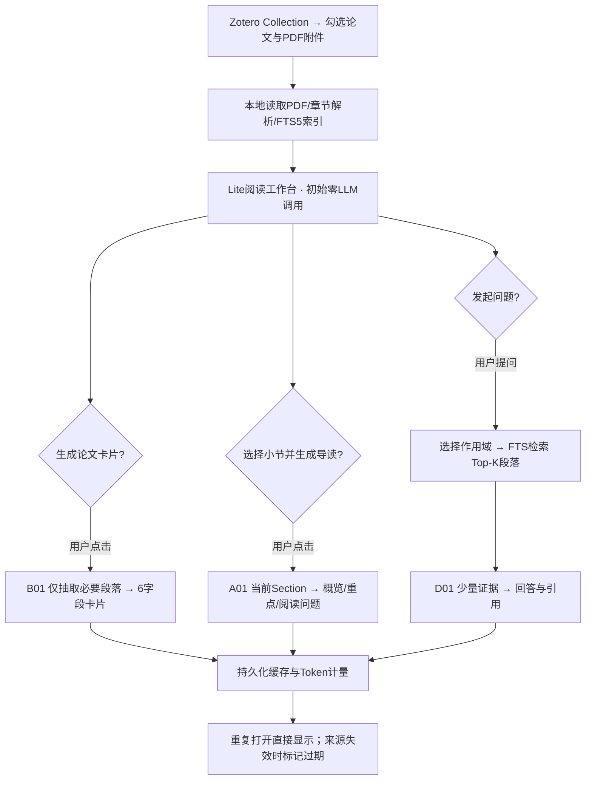

# 01 产品设计说明书 — ResearchGraph Lite (A+B+D)

版本 v1.0 · 2026-11-09 · 目标用户：阅读英文论文的研究生 · 首发 Windows 桌面应用 · 既有工程增量改造

2026-11-12 当前决定：按用户要求撤下版式 PDF 翻译，移除界面、业务 API、执行器及随包资源，适用边界见 [ADR0040](../../adr/0040-remove-pdf-translation.md)。A/B/D、LightGraph 和模型配置继续保留，阅读工作区置顶、论文信息置后默认折叠。保留已有数据库迁移链和历史翻译数据，不执行降级、删除或旧任务重放。

## 1. 为什么重新定位

现有版本一篇普通研究论文，Codex估计“完整知识图谱建构 P02+P12+P13”为 **30万～80万 Token**；再完成3–5次问答、一次LLM语义Lint和Wiki约 **100万～250万 Token**。这是**预测预算，不是逐篇实际观测值**，且可能存在重复调用、超时重试、冗余上下文的影响。对“帮助研究生读懂论文”而言，这种为少量阅读问题提前构建数百个完整科研实体的成本不划算。

**目标改变**：从“自动构建长期演化的科研论证图谱”改成“将 Zotero 中的论文转变为按需、低成本、可追溯的阅读辅助体验”。

## 2. 必须做、不默认做、不做

| 分级 | 功能 | 设计理由 |
|---|---|---|
| Core · B | 论文快速知识卡片 | 一屏了解问题、动机、方法、贡献、主要结果、局限 |
| Core · A | **每小节**导读 | 读前知道本节讲什么、关注点、带哪些问题去读 |
| Core · D | 有证据的局部问答 | 遇到困难才检索相关原文，避免16万Token级上下文拼接 |
| Foundation | Zotero选择论文、PDF本地解析、Section/Span/FTS5索引、模型配置与任务缓存 | 通用基础，不额外消耗LLM Token |
| Optional | 一键在Zotero打开论文/定位页；导出当前卡片和导读为 Markdown | 方便复习，不强制集成Obsidian自动维护 |
| Legacy，仅保留兼容 | 完整 Knowledge Graph、RelationAssertion、Claim Comparator | 旧数据可查看，不是Lite默认流程 |
| Off by default | P02/P12/P13全量抽取、自动跨论文条件比较、图谱自更新、Query知识沉淀、LLM Lint、Wiki增量更新 | 不再对每篇论文强制调用 |
| 首版不做 | PDF原文阅读器、整篇 PDF 翻译、全量生成所有导读、自动文献发现、自动训练模型 | 不符合节流目标；全文翻译已按 ADR0040 撤下 |

## 3. 设计理念

**按需触发（On demand）**：选择论文只发生本地解析，默认不调用LLM。卡片、导读、问答分别有显式按钮。

**由阅读范围决定成本**：章节导读一次只处理一小节及少量上下文；问答默认当前章节，用户可主动扩大到整篇论文。

**轻量结构化**：知识卡片是结构化摘要，不为每个Claim、Condition、Finding创建新的完整图谱节点。

**可信但不过度工程化**：引用 `span_id`/`section_id` 和纸面页码由程序确定；模型只引用收到的ID，不做全量语义审核循环。无法确认的内容留空或表达不确定性。

**单一来源**：Zotero持有原始PDF、附件、标注；ResearchGraph持有本地解析索引、卡片、导读、问答历史和费用统计。Obsidian 可选为导出终点，不是运行前置条件。

## 4. 端到端用户流程

### B：论文卡片

在论文列表选择“生成概览”，后端选择受限内容：Abstract、Introduction的问题和贡献、Method总览、Results代表性段落、Conclusion/Limitations。**采用可审计的上下文预算，不得默认拼入整篇PDF**。结果固定六栏：研究问题、研究动机、核心方法、主要贡献、主要结果、局限性；字段可留空，说明依据不足。

卡片支持“查看原文出处”“重新生成（说明将产生新调用）”“复制Markdown”。不同模型或Prompt版本生成的卡片按版本缓存，不覆盖旧版，设置中可选清除历史缓存。

### A：小节导读

左侧论文目录按章节/小节展开；点击任一小节后显示是否已有缓存。用户选择快速/标准/深入中的一种并点击“生成导读”。输出严格为：本节做什么（2–3句）、关注点（2–4条）、带着什么问题读（2–3个）、可选困难概念（最多3个）。**不做整篇总结式导读**，不将作者尚未讲的结论提前替作者断言。

对超长章节：先按子标题/段落范围拆成可选择的子节；若没有可辨结构，提示用户选范围；不自动对全文递归多批生成。

### D：上下文有限的论文问答

三种作用域：`selection`（用户选中的文本；若无法由Zotero送入所选文本，可在应用中粘贴或选定Span）、`section`（当前小节，默认）、`paper`（整篇检索，而非整篇发送）。

`section`或`paper`先在本地FTS5检索，再发送3–5个候选片段给LLM；限制总输入长度。中文问题与英文PDF可能造成关键词不匹配：先利用卡片中的术语和标题生成离线英文词汇扩展；检索明显不足时可由用户主动选择“改用英文关键词扩展”，或调用**低预算、可缓存**的D02关键词辅助，绝不在每次问答前默认走大型Query Planner。

回答为中文，列出证据来源。没有足够证据时必须明确“当前检索范围不能支持该回答”，允许用户点击“扩大搜索范围”后二次检索（并显示额外成本）。问答默认只是阅读帮助，不沉淀成知识图谱。

## 5. 软件页面与交互

**全局侧栏（沿用现有）**：项目/论文、设置与诊断固定底部；可折叠并记住位置。删除大段营销介绍块，不让解析文本流淹没主界面。

**论文列表/项目页**：显示Zotero来源、条目与附件、解析状态、卡片状态、最近阅读时间、已消耗Token；支持批量选择，但**批量选择不自动批量请求LLM**。

**论文阅读工作台（三栏）**：左为论文小节目录；中为“卡片/小节导读/问答”标签页；右为来源与本次引用列表、Token估算和“在Zotero打开”。没有PDF全文阅读器。默认打开最后阅读的小节，无内容时显示操作入口而不是宣传文案。

**任务及设置**：模型配置复用现有Provider；任务显示 `queued/running/succeeded/failed/cached/cancelled/stale`；模型调用前显示预计Token和可用预算，失败允许重试但需避免重复入库和重放成功调用。

### 核心状态可见性

- `not_generated`：尚未请求AI；不意味着解析失败。
- `cached`：同输入、同模型参数与同Prompt版本已有结果。
- `stale`：PDF或解析器版本改变，旧内容可查看但标为过期。
- `insufficient_evidence`：证据不足，不能强行补全。
- `failed`：区分网络、限流、模型格式、无效源文件。

## 6. 文献与证据归属

Zotero连接后选择 Collection → 勾选条目/多个PDF附件 → 建立引用与本地解析索引。原PDF继续在Zotero。ResearchGraph记录 `zotero_item_key`、`attachment_key`、`document_version_id`、SHA-256、提取页面/字符范围。PDF文件缺失后旧卡片可看，但打开原文时提示重新定位。

直接PDF仍是备用来源；不得未经同意默默复制私人PDF到工作目录。用户从应用打开原文，应通过Zotero可支持的打开/定位手段或本地受控入口，失败时退回条目级打开，不伪造可用深链。

## 7. 隐私、可靠性和可访问性

- 云端推理前展示“选定论文片段将发送给配置的模型服务”；密钥使用操作系统安全存储，日志脱敏。
- 原文/批注是**不可信内容**，禁止其中的指令影响模型系统规则或调用敏感工具。
- 仅把必要片段发送给LLM；用户可以选择本地兼容模型。
- 任何LLM任务都有最大输入、输出及重试上限；支持取消和持久化缓存。
- 中文优先展示，英文专业术语原样保留；不自动翻译全文。
- Zotero不可用时已有缓存可读；PDF解析异常不应阻塞其他论文。

## 8. 本版交付与明确不承诺

交付：A/B/D三项真实功能、引用回溯、Token仪表板、稳定可安装的Windows应用、旧P2/P3项目兼容。**不承诺**生成完整科学论证图谱、自主科学发现、自动Wiki演化，也不承诺固定论文长度下一定低于某个Token数；指标必须由真实使用统计验证。
